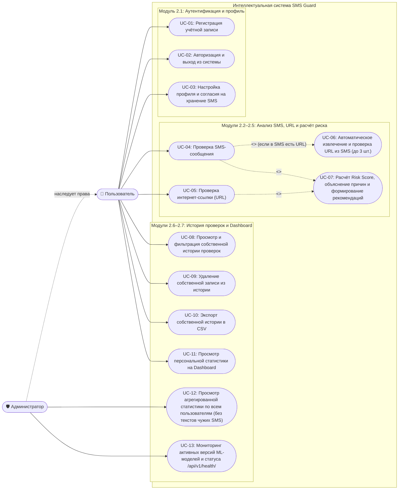
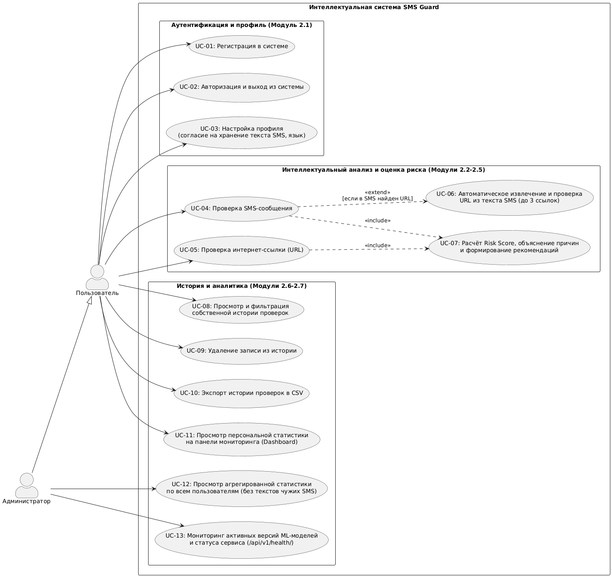
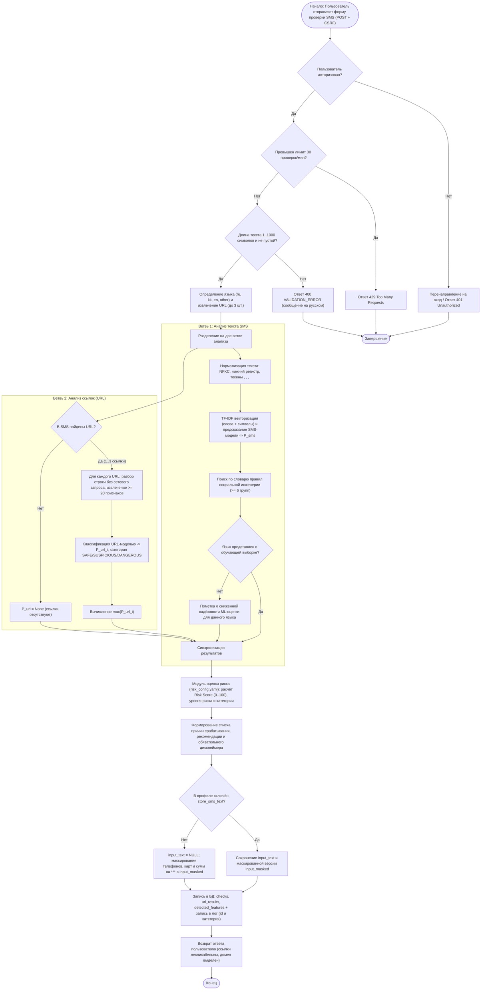
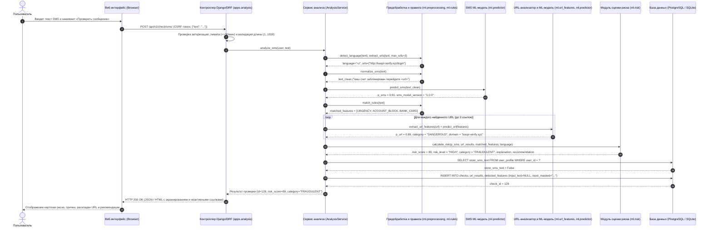
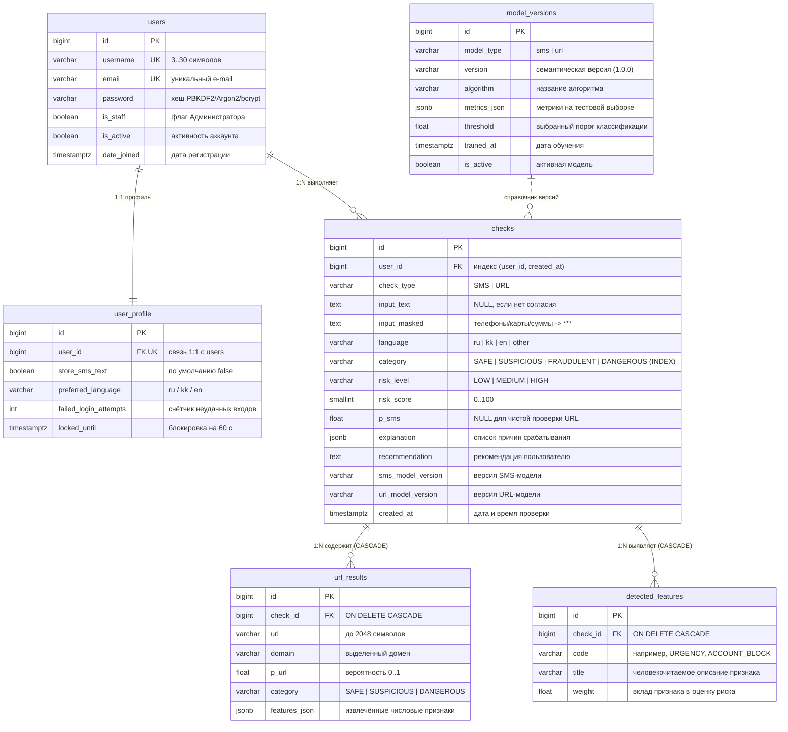

# Задание 1. Анализ предметной области и проектирование системы «SMS Guard»

**Полное наименование проекта:** Интеллектуальная система обнаружения мошеннических SMS-сообщений и подозрительных ссылок на основе методов искусственного интеллекта и машинного обучения  
**Краткое наименование:** SMS Guard  
**Документ:** Аналитический отчёт и техническое проектирование (Задание 1)

---

## Содержание

1. [Введение и актуальность проблемы](#1-введение-и-актуальность-проблемы)
2. [Классификация категорий угроз SMS-мошенничества (смишинга) и социальной инженерии](#2-классификация-категорий-угроз-sms-мошенничества-смишинга-и-социальной-инженерии)
3. [Анализ существующих решений и аналогов](#3-анализ-существующих-решений-и-аналогов)
4. [Целевая аудитория и ролевая модель системы](#4-целевая-аудитория-и-ролевая-модель-системы)
5. [Проектирование системы и архитектурные диаграммы](#5-проектирование-системы-и-архитектурные-диаграммы)
   - [5.1. Диаграмма вариантов использования (Use Case Diagram)](#51-диаграмма-вариантов-использования-use-case-diagram)
   - [5.2. Диаграмма деятельности (Activity Diagram)](#52-диаграмма-деятельности-activity-diagram)
   - [5.3. Диаграмма последовательности (Sequence Diagram)](#53-диаграмма-последовательности-sequence-diagram)
   - [5.4. ER-диаграмма базы данных (Entity-Relationship Diagram)](#54-er-диаграмма-базы-данных-entity-relationship-diagram)
6. [Спецификация функциональных требований (ФТ)](#6-спецификация-функциональных-требований-фт)
7. [Спецификация нефункциональных требований (НФТ)](#7-спецификация-нефункциональных-требований-нфт)
8. [Выводы по Заданию 1](#8-выводы-по-заданию-1)

---

## 1. Введение и актуальность проблемы

Мошеннические SMS-сообщения (**смишинг**, от англ. *SMS phishing*) остаются одним из наиболее массовых и опасных векторов атак на рядовых пользователей мобильной связи и онлайн-банкинга. В отличие от классического электронного спама, смишинг-атаки характеризуются высокой персонализацией, краткостью текста и сочетанием двух взаимодополняющих механизмов воздействия:

1. **Психологическое манипулирование (социальная инженерия):** злоумышленники искусственно создают дефицит времени, провоцируют панику (угроза потери средств, блокировки счёта, уголовного преследования) или апеллируют к базовым когнитивным искажениям (жадность при сообщении о крупном выигрыше, доверие к авторитету банка или государственного органа, желание помочь близкому человеку).
2. **Техническая маскировка фишингового ресурса (URL-обфускация):** в текст SMS внедряется ссылка на поддельный веб-ресурс, имитирующий интерфейс интернет-банка, портала государственных услуг или курьерской службы. Для обхода простых спам-фильтров используются сервисы сокращения ссылок (`bit.ly`, `tinyurl.com`, `clck.ru` и др.), тайпсквоттинг (расстояние Левенштейна 1–2 символа от известного бренда), омоглифы и интернационализированные домены в кодировке Punycode (`xn--`), многоуровневые поддомены и прямые IP-адреса.

**Почему необходим комплексный двухконтурный анализ?**
- Анализ *исключительно текста* пропускает сообщения с нейтральной формулировкой (например, «Посмотрите фото по ссылке»), содержащие при этом явно вредоносный или фишинговый URL.
- Анализ *исключительно URL* не способен выявить мошеннические схемы, не содержащие ссылок вовсе — например, выманивание одноразового кода подтверждения (OTP), требование перезвонить на подменный номер или перевести деньги по номеру телефона («родственник в беде»).
- Кроме того, неспециалисту крайне сложно интерпретировать «сырую» вероятность модели машинного обучения. Пользователю необходима прозрачная **объяснимость (Explainable AI / Rule-based гибридизация)**: указание конкретных сработавших триггеров социальной инженерии, подозрительных структурных свойств ссылки и чёткая рекомендация по безопасным действиям.

Разрабатываемая система **SMS Guard** решает эту задачу путём объединения текстового классификатора (TF-IDF на словах и символьных N-граммах + словарь правил социальной инженерии) со структурно-лексическим анализатором URL (≥ 20 признаков без сетевого обращения к целевому сайту) и конфигурируемым модулем расчёта риска (`Risk Score` от 0 до 100).

---

## 2. Классификация категорий угроз SMS-мошенничества (смишинга) и социальной инженерии

В рамках анализа предметной области выделены **8 основных категорий угроз**, охватывающих подавляющее большинство современных сценариев SMS-мошенничества в русскоязычном, казахстаноязычном и международном сегментах.

Базовые психологические приёмы социальной инженерии, используемые злоумышленниками:
- **Срочность (Urgency):** принуждение к немедленному действию («в течение 15 минут», «немедленно», «шұғыл», «immediately»), блокирующее критическое мышление жертвы.
- **Страх (Fear / Intimidation):** угроза потери денег, блокировки счёта, начисления пени, судебного иска или ареста имущества.
- **Авторитет (Authority):** выдача себя за службу безопасности банка, Национальный банк, портал госуслуг (eGov), налоговые органы, полицию или крупного оператора доставки.
- **Выгода / Жадность (Greed / Reward):** обещание лёгкого выигрыша, приза, компенсации, высокой доходности инвестиций или возврата кешбэка.
- **Секретность (Secrecy):** требование никому не сообщать о звонке/сообщении («не разглашайте сотрудникам банка», «конфиденциальная операция»), а также эксплуатация доверия в закрытом семейном кругу.

> **Примечание по безопасности данных:** Все приведённые ниже примеры являются полностью искусственными (синтетическими), созданными специально для аналитического отчёта, и не содержат реальных номеров телефонов, банковских карт, персональных данных или действующих вредоносных ссылок.

---

### 2.1. Категория 1: Поддельный банк (имитация банковского уведомления или службы безопасности)

**Описание схемы:**  
Злоумышленники рассылают сообщения от имени крупного банка о якобы зафиксированном несанкционированном входе в личный кабинет, подозрительном переводе или необходимости «обновить сертификат безопасности». Цель — заставить жертву перейти по фишинговой ссылке и ввести логин, пароль и SMS-код от интернет-банкинга.

**Искусственные примеры SMS:**
- **Русский (`ru`):** `Уведомление Безопасности Банка: зафиксирован вход в ваш онлайн-банкинг с нового устройства. Если это были не вы, срочно отмените операцию: http://secure-bank-verify.example/login`
- **Казахский (`kk`):** `Банк қауіпсіздік қызметі: Сіздің жеке кабинетіңізге бөтен құрылғыдан кіру тіркелді. Егер бұл сіз болмасаңыз, операцияны шұғыл тоқтатыңыз: http://kaspi-secure-check.example/auth`
- **Английский (`en`):** `Bank Security Alert: Unusual sign-in detected on your online banking account. Verify your identity immediately within 30 minutes to prevent unauthorized transfer: http://citibank-verify-alert.example/secure`

**Признаки социальной инженерии:**
- **Авторитет:** обращение от имени «Службы безопасности банка» (`Bank Security Alert`, `Банк қауіпсіздік қызметі`).
- **Страх:** сообщение о взломе аккаунта или несанкционированном списании средств.
- **Срочность:** требование «срочно отменить операцию» (`within 30 minutes`, `шұғыл`).
- **Технические признаки:** наличие URL с подозрительными словами (`secure`, `verify`, `login`, `auth`) на стороннем домене.

---

### 2.2. Категория 2: «Блокировка карты» или банковского счёта

**Описание схемы:**  
Сообщение утверждает, что банковская карта или счёт пользователя уже заблокированы (либо будут заблокированы через несколько минут) из-за «подозрительной транзакции», «ошибки верификации» или «истечения срока действия». Для разблокировки предлагается перейти по короткой или поддельной ссылке и ввести полные реквизиты карты (включая CVV/CVC и срок действия) либо позвонить в фальшивый колл-центр.

**Искусственные примеры SMS:**
- **Русский (`ru`):** `ВНИМАНИЕ! Ваша банковская карта *0000 временно ЗАБЛОКИРОВАНА в связи с подозрительным списанием 45 000 тг. Для разблокировки подтвердите данные в течение 15 мин: http://card-unblock-service.example`
- **Казахский (`kk`):** `НАЗАР АУДАРЫҢЫЗ! Сіздің *0000 банк картаңыз күдікті аударымға байланысты БҰҒАТТАЛДЫ. Картаны қайта іске қосу үшін 15 минут ішінде деректерді растаңыз: http://halyk-unblock.example`
- **Английский (`en`):** `URGENT: Your debit card ending in 0000 has been SUSPENDED due to abnormal activity of $450.00. Reactivate your card now at http://bit.ly/card-restore-example`

**Признаки социальной инженерии:**
- **Страх:** потеря доступа к собственным финансам и угроза списания крупной суммы (`ЗАБЛОКИРОВАНА`, `БҰҒАТТАЛДЫ`, `SUSPENDED`).
- **Срочность:** жёсткий лимит времени (`в течение 15 мин`, `15 минут ішінде`, `URGENT`, `now`), использование КАПСЛОКА и восклицательных знаков.
- **Авторитет:** имитация автоматического банковского шлюза уведомлений.

---

### 2.3. Категория 3: Выигрыш, лотерея или ценный приз

**Описание схемы:**  
Жертве сообщают, что её абонентский номер или платёжная карта победили в «юбилейном розыгрыше», акции маркетплейса или викторине. Для получения денежного приза или дорогостоящего гаджета требуется перейти по ссылке и оплатить «налог на выигрыш», «комиссию за перевод» или «конвертацию валюты».

**Искусственные примеры SMS:**
- **Русский (`ru`):** `Поздравляем! Ваш номер выбран победителем акции и выиграл 500 000 тг! Заберите ваш приз сегодня, пока ссылка секретна и активна: http://prize-bonus-claim.example/win`
- **Казахский (`kk`):** `Құттықтаймыз! Сіздің нөміріңіз ұтыс ойынында жеңімпаз атанып, 500 000 тг ұтып алды! Сыйлықты бүгін мына құпия сілтеме арқылы алыңыз: http://tulpar-prize.example/bonus`
- **Английский (`en`):** `CONGRATULATIONS! Your mobile number won a $1,000 Cash Reward in our annual promo! Claim your free prize before midnight, keep this link confidential: http://free-bonus-reward.example/claim`

**Признаки социальной инженерии:**
- **Выгода (жадность):** обещание крупной безвозмездной суммы (`500 000 тг`, `$1,000 Cash Reward`, `free prize`).
- **Срочность:** искусственное ограничение срока получения приза (`сегодня`, `бүгін`, `before midnight`).
- **Секретность:** указание на «секретность/конфиденциальность» ссылки (`пока ссылка секретна`, `құпия сілтеме`, `keep this link confidential`), чтобы жертва не советовалась с близкими.

---

### 2.4. Категория 4: Служба доставки и почтовые отправления

**Описание схемы:**  
Один из самых распространённых сценариев: пользователю приходит уведомление от имени почтового оператора (Казпочта, Почта России, DHL, СДЭК, FedEx) о том, что посылка не может быть доставлена из-за «неполного адреса», «неоплаченного таможенного сбора» или «окончания срока бесплатного хранения». По ссылке открывается фальшивая форма оплаты доставки (на небольшую сумму, например 300–500 тг), цель которой — перехват данных банковской карты и кода 3-D Secure.

**Искусственные примеры SMS:**
- **Русский (`ru`):** `Служба доставки: отправка посылки #KZ000123 приостановлена из-за ошибки в адресе. Уточните адрес и оплатите пересылку 350 тг в течение 24ч, иначе возврат: http://post-delivery-track.example/pay`
- **Казахский (`kk`):** `Жеткізу қызметі: #KZ000123 сәлемдемесі мекенжай қатесіне байланысты тоқтатылды. 24 сағат ішінде 350 тг төлеп, мекенжайды растаңыз: http://kazpost-track-info.example/pay`
- **Английский (`en`):** `Parcel Delivery Notice: Your package #US000123 is on hold due to an incomplete street address. Update delivery details and pay $1.99 redelivery fee within 24h: http://dhl-track-update.example/fee`

**Признаки социальной инженерии:**
- **Авторитет:** ссылка на официальную курьерскую или почтовую службу и правдоподобный трек-номер (`#KZ000123`).
- **Страх (упущенной посылки):** угроза возврата или утилизации отправления.
- **Срочность:** требование оплатить и обновить данные в течение 24 часов.
- **Выгода / низкий порог входа:** незначительная сумма пошлины (`350 тг`, `$1.99`) усыпляет бдительность пользователя.

---

### 2.5. Категория 5: «Родственник в беде» / экстренная жизненная ситуация

**Описание схемы:**  
Сообщение имитирует обращение близкого человека (сына, дочери, мамы, друга) с чужого номера телефона. В тексте говорится, что абонент попал в ДТП, больницу, полицию или разбил телефон, и ему срочно нужны деньги на карту или счёт. Отличительная особенность — часто **отсутствует ссылка**, поэтому защита на базе одних лишь URL-фильтров полностью слепа к этой атаке.

**Искусственные примеры SMS:**
- **Русский (`ru`):** `Мама, я в беде, попал в аварию, телефон разбился, пишу с чужого номера! Срочно переведи 150 000 тг на номер +77000000000, никому не говори, потом всё объясню!`
- **Казахский (`kk`):** `Анашым, мен жол апатына түстім, телефоным сынып қалды, бөтен нөмірден жазып тұрмын! Тез арада +77000000000 нөміріне 150 000 тг аударшы, ешкімге айтпа!`
- **Английский (`en`):** `Mom I'm in trouble, had a car accident and broke my phone, texting from a friend's number! Please urgently transfer $500 to account 0000-0000, don't tell dad, I'll explain later!`

**Признаки социальной инженерии:**
- **Страх и эмпатия:** эмоциональный шок от известия об аварии или угрозе жизни/свободе близкого человека.
- **Срочность:** требование немедленного перевода без звонка и проверки (`Срочно переведи`, `Тез арада`, `urgently transfer`).
- **Секретность:** прямой запрет связываться с другими родственниками (`никому не говори`, `ешкімге айтпа`, `don't tell dad`), чтобы жертва не позвонила настоящему родственнику и не раскрыла обман.

---

### 2.6. Категория 6: Запрос кода подтверждения из SMS (OTP-код / двухфакторная аутентификация)

**Описание схемы:**  
Злоумышленник инициирует процедуру сброса пароля, входа в аккаунт или оформления микрозайма на номер жертвы, после чего присылает SMS (или пишет в мессенджер) под видом «службы технической поддержки», «оператора связи» или «ошибочно отправленного кода» с просьбой переслать полученный 4–6-значный код подтверждения.

**Искусственные примеры SMS:**
- **Русский (`ru`):** `Техподдержка оператора: для продления договора вашей SIM-карты и отмены блокировки номера срочно отправьте в ответ 6-значный код подтверждения из предыдущего SMS. Никому не разглашайте заявку.`
- **Казахский (`kk`):** `Байланыс операторының қолдау қызметі: SIM-картаңыздың бұғатталуын болдырмау үшін алдыңғы SMS-тегі 6 таңбалы растау кодын шұғыл түрде осы нөмірге жіберіңіз.`
- **Английский (`en`):** `Security Support: To prevent SIM deactivation and keep your number active, reply immediately with the 6-digit verification code just sent to your phone. Confidential security check.`

**Признаки социальной инженерии:**
- **Авторитет:** маскировка под службу поддержки сотового оператора или службу безопасности портала.
- **Страх:** угроза отключения SIM-карты и потери телефонного номера.
- **Срочность:** требование немедленно отправить код в ответном сообщении.
- **Секретность:** маркировка проверки как «конфиденциальной заявки».

---

### 2.7. Категория 7: Поддельные госуслуги, налоги и штрафы

**Описание схемы:**  
Сообщения от имени государственных порталов (eGov.kz, Госуслуги, налоговый комитет, судебные исполнители, дорожная полиция) о наличии неоплаченного штрафа ПДД, налоговой задолженности или судебного предписания. Жертву запугивают арестом счетов, запретом на выезд за границу или удвоением штрафа, предлагая «оплатить со скидкой 50% прямо сейчас» по фишинговой ссылке.

**Искусственные примеры SMS:**
- **Русский (`ru`):** `Госуслуги / Судебный пристав: по вашему ИИН вынесено постановление о взыскании штрафа 25 000 тг. Оплатите в течение 24 часов во избежание ареста банковских счетов: http://egov-fine-pay.example`
- **Казахский (`kk`):** `eGov / Сот орындаушысы: Сіздің ЖСН бойынша 25 000 тг айыппұл өндіру туралы қаулы шықты. Банк шоттарыңызға тыйым салынбауы үшін 24 сағат ішінде төлеңіз: http://egov-kz-shtraf.example`
- **Английский (`en`):** `Gov Tax Notice: You have an overdue penalty of $280.00. Pay within 24 hours to avoid bank account seizure and legal action, or claim 50% discount now: http://gov-tax-penalty.example/pay`

**Признаки социальной инженерии:**
- **Авторитет:** использование государственных брендов (`eGov`, `Госуслуги`, `Судебный пристав`, `Gov Tax Notice`) и юридической лексики («постановление», «взыскание», «ИИН/ЖСН»).
- **Страх:** угроза блокировки всех банковских счетов и судебного преследования.
- **Срочность и выгода:** жёсткий дедлайн (24 часа) в сочетании с обещанием «скидки 50% при быстрой оплате».

---

### 2.8. Категория 8: Инвестиционное мошенничество и пассивный заработок

**Описание схемы:**  
Сообщения с предложением гарантированного высокого дохода на «государственной инвестиционной платформе», акциях национальных компаний (например, фальшивые программы «Народное IPO», «КазМунайГаз Инвест»), криптовалютном арбитраже или удалённой подработке с ежедневными выплатами. Цель — заманить пользователя на сайт-ловушку, где лжеброкеры выманивают депозиты.

**Искусственные примеры SMS:**
- **Русский (`ru`):** `Государственная программа инвестиций: получайте гарантированный доход от 45 000 тг в день при вложении от 10 000 тг! Осталось 3 закрытых места, регистрация до конца дня: http://invest-profit-kz.example`
- **Казахский (`kk`):** `Ұлттық инвестициялық бағдарлама: 10 000 тг салыммен күніне кепілдендірілген 45 000 тг табыс табыңыз! Тек 3 жабық орын қалды, бүгін тіркеліңіз: http://kaz-invest-bonus.example`
- **Английский (`en`):** `Exclusive AI Investment Platform: Earn guaranteed $300/day passive income starting with just $50! Only 3 private spots left today, register confidentially: http://crypto-ai-profit.example/join`

**Признаки социальной инженерии:**
- **Выгода (жадность):** нереалистично высокая и «гарантированная» доходность при минимальном вложении (`45 000 тг в день`, `guaranteed $300/day`).
- **Авторитет:** ложная отсылка к «государственной/национальной программе» или «ИИ-платформе».
- **Срочность и дефицит:** приём искусственного дефицита (`Осталось 3 закрытых места`, `регистрация до конца дня`).
- **Секретность:** позиционирование предложения как «закрытого/приватного» (`закрытых места`, `private spots`).

---

### 2.9. Сводная матрица категорий угроз и признаков социальной инженерии

| № | Категория угрозы | Срочность | Страх | Авторитет | Выгода | Секретность | Наличие URL в SMS |
| :-: | :--- | :-: | :-: | :-: | :-: | :-: | :--- |
| 1 | **Поддельный банк** | Высокая | Высокий | Высокий | — | Средняя | Почти всегда (`90%+`) |
| 2 | **Блокировка карты** | Высокая | Высокий | Высокий | — | — | Часто (`70–80%`) или телефон |
| 3 | **Выигрыш / приз** | Средняя | — | Средний | Высокая | Средняя | Почти всегда (`95%+`) |
| 4 | **Служба доставки** | Средняя | Средний | Высокий | Низкая (мелкий платёж) | — | Всегда (`100%`) |
| 5 | **«Родственник в беде»** | Критическая | Критический | — (доверие к близким) | — | Высокая | Редко (обычно номер/карта) |
| 6 | **Запрос кода из SMS** | Высокая | Средний | Высокий | — | Высокая | Редко (запрос ответа/звонка) |
| 7 | **Поддельные госуслуги / штрафы** | Высокая | Высокий | Высокий | Средняя (скидка 50%) | — | Почти всегда (`90%+`) |
| 8 | **Инвестиционное мошенничество** | Средняя | — (страх упустить выгоду — FOMO) | Средний | Критическая | Средняя | Всегда (`100%`) |

---

## 3. Анализ существующих решений и аналогов

Для обоснования архитектурных решений системы **SMS Guard** проведён сравнительный анализ **5 существующих классов решений и промышленных систем**, применяемых для борьбы со смишингом и фишинговыми ссылками.

| Критерий / Система | 1. Встроенные фильтры спама смартфонов (Google Messages / Apple iOS) | 2. Google Safe Browsing (API / браузерная защита) | 3. VirusTotal (мультидвижковый агрегатор) | 4. Антиспам-системы операторов сотовой связи (SMS Firewall) | 5. Определители номеров (Truecaller / Kaspersky Who Calls) | **Разрабатываемая система «SMS Guard»** |
| :--- | :--- | :--- | :--- | :--- | :--- | :--- |
| **Основное назначение** | Автоматическая фильтрация входящих SMS на устройстве и перемещение подозрительных сообщений в папку «Спам» | Проверка URL-адресов по облачным базам известных фишинговых и вредоносных сайтов при переходе в браузере | Проверка файлов, IP, доменов и URL по 70+ антивирусным движкам и базам репутации (blocklists) | Сетевая фильтрация массовых SMS-рассылок на уровне SMSC/шлюза мобильного оператора | Идентификация репутации номера звонящего/отправителя по краудсорсинговой базе жалоб | Самостоятельная комплексная проверка текста SMS и ссылок с оценкой риска и детальным объяснением |
| **Объект анализа** | Текст SMS и метаданные отправителя | Только URL / домен | Только URL / домен / IP / файл (не анализирует текст SMS) | Шаблоны массовых рассылок, частота отправки, репутация Sender ID | Номер телефона отправителя (частично шаблоны SMS на устройстве) | **Совместный анализ текста SMS и до 3 извлечённых URL** |
| **Сильные стороны** | • Работает «из коробки» в фоне. • Не требует ручного ввода. • Глубокая интеграция с ОС смартфона. | • Огромная глобальная база известных фишинговых доменов. • Высокая скорость ответа по хеш-префиксам. • Встроен в современные браузеры. | • Объединяет вердикты десятков вендоров ИБ. • Предоставляет подробные WHOIS/DNS-метаданные домена. | • Блокирует миллионы спам-сообщений до доставки абоненту. • Видит сетевую аномалию (всплеск трафика с одного номера). | • Отлично выявляет известные мошеннические номера по жалобам других абонентов. | • **Двухконтурный ML-анализ (NLP + URL-признаки).** • **Объяснимость (XAI):** показывает конкретные уловки СИ. • Работает со свежесозданными (zero-day) URL без загрузки страницы. |
| **Ограничения и недостатки** | • «Чёрный ящик»: не объясняет пользователю, *почему* сообщение опасно. • Недоступен для проверки сообщений из мессенджеров или на ПК. • Слабая адаптация к локальным схемам (например, на казахском языке). | • **Реактивность:** новые фишинговые домены (живущие 2–4 часа) попадают в базу с задержкой. • **Не анализирует текст SMS** (бессилен против схем «родственник в беде» и выманивания OTP-кода). | • Перегруженный технический интерфейс, непонятный обычному пользователю. • Новые фишинговые ссылки часто имеют статус `0/90 Clean`, создавая ложное чувство безопасности. • Жёсткие лимиты бесплатного API. | • Ориентирован на массовый трафик; пропускает целевые и малообъёмные рассылки через SIM-боксы. • Операторы не могут слишком жёстко фильтровать трафик из-за риска потери легитимных банковских SMS (False Positive). | • Бессилен при использовании мошенниками новых SIM-карт, одноразовых виртуальных номеров или подмены Alpha-имени. • Требует доступа к контактам и SMS на телефоне (риск приватности). | • Требует инициативы пользователя (ручной ввод текста или ссылки в веб-интерфейс). • Качество ML-модели на `ru`/`kk` зависит от объёма размеченного локального корпуса (компенсируется словарём правил и URL-моделью). |

**Ключевой вывод из анализа аналогов:**  
Существующие промышленные инструменты либо работают как непрозрачный сетевой фильтр без объяснения причин, либо проверяют только репутацию уже известных доменов (Google Safe Browsing, VirusTotal), пропуская только что зарегистрированные фишинговые ссылки и текстовые атаки без ссылок. **SMS Guard** занимает нишу интерактивного интеллектуального помощника («второго мнения»), который оценивает структурные признаки даже неизвестного ранее URL и объясняет пользователю психологические манипуляции в тексте на понятном языке.

---

## 4. Целевая аудитория и ролевая модель системы

### 4.1. Целевая аудитория

Система ориентирована на четыре основные группы пользователей:
1. **Широкий круг пользователей мобильной связи и онлайн-банкинга** (в том числе люди старшего возраста, студенты, клиенты маркетплейсов и служб доставки), которые получили подозрительное сообщение и хотят быстро получить понятный вердикт и рекомендацию, не переходя по опасной ссылке.
2. **Пользователи в многоязычной среде (Республика Казахстан и СНГ)**, сталкивающиеся с мошенническими сообщениями на русском, казахском и английском языках (уведомления о доставке, штрафах eGov, блокировке карт локальных банков).
3. **Специалисты по обучению цифровой грамотности и информационной безопасности**, использующие систему для демонстрации механизмов социальной инженерии и структуры фишинговых ссылок.
4. **Администраторы и исследователи системы**, отслеживающие агрегированную статистику угроз, распределение сработавших триггеров социальной инженерии и качество работы ML-моделей.

### 4.2. Описание ролей пользователей

В соответствии с разделом 2.1 ТЗ в системе реализована ролевая модель разграничения доступа с двумя основными аутентифицированными ролями (неавторизованному гостю доступны только главная промо-страница, страницы входа/регистрации и публичный эндпоинт проверки состояния `/api/v1/health/`):

#### Роль 1: «Пользователь» (Авторизованный пользователь)
- **Назначение роли:** конечный потребитель функционала проверки SMS-сообщений и интернет-ссылок.
- **Права и доступные функции:**
  - Регистрация учётной записи, вход и выход из системы (ФТ-1.1..ФТ-1.5).
  - Управление собственным профилем: выбор предпочтительного языка интерфейса и управление осознанным согласием на сохранение полного текста SMS (`store_sms_text`, по умолчанию `False`).
  - Отправка текста SMS (до 1000 символов) на комплексный анализ с автоматическим извлечением и проверкой до 3 содержащихся в нём URL (ФТ-2.1..ФТ-2.8).
  - Отправка отдельной интернет-ссылки (до 2048 символов) на структурно-лексический и ML-анализ (ФТ-3.1..ФТ-3.11).
  - Получение детального отчёта по проверке: итоговый `Risk Score` (0–100), уровень риска (`LOW`, `MEDIUM`, `HIGH`), категория (`SAFE`, `SUSPICIOUS`, `FRAUDULENT` / `DANGEROUS`), вероятности моделей `P_sms` и `P_url`, сработавшие категории социальной инженерии, текстовое объяснение причин, рекомендация по действиям и предупреждение о вероятностном характере оценки.
  - Просмотр, фильтрация (по датам, типу, категории, уровню риска) и пагинация **только собственной** истории проверок (ФТ-1.7, разд. 2.7).
  - Удаление записей из собственной истории проверок и экспорт собственной истории в формат CSV.
  - Просмотр персональной панели мониторинга (Dashboard), построенной исключительно по проверкам данного пользователя.
- **Ограничения:** не имеет доступа к проверкам других пользователей (при попытке обращения к чужому `check_id` возвращается `404` или `403`, ФТ-1.7); ограничен частотным лимитом API — не более 30 проверок в минуту (НФТ-6).

#### Роль 2: «Администратор» (`is_staff = True`)
- **Назначение роли:** мониторинг общесистемной аналитики, контроль работоспособности ML-моделей и анализ трендов выявляемых угроз при строгом соблюдении приватности пользователей.
- **Права и доступные функции:**
  - Наследует все возможности роли «Пользователь» для выполнения собственных проверок.
  - Просматривает на панели мониторинга (Dashboard) **агрегированную статистику по всем пользователям системы** (ФТ-1.9): общее число проверенных SMS и URL, распределение по категориям и уровням риска, суточную динамику проверок за последние 30 дней, топ-5 сработавших признаков социальной инженерии.
  - Контролирует метаданные и статус активных версий ML-моделей (`model_versions`: версия, алгоритм, порог классификации, метрики на тесте, дата обучения).
- **Ограничения приватности (ФТ-1.9, НФТ-9):** администратор **не имеет доступа к исходным текстам чужих SMS** в общей статистике — агрегация выполняется обезличенно, а при отсутствии согласия пользователя (`store_sms_text = False`) исходный текст SMS в БД не сохраняется вовсе (хранится только маскированная строка `input_masked`, где телефоны, карты и суммы заменены на `***`).

---

## 5. Проектирование системы и архитектурные диаграммы

Исходные файлы всех диаграмм в формате PlantUML размещены в каталоге `docs/diagrams/`:
- [`docs/diagrams/use_case.puml`](diagrams/use_case.puml) — диаграмма вариантов использования;
- [`docs/diagrams/activity.puml`](diagrams/activity.puml) — диаграмма деятельности (поток проверки SMS);
- [`docs/diagrams/sequence.puml`](diagrams/sequence.puml) — диаграмма последовательности компонентов;
- [`docs/diagrams/er_diagram.puml`](diagrams/er_diagram.puml) — ER-диаграмма реляционной базы данных.

Ниже приведены диаграммы в форматах **Mermaid** и **PlantUML** с подробной архитектурной спецификацией.

---

### 5.1. Диаграмма вариантов использования (Use Case Diagram)

Диаграмма включает **13 прецедентов (Use Cases)**, распределённых по функциональным пакетам системы для ролей «Пользователь» и «Администратор».

#### Вариант в формате Mermaid

#### Вариант в формате PlantUML (соответствует `docs/diagrams/use_case.puml`)

#### Спецификация вариантов использования (Use Cases)

| Код | Наименование прецедента | Актор | Связанные требования | Краткое описание сценария |
| :-: | :--- | :--- | :--- | :--- |
| **UC-01** | Регистрация в системе | Пользователь | ФТ-1.1, ФТ-1.2, ФТ-1.4 | Создание новой учётной записи по уникальному логину, e-mail и паролю с хешированием пароля и автоматическим созданием профиля (`user_profile`). |
| **UC-02** | Авторизация и выход из системы | Пользователь | ФТ-1.3, ФТ-1.5, ФТ-1.8 | Аутентификация по логину и паролю с защитой от перебора (блокировка на 60 с после 5 неудачных попыток) и безопасное уничтожение сессии при выходе. |
| **UC-03** | Настройка профиля и согласия на хранение SMS | Пользователь | ФТ-1.6, разд. 2.7 | Управление параметром `store_sms_text` (согласие на сохранение полного текста SMS в БД) и выбором языка интерфейса (`preferred_language`). |
| **UC-04** | Проверка SMS-сообщения | Пользователь | ФТ-2.1..ФТ-2.8, НФТ-1 | Ввод текста SMS (1–1000 символов), определение языка, нормализация, оценка ML-моделью (`P_sms`) и поиск триггеров социальной инженерии по словарю правил. |
| **UC-05** | Проверка интернет-ссылки (URL) | Пользователь | ФТ-3.1..ФТ-3.11 | Ввод отдельного URL (до 2048 символов), извлечение ≥ 20 структурно-лексических признаков без сетевого перехода по ссылке и оценка URL-моделью (`P_url`). |
| **UC-06** | Автоматическое извлечение и проверка URL из SMS | Система (расширяет UC-04) | ФТ-2.7, ФТ-3.1..ФТ-3.9 | Автоматическое выделение регулярным выражением до 3 ссылок из текста проверяемого SMS и передача каждой ссылки в модуль анализа URL. |
| **UC-07** | Расчёт Risk Score, объяснение причин и рекомендаций | Система (включается в UC-04, UC-05) | Разд. 2.5 | Агрегация `P_sms`, `max(P_url)` и весов сработавших правил социальной инженерии по `risk_config.yaml` в итоговый `Risk Score` (0–100) с генерацией объяснения и рекомендации. |
| **UC-08** | Просмотр и фильтрация собственной истории проверок | Пользователь | ФТ-1.7, разд. 2.7 | Отображение постраничного списка (по 20 записей) собственных проверок с фильтрацией по датам, типу (`SMS`/`URL`), категории и уровню риска. |
| **UC-09** | Удаление записи из истории | Пользователь | ФТ-1.7, разд. 2.7 | Каскадное удаление выбранной пользователем собственной проверки вместе со связанными записями в `url_results` и `detected_features`. |
| **UC-10** | Экспорт собственной истории в CSV | Пользователь | Разд. 2.7 | Выгрузка отфильтрованной истории собственных проверок пользователя в файл формата CSV. |
| **UC-11** | Просмотр персональной статистики на Dashboard | Пользователь | Разд. 2.6, НФТ-2 | Визуализация карточек-счётчиков, круговой диаграммы категорий, графика динамики за 30 дней, топ-5 признаков СИ и последних проверок пользователя. |
| **UC-12** | Просмотр агрегированной статистики по всей системе | Администратор | ФТ-1.9, разд. 2.6 | Просмотр общесистемных метрик и графиков по всем пользователям на Dashboard без раскрытия исходных текстов чужих SMS. |
| **UC-13** | Мониторинг активных версий ML-моделей и статуса сервиса | Администратор | Разд. 2.4, 4.3, 4.4, НФТ-14 | Проверка состояния загруженных в память моделей (`sms_model`, `url_model`), их версий, порогов и метрик через `/api/v1/health/` и справочник `model_versions`. |

---

### 5.2. Диаграмма деятельности (Activity Diagram)

Диаграмма деятельности отражает полный алгоритмический поток обработки запроса при проверке SMS-сообщения (раздел 4.1 ТЗ), включая валидацию, параллельные/двухветвевые контуры анализа текста и ссылок, расчёт риска и политику приватности при сохранении в БД (файл PlantUML: [`docs/diagrams/activity.puml`](diagrams/activity.puml)).

---

### 5.3. Диаграмма последовательности (Sequence Diagram)

Диаграмма последовательности демонстрирует взаимодействие компонентов монолитного веб-приложения Django при обработке запроса `POST /api/v1/check/sms/` (файл PlantUML: [`docs/diagrams/sequence.puml`](diagrams/sequence.puml)).

---

### 5.4. ER-диаграмма базы данных (Entity-Relationship Diagram)

Модель данных спроектирована в полном соответствии с разделом 4.3 ТЗ и включает 6 таблиц: `users`, `user_profile`, `checks`, `url_results`, `detected_features` и `model_versions` (файл PlantUML: [`docs/diagrams/er_diagram.puml`](diagrams/er_diagram.puml)). Предусмотрены индексы `checks(user_id, created_at)` и `checks(category)`, а также каскадное удаление (`ON DELETE CASCADE`) записей `url_results` и `detected_features` при удалении проверки.

---

## 6. Спецификация функциональных требований (ФТ)

В таблице ниже приведён полный перечень функциональных требований из раздела 2 ТЗ (включая все требования модулей 2.1–2.7) с назначением приоритетов по методологии **MoSCoW**:
- **Must (M)** — критически обязательные требования, без которых система не считается работоспособной и безопасной;
- **Should (S)** — важные требования, значительно повышающие точность, информативность и удобство использования;
- **Could (C)** — желательные дополнительные функции, не влияющие на базовый контур работы при их отсутствии.

| Код | Модуль | Описание функционального требования | Способ проверки | Приоритет (MoSCoW) |
| :-: | :--- | :--- | :--- | :-: |
| **ФТ-1.1** | 2.1. Регистрация и авторизация | Регистрация по логину (3–30 символов, латиница, цифры, `_`), e-mail и паролю (не менее 8 символов, буквы и цифры). | Попытка регистрации с корректными и некорректными данными. | **Must** |
| **ФТ-1.2** | 2.1. Регистрация и авторизация | Логин и e-mail уникальны; при повторе выводится понятная ошибка на русском языке. | Повторная регистрация с существующим логином и e-mail. | **Must** |
| **ФТ-1.3** | 2.1. Регистрация и авторизация | Авторизация по логину и паролю; после 5 неудачных попыток подряд — пауза (блокировка) не менее 60 с. | Серия из 5+ неверных входов подряд. | **Must** |
| **ФТ-1.4** | 2.1. Регистрация и авторизация | Пароли хранятся только как криптографический хеш с солью (`PBKDF2`, `bcrypt` или `Argon2`). | Просмотр таблицы `users` в базе данных. | **Must** |
| **ФТ-1.5** | 2.1. Регистрация и авторизация | Выход из системы уничтожает серверную сессию пользователя. | Повторный запрос защищённой страницы после выхода. | **Must** |
| **ФТ-1.6** | 2.1. Регистрация и авторизация | Страницы проверки, истории, Dashboard и профиля доступны только авторизованному пользователю. | Прямой переход по URL без входа → перенаправление на страницу входа. | **Must** |
| **ФТ-1.7** | 2.1. Регистрация и авторизация | Пользователь видит только свои проверки; запрос чужой записи возвращает HTTP `404` или `403`. | Подмена `id` проверки в адресной строке / API-запросе под другим пользователем. | **Must** |
| **ФТ-1.8** | 2.1. Регистрация и авторизация | Cookie сессии: `HttpOnly`, `SameSite=Lax`, `Secure` при HTTPS; все POST-формы защищены CSRF-токеном. | Проверка через инструменты разработчика браузера и POST-запрос без CSRF-токена. | **Must** |
| **ФТ-1.9** | 2.1. Регистрация и авторизация | Роль «Администратор» видит агрегированную статистику по всем пользователям без текстов чужих SMS. | Вход под учётной записью администратора и проверка Dashboard. | **Should** |
| **ФТ-2.1** | 2.2. Модуль анализа SMS | Поле ввода SMS: от 1 до 1000 символов; пустой ввод и ввод только из пробелов отклоняются с понятным сообщением. | Отправка пустой строки, строки из пробелов и строки > 1000 символов. | **Must** |
| **ФТ-2.2** | 2.2. Модуль анализа SMS | Определение языка текста (`ru`, `kk`, `en`, `other`) и вывод его в результате проверки. | Тестирование на сообщениях на русском, казахском и английском языках. | **Must** |
| **ФТ-2.3** | 2.2. Модуль анализа SMS | Очистка и нормализация: нижний регистр, NFKC, замена URL, телефонов, чисел и сумм на токены (`<URL>`, `<PHONE>`, `<NUM>`, `<MONEY>`), удаление лишних пробелов и управляющих символов. | Модульные тесты `tests/test_preprocessing.py` (не менее 8 тестов). | **Must** |
| **ФТ-2.4** | 2.2. Модуль анализа SMS | Извлечение TF-IDF-признаков той же векторизацией, что и при обучении (единый сохранённый `Pipeline`). | Проверка загрузки `sms_model.joblib` и воспроизводимости предсказаний. | **Must** |
| **ФТ-2.5** | 2.2. Модуль анализа SMS | Поиск мошеннических выражений по словарю правил (не менее 6 групп: срочность, деньги/переводы, банк/карта, блокировка аккаунта, выигрыш/приз, запрос кода/пароля). | Проверка текстов, содержащих ключевые выражения каждой из 6+ групп. | **Must** |
| **ФТ-2.6** | 2.2. Модуль анализа SMS | Классификация ML-моделью с выводом вероятности класса «мошенничество» `P_sms` в диапазоне от 0 до 1. | Вызов функции предсказания и API `/api/v1/check/sms/`. | **Must** |
| **ФТ-2.7** | 2.2. Модуль анализа SMS | Если в тексте SMS есть URL — автоматическая передача его в модуль проверки ссылок (до 3 ссылок на сообщение). | Отправка SMS с 1, 3 и 4 ссылками в тексте. | **Must** |
| **ФТ-2.8** | 2.2. Модуль анализа SMS | Для языка, не представленного в обучающих данных (или при невыполнении порога Recall ≥ 0,80 на `ru`/`kk`), выводится предупреждение о сниженной надёжности ML-оценки. | Проверка сообщения на языке вне обучающего корпуса. | **Should** |
| **ФТ-3.1** | 2.3. Модуль проверки ссылок | Проверка формата URL: допустимые схемы `http`, `https` или URL без схемы (добавляется `http://` для разбора); длина до 2048 символов; отсутствие сетевого запроса к странице. | Подача URL со схемой, без схемы, с `ftp://` и длиной > 2048 символов. | **Must** |
| **ФТ-3.2** | 2.3. Модуль проверки ссылок | Извлечение не менее 20 числовых структурных и лексических признаков из строки URL (согласно перечню Задания 9). | Модульные тесты `extract_url_features(url)` на проверку размерности и значений словаря признаков. | **Must** |
| **ФТ-3.3** | 2.3. Модуль проверки ссылок | Обнаружение IP-адреса (`IPv4`/`IPv6`) вместо доменного имени в хосте ссылки. | Тест на ссылках вида `http://192.168.1.1/login` и `http://[2001:db8::1]/`. | **Must** |
| **ФТ-3.4** | 2.3. Модуль проверки ссылок | Подсчёт числа поддоменов, точек, дефисов, цифр и спецсимволов (`@`, `~`, `%`, `=`, `&`, `_`). | Модульный тест на URL с известным количеством спецсимволов и поддоменов. | **Must** |
| **ФТ-3.5** | 2.3. Модуль проверки ссылок | Проверка наличия HTTPS, нестандартного порта (не 80/443), символа `@` в адресе, двойного `//` в пути URL. | Модульные тесты на URL с портом `:8080`, символом `@` и `//` в пути. | **Must** |
| **ФТ-3.6** | 2.3. Модуль проверки ссылок | Распознавание сервисов сокращения ссылок (URL-сокращателей) по списку из не менее 15 сервисов (`bit.ly`, `tinyurl.com`, `clck.ru`, `t.co` и др.). | Проверка ссылок с доменами из списка сокращателей и обычными доменами. | **Must** |
| **ФТ-3.7** | 2.3. Модуль проверки ссылок | Обнаружение и подсчёт подозрительных ключевых слов в URL (`login`, `verify`, `secure`, `account`, `update`, `bank`, `bonus`, `free`, `kaspi`, `halyk` и др.). | Проверка URL, содержащих целевые фишинговые токены. | **Must** |
| **ФТ-3.8** | 2.3. Модуль проверки ссылок | Выявление признаков маскировки домена: Punycode (`xn--`), смешение алфавитов (кириллица + латиница), сходство с защищаемым брендом (расстояние Левенштейна ≤ 2, например `kasp1.kz`). | Модульные тесты на IDN/Punycode-доменах и опечатках в названиях брендов. | **Must** |
| **ФТ-3.9** | 2.3. Модуль проверки ссылок | Классификация ссылки обученной ML-моделью с выводом вероятности опасности `P_url` (0..1) и категории `SAFE` / `SUSPICIOUS` / `DANGEROUS`. | Проверка безопасных и фишинговых ссылок через `/api/v1/check/url/`. | **Must** |
| **ФТ-3.10** | 2.3. Модуль проверки ссылок | Отображение проверенных ссылок в пользовательском интерфейсе как неактивного текста (не кликабельны), с визуальным выделением домена. | Инспекция DOM-дерева страницы результата (отсутствие тега `<a href="...">` для опасного URL). | **Must** |
| **ФТ-3.11** | 2.3. Модуль проверки ссылок | Необязательный запрос к внешнему сервису репутации (например, Google Safe Browsing API) с таймаутом 3 с; при недоступности — автономная работа на собственной модели. | Тестирование с отключённым внешним API / имитацией таймаута. | **Could** |
| **ФТ-4.1** | 2.4. Интеллектуальный модуль | Построение SMS-модели (`TfidfVectorizer` + классификатор) со сравнением не менее 3 алгоритмов: `MultinomialNB`, `LogisticRegression`, `LinearSVC` (`CalibratedClassifierCV`) или `RandomForest`. | Проверка ноутбука экспериментов и сводной таблицы метрик (Задание 8). | **Must** |
| **ФТ-4.2** | 2.4. Интеллектуальный модуль | Построение URL-модели (числовые признаки + классификатор) со сравнением не менее 2 алгоритмов: `LogisticRegression`, `RandomForest` (или `GradientBoosting`). | Проверка ноутбука обучения URL-моделей и метрик на тесте. | **Must** |
| **ФТ-4.3** | 2.4. Интеллектуальный модуль | Сохранение обеих моделей в файлы (`joblib`) вместе с метаданными (`metadata.json`: версия, дата обучения, набор признаков, метрики на тесте, выбранный порог). | Проверка наличия файлов в `ml/artifacts/` и структуры JSON-метаданных. | **Must** |
| **ФТ-4.4** | 2.4. Интеллектуальный модуль | Загрузка обученных моделей в оперативную память один раз при старте приложения (singleton/registry), а не при каждом HTTP-запросе. | Код-ревью `ml/predictor.py` и замер времени ответа (НФТ-1). | **Must** |
| **ФТ-5.1** | 2.5. Модуль оценки риска | Расчёт итогового `Risk Score` от 0 до 100 и уровня риска (` низкий / средний / высокий `) с учётом `P_sms`, `max(P_url)`, числа групп социальной инженерии и комбинации признаков. | Модульные тесты `ml/risk.py` на граничных и комбинированных сценариях. | **Must** |
| **ФТ-5.2** | 2.5. Модуль оценки риска | Хранение порогов и весов расчёта риска во внешнем конфигурационном файле `risk_config.yaml`, а не в исходном коде. | Изменение параметра в `risk_config.yaml` и проверка изменения расчёта без правки `.py`-кода. | **Must** |
| **ФТ-5.3** | 2.5. Модуль оценки риска | Формирование для каждого результата понятного списка причин (не менее одной) и практической рекомендации пользователю. | Проверка структуры JSON-ответа API и блока объяснения в UI. | **Must** |
| **ФТ-5.4** | 2.5. Модуль оценки риска | Обязательное отображение в каждом результате предупреждения (дисклеймера): «Оценка носит вероятностный характер и не гарантирует безопасность». | Проверка страницы результата и ответа `/api/v1/check/sms/` и `/api/v1/check/url/`. | **Must** |
| **ФТ-6.1** | 2.6. Панель мониторинга (Dashboard) | Отображение карточек-счётчиков: общее число проверенных SMS и URL, число безопасных, подозрительных и мошеннических результатов (для пользователя — свои, для администратора — по всей системе). | Сверка значений счётчиков на Dashboard с записями в БД. | **Must** |
| **ФТ-6.2** | 2.6. Панель мониторинга (Dashboard) | Визуализация распределения по категориям (круговая/столбчатая диаграмма), распределения уровней риска и динамики проверок по дням за последние 30 дней (линейный график на Chart.js / Plotly.js). | Открытие Dashboard в браузере и проверка рендеринга графиков после новой проверки. | **Must** |
| **ФТ-6.3** | 2.6. Панель мониторинга (Dashboard) | Отображение топ-5 сработавших признаков социальной инженерии и таблицы из 5–10 последних проверок с переходом к подробному отчёту. | Выполнение серии проверок с разными триггерами СИ и проверка таблицы на Dashboard. | **Should** |
| **ФТ-7.1** | 2.7. История проверок | Сохранение в БД для каждой проверки: даты/времени, типа (`SMS`/`URL`), категории, уровня риска, `Risk Score`, вероятностей моделей, краткого объяснения и версий моделей. | Просмотр записей в таблицах `checks`, `url_results`, `detected_features`. | **Must** |
| **ФТ-7.2** | 2.7. История проверок | Вывод списка проверок с пагинацией по 20 записей, сортировкой по дате (новые сверху) и фильтрами (диапазон дат, тип проверки, категория, уровень риска). | Проверка работы пагинации и каждого фильтра на странице истории и в `GET /api/v1/checks/`. | **Must** |
| **ФТ-7.3** | 2.7. История проверок | Просмотр подробного результата проверки и удаление собственной записи (с каскадным удалением связанных результатов URL и признаков). | Переход на страницу деталей проверки и удаление записи через UI / `DELETE /api/v1/checks/{id}/`. | **Must** |
| **ФТ-7.4** | 2.7. История проверок | Сохранение полного текста SMS только при явном согласии пользователя (флажок `store_sms_text` в профиле, по умолчанию выключен); без согласия хранится маскированная версия (`***` вместо телефонов, карт и сумм). | Проверка поля `input_text` и `input_masked` в БД при выключенном и включённом флажке согласия. | **Must** |
| **ФТ-7.5** | 2.7. История проверок | Экспорт собственной истории проверок пользователя в файл формата CSV. | Нажатие кнопки экспорта CSV и проверка корректности выгруженного файла. | **Could** |

---

## 7. Спецификация нефункциональных требований (НФТ)

Нефункциональные требования из раздела 3.1 ТЗ зафиксированы в количественном и проверяемом виде и ранжированы по методологии **MoSCoW**:

| Код | Группа | Описание нефункционального требования | Способ проверки | Приоритет (MoSCoW) |
| :-: | :--- | :--- | :--- | :-: |
| **НФТ-1** | Производительность | Анализ одного SMS (с извлечением и проверкой до 3 URL) на сервере — **не более 500 мс** без учёта внешних API. | Замер времени выполнения в логах / бенчмарк на серии из 100 запросов. | **Must** |
| **НФТ-2** | Производительность | Загрузка страницы панели мониторинга (Dashboard) при 1000 записях истории в БД — **не более 2 с**. | Замер времени ответа через инструменты разработчика браузера (Network) и тест с 1000 записями. | **Should** |
| **НФТ-3** | Производительность | Повторная отправка той же формы не создаёт дубликат записи в БД (защита от двойного клика / блокировка кнопки при отправке). | Быстрое двойное нажатие кнопки «Проверить» в UI и проверка числа созданных записей. | **Should** |
| **НФТ-4** | Безопасность | Все запросы к БД выполняются только через Django ORM или параметризованные запросы; строковая конкатенация SQL категорически запрещена. | Код-ревью и негативный тест с вводом полезных нагрузок типа `' OR 1=1 --`. | **Must** |
| **НФТ-5** | Безопасность | Весь пользовательский ввод экранируется при выводе в HTML; конструкция `` в тексте SMS и URL. | **Must** |
| **НФТ-6** | Безопасность | Ограничение частоты запросов к API (Rate Limiting): **не более 30 проверок в минуту** на одного пользователя (при превышении возвращается HTTP `429 Too Many Requests`). | Автоматизированный тестовый скрипт, отправляющий 40 запросов подряд за 1 минуту. | **Must** |
| **НФТ-7** | Безопасность | Секретный ключ (`SECRET_KEY`), пароли БД и API-ключи хранятся исключительно в `.env` (вне Git-репозитория); в демонстрационной сборке `DEBUG=False`. | Проверка истории Git-репозитория, файла `.gitignore` и `.env.example`. | **Must** |
| **НФТ-8** | Безопасность | Загрузка файлов (если реализована для пакетной проверки): разрешены только `.txt` / `.csv` размером до 1 МБ, проверка содержимого, хранение вне публичного веб-корня. | Попытка загрузки файла `.exe` и файла размером 5 МБ. | **Could** |
| **НФТ-9** | Приватность | Исходные тексты SMS никогда не записываются в лог-файлы приложения; в логах фиксируются только `id` проверки, уровень события и итоговая категория. | Инспекция содержимого файла `logs/app.log` после проведения проверок SMS. | **Must** |
| **НФТ-10** | Удобство (Usability) | Адаптивная вёрстка интерфейса (Bootstrap 5): корректное отображение без горизонтальной прокрутки при ширине экрана **360 px, 768 px и 1366 px**. | Проверка в режиме адаптивного дизайна (Responsive Design Mode) браузера. | **Should** |
| **НФТ-11** | Удобство (Usability) | Каждая ошибка пользовательского ввода сопровождается понятным сообщением на русском языке рядом с соответствующим полем формы. | Ввод некорректных данных во все формы регистрации, входа и проверки SMS/URL. | **Must** |
| **НФТ-12** | Надёжность | Пустой, слишком длинный, бинарный/непечатаемый ввод и синтаксически некорректный URL корректно обрабатываются и **не вызывают ошибку сервера HTTP 500**. | Прогон набора негативных модульных и интеграционных тестов (`pytest`). | **Must** |
| **НФТ-13** | Надёжность | Ошибки и события приложения записываются в `logs/app.log` с автоматической ротацией (`RotatingFileHandler`: 5 файлов по 1 МБ) и форматом: уровень, время, модуль, сообщение. | Проверка конфигурации `LOGGING` в Django и просмотр файла `logs/app.log`. | **Must** |
| **НФТ-14** | Надёжность | При отсутствии или повреждении файла ML-модели приложение корректно стартует с понятным сообщением в логе, а страница проверки сообщает о временной недоступности анализа (HTTP `503`). | Временное переименование файла модели в `ml/artifacts/` и проверка старта и ответа `/api/v1/health/`. | **Must** |
| **НФТ-15** | Сопровождаемость | Покрытие ключевых вычислительных модулей `ml/` и `risk/` модульными автотестами — **не менее 60% строк кода**. | Запуск команды `pytest --cov=ml` и проверка отчёта покрытия. | **Must** |

---

## 8. Выводы по Заданию 1

В результате выполнения Задания 1 проведён всесторонний анализ предметной области обнаружения SMS-мошенничества и фишинговых ссылок и заложена архитектурная база системы **SMS Guard**:

1. **Систематизированы 8 категорий смишинг-угроз** (поддельный банк, блокировка карты, выигрыш/приз, служба доставки, «родственник в беде», запрос кода из SMS, поддельные госуслуги/штрафы, инвестиционное мошенничество). Для каждой категории разработаны синтетические примеры на трёх языках (`ru`, `kk`, `en`) и выделены индикаторы социальной инженерии (срочность, страх, авторитет, выгода, секретность).
2. **Проведён сравнительный анализ 5 классов существующих решений** (встроенные фильтры смартфонов, Google Safe Browsing, VirusTotal, операторский антиспам, определители номеров). Доказана необходимость гибридной двухконтурной архитектуры (анализ текста + безсетевой анализ структуры URL) с объяснением вердикта пользователю.
3. **Определены целевая аудитория и ролевая модель** («Пользователь» и «Администратор») с жёсткими гарантиями приватности персональных данных (маскирование `***`, опциональное согласие `store_sms_text`, запрет логирования текстов SMS и обезличенная статистика для администратора).
4. **Разработаны 4 архитектурные диаграммы** в форматах Mermaid и PlantUML (`use_case.puml`, `activity.puml`, `sequence.puml`, `er_diagram.puml`), охватывающие 13 прецедентов использования, поток двухветвевого анализа, взаимодействие модулей и схему БД из 6 таблиц.
5. **Сформирована полная матрица трассируемости требований** (43 функциональных требования по 7 модулям и 15 нефункциональных требований) с методами верификации и приоритизацией по методологии MoSCoW.
