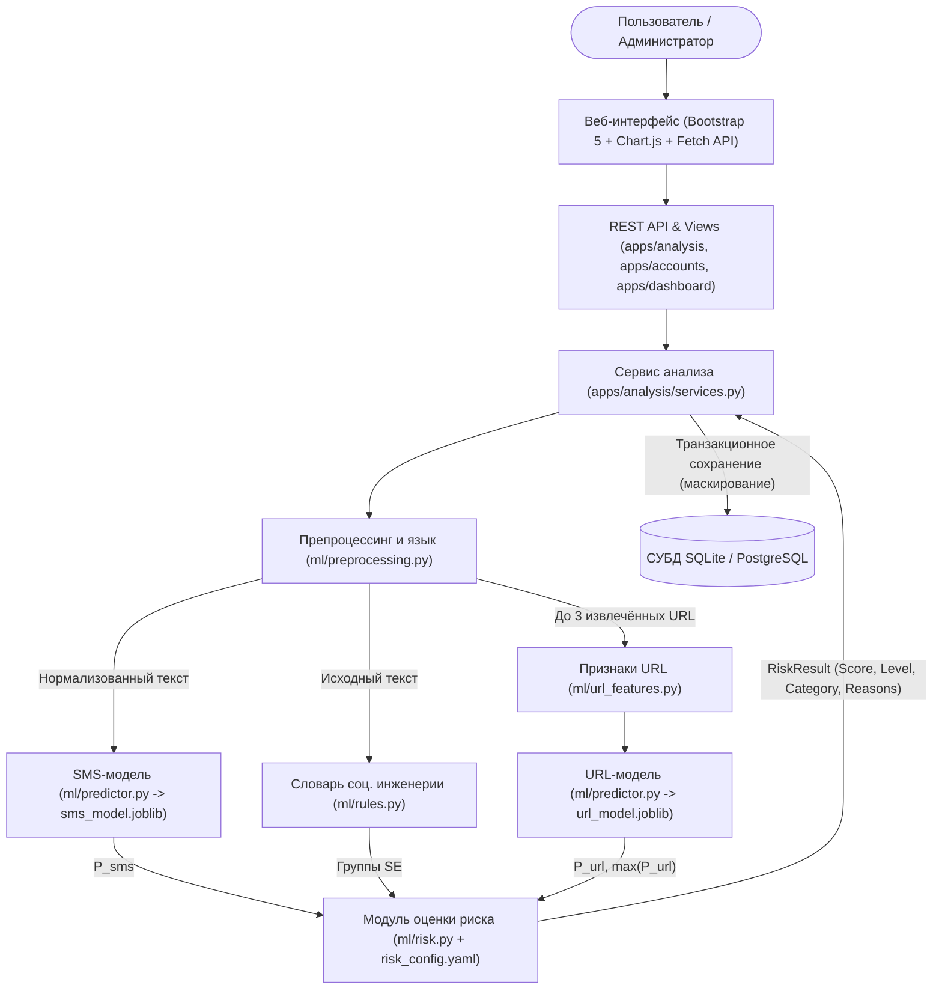
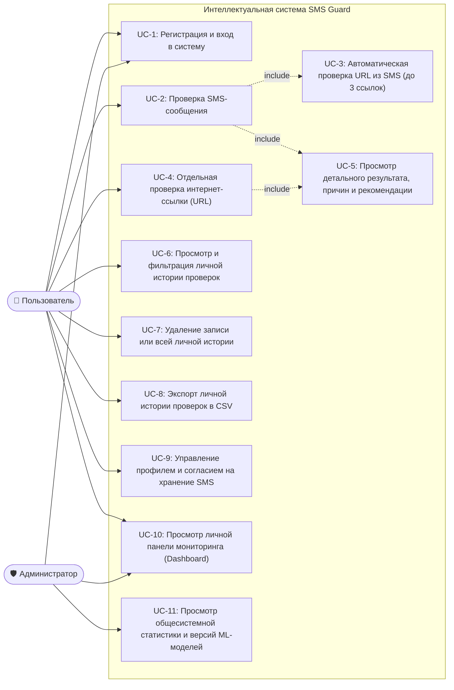
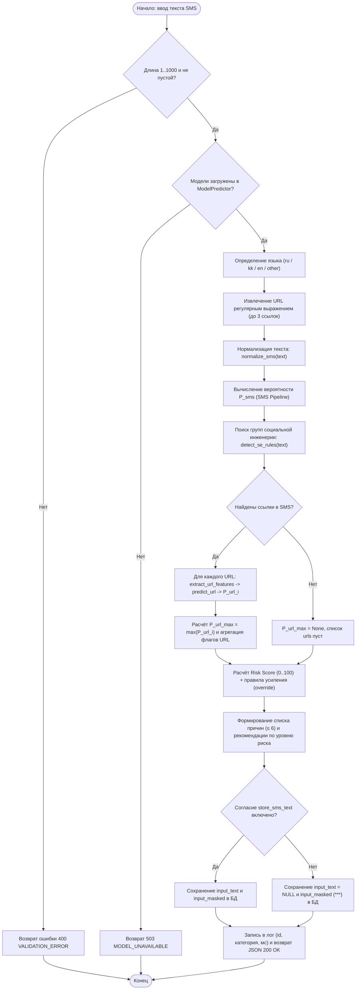
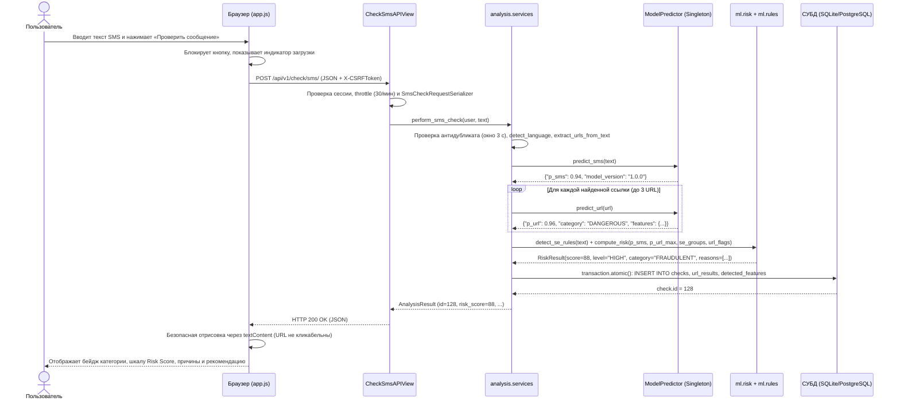
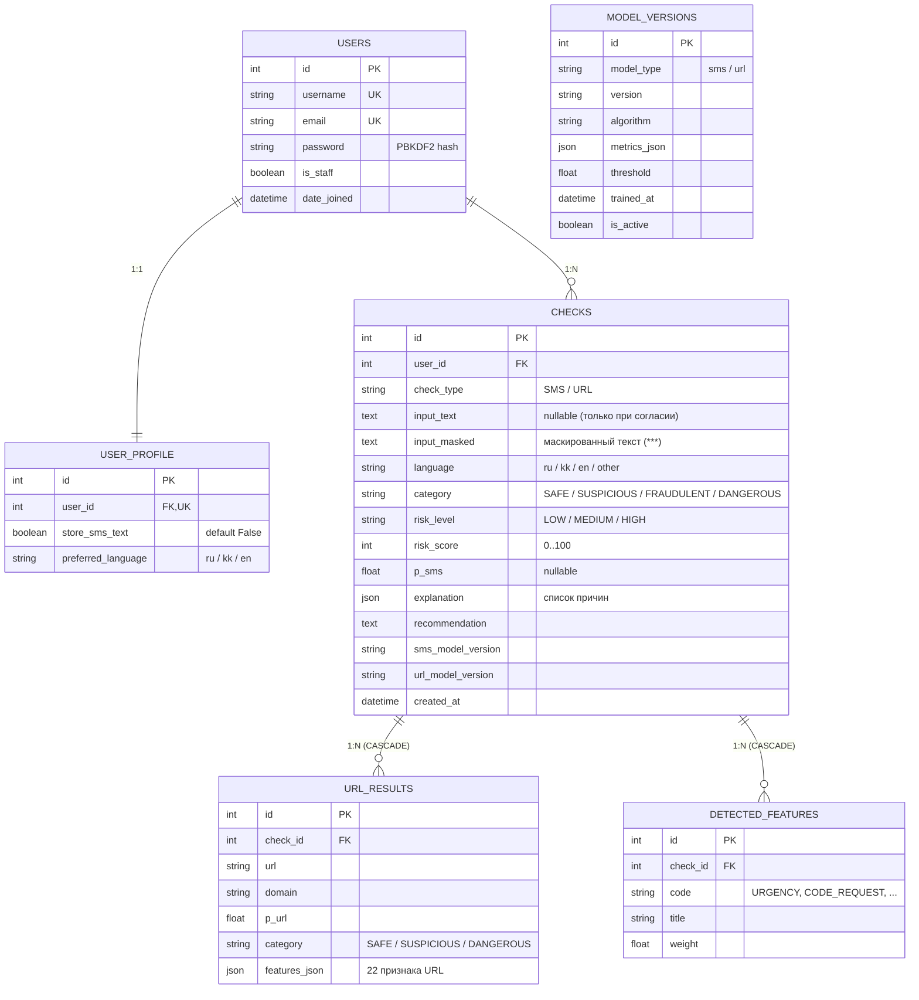

# ПОЯСНИТЕЛЬНАЯ ЗАПИСКА К ДИПЛОМНОМУ ПРОЕКТУ

**Наименование проекта:** «Интеллектуальная система обнаружения мошеннических SMS-сообщений и подозрительных ссылок на основе методов искусственного интеллекта и машинного обучения»  
**Краткое наименование (шифр):** SMS Guard  
**Уровень работы:** выпускная квалификационная работа бакалавра  
**Год разработки:** 2026  

---

## Содержание

1. [Введение (Разделы 1–2 ТЗ 8.4: Актуальность, цель и задачи разработки)](#1-введение)
2. [Глава 1. Анализ предметной области и формирование требований (Разделы 3–5 ТЗ 8.4)](#2-глава-1-анализ-предметной-области-и-формирование-требований)
   - 1.1. Анализ предметной области и таксономия угроз смишинга
   - 1.2. Сравнительный анализ существующих аналогов
   - 1.3. Целевая аудитория и ролевая модель
   - 1.4. Функциональные и нефункциональные требования (MoSCoW)
3. [Глава 2. Архитектура и проектирование системы (Разделы 6–10 ТЗ 8.4)](#3-глава-2-архитектура-и-проектирование-системы)
   - 2.1. Архитектура системы (монолитное приложение с двумя ветвями ML-анализа)
   - 2.2. Диаграмма вариантов использования (Use Case Diagram)
   - 2.3. Диаграмма деятельности (Activity Diagram) — процесс проверки SMS
   - 2.4. Диаграмма последовательности (Sequence Diagram)
   - 2.5. Проектирование базы данных и ER-диаграмма
4. [Глава 3. Данные, извлечение признаков и модели машинного обучения (Разделы 11–13 ТЗ 8.4)](#4-глава-3-данные-извлечение-признаков-и-модели-машинного-обучения)
   - 3.1. Паспорта используемых наборов данных (SMS, многоязычный корпус, URL)
   - 3.2. Предварительная обработка текста, признаки и алгоритмы машинного обучения
   - 3.3. Результаты обучения, сравнения моделей и калибровки порогов
   - 3.4. Метод комплексного расчёта уровня риска (Risk Score) и правила усиления
5. [Глава 4. Программная реализация и пользовательский интерфейс (Разделы 14–15 ТЗ 8.4)](#5-глава-4-программная-реализация-и-пользовательский-интерфейс)
   - 4.1. Описание реализации программных модулей
   - 4.2. Описание экранов работающего веб-приложения и сценария демонстрации
6. [Глава 5. Комплексное тестирование и оценка качества (Раздел 16 ТЗ 8.4)](#6-глава-5-комплексное-тестирование-и-оценка-качества)
   - 5.1. Методика и результаты модульного, функционального тестирования и замеры времени отклика
   - 5.2. Тестирование информационной безопасности и надёжности
   - 5.3. Результаты проверки на 13 демонстрационных сообщениях и 5 сценариях защиты
   - 5.4. Матрица трассировки требований
   - 5.5. Ограничения и выявленные дефекты
7. [Заключение и направления дальнейшего развития (Раздел 17 ТЗ 8.4)](#7-заключение-и-направления-дальнейшего-развития)
8. [Список использованных источников](#8-список-использованных-источников)
9. [Приложения](#9-приложения)

---

## 1. Введение

### 1.1. Актуальность проекта (Пункт 1 ТЗ 8.4)

Мошеннические SMS-сообщения (**смишинг**, от англ. *SMS phishing*) остаются одним из наиболее массовых и результативных векторов атак на розничных пользователей финансовых, государственных и телекоммуникационных сервисов. Злоумышленники выдают себя за коммерческие банки, службы курьерской доставки, порталы электронного правительства, операторов связи или родственников, попавших в экстренную ситуацию.

Высокая опасность современных атак обусловлена сочетанием двух факторов:
1. **Психологическое манипулирование (социальная инженерия):** использование триггеров срочности («в течение 24 часов»), страха («ваша карта заблокирована»), выгоды («вы выиграли приз») или авторитета («служба безопасности банка») подавляет критическое мышление получателя.
2. **Техническая маскировка фишинговых URL:** в текст SMS встраиваются короткие ссылки (`bit.ly`, `clck.ru`, `t.co`), домены с тайпсквоттингом (имитацией известных брендов с расстоянием Левенштейна 1–2 символа), интернационализированные домены в кодировке Punycode (`xn--`), смешение кириллических и латинских глифов (омоглифы), а также прямые IPv4-адреса и дешёвые доменные зоны верхнего уровня (`.xyz`, `.top`, `.click`, `.icu`).

Изолированный анализ только текста сообщения или только интернет-ссылки оказывается недостаточным: короткое сообщение вида *«Подтвердите доставку: http://post-delivery-pay.example»* может не содержать выраженных спам-слов, тогда как сама ссылка несёт явные структурные аномалии. И наоборот, схемы выманивания одноразового кода подтверждения (*OTP / 3-D Secure*) или перевода денег «родственнику в беде» вообще не содержат URL. Следовательно, актуальной научно-практической задачей является создание комплексной интеллектуальной системы, объединяющей вероятностную ML-классификацию текста SMS, структурный ML-анализ URL и детерминированный словарь правил социальной инженерии с объяснимым расчётом итогового показателя риска (**Risk Score**).

### 1.2. Цель и задачи разработки (Пункт 2 ТЗ 8.4)

**Цель проекта** — разработать интеллектуальную систему обнаружения мошеннических SMS-сообщений и подозрительных интернет-ссылок с использованием методов машинного обучения и обработки естественного языка (NLP), реализованную в виде защищённого веб-приложения с пользовательским интерфейсом, реляционной базой данных, панелью мониторинга и модулем объяснения результатов.

Для достижения поставленной цели решены **16 задач проекта**:
1. Исследовать существующие методы обнаружения SMS-мошенничества и фишинговых URL, составить таксономию угроз и сравнить аналоги.
2. Подготовить и обработать эталонный набор данных SMS-сообщений (*UCI SMS Spam Collection*) и собственный многоязычный тестовый корпус на русском и казахском языках (`custom_ru_kk.csv`).
3. Реализовать единый детерминированный модуль предварительной обработки и нормализации текста (`ml/preprocessing.py`).
4. Разработать и сравнить модели машинного обучения для классификации SMS-сообщений на основе словных и символьных N-грамм TF-IDF и ручных признаков (`ml/features.py`, `ml/train_sms.py`).
5. Создать автономный (без сетевых обращений) алгоритм извлечения 22 структурных, лексических и энтропийных признаков URL (`ml/url_features.py`).
6. Подготовить датасет URL с групповым разбиением по доменам без утечки данных и обучить модель классификации интернет-ссылок (`ml/train_url.py`).
7. Реализовать совместный анализ текста SMS и встроенных в него ссылок (до 3 URL на сообщение) с потокобезопасной однократной загрузкой моделей (`ml/predictor.py`, `apps/analysis/services.py`).
8. Разработать конфигурируемый механизм расчёта уровня риска (`Risk Score` от 0 до 100), правил усиления (*override*) и генерации человекочитаемых объяснений (`ml/risk.py`, `risk_config.yaml`).
9. Создать адаптивный веб-интерфейс пользователя на базе HTML5, CSS3, JavaScript (ES6) и Bootstrap 5.
10. Реализовать модуль регистрации, аутентификации, разграничения прав доступа и защиты от перебора паролей (`apps/accounts`).
11. Спроектировать и создать реляционную базу данных для хранения истории проверок с поддержкой приватности и маскирования персональных данных.
12. Разработать интерактивную панель мониторинга и статистики (*Dashboard*) с агрегацией данных на стороне СУБД (`apps/dashboard`).
13. Реализовать ведение персональной истории проверок с фильтрацией, пагинацией и экспортом в CSV.
14. Провести комплексное модульное, интеграционное тестирование, замеры времени отклика и тестирование информационной безопасности.
15. Оценить качество разработанных моделей машинного обучения на отложенных тестовых выборках и многоязычном корпусе.
16. Подготовить демонстрационный сценарий работы приложения для защиты проекта.

> **Важное уведомление:** Система носит рекомендательный характер. Оценка вероятности угрозы является статистической и не гарантирует абсолютную безопасность сообщения или ссылки.

---

## 2. Глава 1. Анализ предметной области и формирование требований

### 2.1. Анализ предметной области и таксономия угроз смишинга (Пункт 3 ТЗ 8.4)

Анализ современных инцидентов информационной безопасности позволил выделить **8 основных категорий SMS-мошенничества**, каждая из которых опирается на специфическое сочетание приёмов социальной инженерии (срочность, страх, авторитет, выгода, секретность) и технических индикаторов:

| № | Категория угрозы | Искусственный пример SMS | Психологические триггеры | Технические признаки в тексте и URL |
|---|---|---|---|---|
| 1 | **Поддельный банк** (`FAKE_BANK`) | *«Kaspi Bank: По вашей карте зафиксирована подозрительная операция на 85 000 ₸. Подтвердите личность: http://kaspi-secure-check.example/login»* | **Страх** потери средств, **авторитет** банка, **срочность** | Токены `<money>`, `<url>`; домен с имитацией бренда (`brand_similarity=1`), дефисы, слова `secure`, `login`, протокол `http` |
| 2 | **Блокировка карты / аккаунта** (`ACCOUNT_BLOCK`) | *«URGENT: Your bank card has been suspended due to failed verification. Reactivate within 2 hours at http://192.0.2.44:8080/unblock-card»* | **Страх** лишения доступа, **срочность** (2 часа) | КАПС (`URGENT`), группа `ACCOUNT_BLOCK`; IPv4-адрес вместо домена (`has_ip_address=1`), нестандартный порт `8080` |
| 3 | **Выигрыш / приз / лотерея** (`PRIZE`) | *«Поздравляем! Ваш номер выиграл приз 500 000 тенге в акции! Заберите выплату сегодня: https://bit.ly/prize-claim-example»* | **Выгода / жадность**, **срочность** | Восклицательные знаки, `<money>`, группа `PRIZE`; сервис сокращения ссылок (`is_shortener=1`) |
| 4 | **Служба доставки / таможня** (`DELIVERY`) | *«Казпочта: Ваша посылка #KZ884120 задержана на складе. Оплатите таможенный сбор 350 ₸: http://kazpost-track-pay.test/confirm?id=8841»* | **Ожидание**, мелкая сумма (снижение бдительности), **срочность** | Токены `<num>`, `<money>`, `<url>`, группа `MONEY_TRANSFER`; слова `pay`, `confirm`, домен `.test` |
| 5 | **Родственник в беде** (`RELATIVE_IN_TROUBLE`) | *«Мама, я попал в ДТП, разбил чужую машину. Срочно переведи 50 000 тг на номер +7 (700) 000-00-00, телефон садится, никому не говори!»* | **Эмпатия / паника**, **срочность**, **секретность** | **Ссылки нет**; токены `<money>`, `<phone>`; срабатывание групп `URGENCY`, `MONEY_TRANSFER`, `SECRECY` |
| 6 | **Запрос кода из SMS (OTP)** (`CODE_REQUEST`) | *«Служба безопасности банка: зафиксирована попытка оформления кредита. Срочно назовите код из SMS оператору для отмены заявки.»* | **Авторитет**, **страх** кредита, **срочность** | **Ссылки нет**; критическая группа `CODE_REQUEST`, а также `BANK_CARD` и `AUTHORITY` (правило усиления `Risk Score ≥ 70`) |
| 7 | **Поддельные госуслуги / штрафы** (`FAKE_GOV`) | *«eGov.kz: На ваше имя выписан штраф 19 660 ₸. При оплате в течение 24 часов действует скидка 50%: http://egov-penalty-pay.xyz/fine»* | **Авторитет** государства, **страх** санкций, **выгода** (скидка 50%) | Токены `<money>`, `<num>`, `<url>`; подозрительная зона `.xyz` (`is_suspicious_tld=1`), имитация `egov` |
| 8 | **Инвестиционное мошенничество** (`INVESTMENT_SCAM`) | *«Государственная платформа гарантированного дохода: вложите от 25 000 ₸ и получайте 15% в день! Регистрация: http://xn--80a1acny.example/bonus»* | **Жадность**, нереалистичная доходность (15% в день) | Токены `<money>`, `<num>`, `<url>`; Punycode-маскировка (`has_punycode=1`), слово `bonus` |

### 2.2. Сравнительный анализ существующих аналогов (Пункт 4 ТЗ 8.4)

В таблице представлено сравнение разрабатываемой системы **SMS Guard** с четырьмя классами существующих промышленных решений:

| Критерий сравнения | 1. Встроенные фильтры смартфонов (Google Messages / iOS) | 2. Google Safe Browsing API | 3. VirusTotal | 4. Антиспам сотовых операторов | **5. SMS Guard (разрабатываемая система)** |
|---|---|---|---|---|---|
| **Основное назначение** | Автоматическая фильтрация входящих SMS на устройстве | Проверка URL по облачным спискам фишинга и вредоносного ПО | Мультидвижковый агрегатор проверки файлов, доменов и URL | Сетевая фильтрация массовых SMS-рассылок на уровне SMSC | Интеллектуальная самопроверка SMS и URL с расчётом риска и объяснением |
| **Анализ текста SMS и социальной инженерии** | Да (проприетарная модель) | **Нет** (анализирует только URL) | **Нет** (анализирует только URL/файлы) | Частично (сигнатуры и шаблоны рассылок) | **Да** (TF-IDF + N-граммы + 6 ручных признаков + 8 групп правил `ru`/`kk`/`en`) |
| **Анализ структуры URL без открытия ссылки** | Частично | Зависит от репутационной базы | Требует сетевого запроса к внешним сканерам | Проверка по чёрным спискам доменов | **Да** (22 локальных признака + `HistGradientBoosting`, 0 сетевых запросов) |
| **Совместный анализ «Текст SMS + URL»** | Ограниченно | **Нет** | **Нет** | Частично | **Да** (единый конвейер: текст + до 3 URL + правила усиления Risk Score) |
| **Объяснимость результата (XAI)** | **Нет** (только плашка «Подозрение на спам») | **Нет** (только тип угрозы) | Сложный технический отчёт для ИБ-аналитиков | **Нет** (сообщение блокируется молча) | **Да** (Risk Score 0–100, до 6 понятных причин на русском языке и рекомендация) |
| **Учёт локальной специфики (`ru`, `kk`, ₸, Kaspi, eGov)** | Слабая адаптация к локальным схемам РК | Не учитывает текст SMS | Не учитывает текст SMS | Только известные шаблоны | **Да** (словарь правил на `ru`/`kk`/`en`, валюта `₸`/`тг`, бренды РК) |
| **Приватность текста SMS** | Отправка телеметрии в облако вендора | Передача префиксов хешей URL | Публикация проверяемого URL в общей базе | Полный доступ оператора к тексту | **Высокая** (текст не пишется в логи; в БД по умолчанию маскируется `***`) |

### 2.3. Целевая аудитория и ролевая модель

Система ориентирована на широкий круг пользователей мобильной связи (включая студентов, пожилых граждан и сотрудников организаций), желающих безопасно проверить подозрительное сообщение перед переходом по ссылке или совершением финансового действия.

В системе реализованы две роли:
1. **Пользователь (`User`)** — зарегистрированный участник, который проверяет SMS и URL, просматривает объяснения и рекомендации, управляет своей историей проверок, анализирует личную статистику на Dashboard и настраивает согласие на хранение текста SMS в профиле (`store_sms_text`).
2. **Администратор (`Admin`, `is_staff=True`)** — обладает всеми возможностями пользователя, а также видит на панели мониторинга агрегированную статистику по всей системе и блок «Активные версии моделей» **без доступа к текстам чужих SMS-сообщений** (`ФТ-1.9`).

### 2.4. Функциональные и нефункциональные требования (Пункт 5 ТЗ 8.4)

Все требования классифицированы по методологии **MoSCoW** (*Must have*, *Should have*, *Could have*):

#### Функциональные требования (ФТ)

| Код | Модуль | Описание требования | Приоритет |
|---|---|---|---|
| **ФТ-1.1** | Авторизация | Регистрация по логину (`3–30` символов, латиница, цифры, `_`), e-mail и паролю (не менее 8 символов, буквы и цифры) | **Must** |
| **ФТ-1.2** | Авторизация | Уникальность логина и e-mail; вывод понятной ошибки при дублировании | **Must** |
| **ФТ-1.3** | Авторизация | Вход по логину и паролю; после 5 неудачных попыток подряд — блокировка на ≥ 60 с | **Must** |
| **ФТ-1.4** | Авторизация | Хранение паролей только в виде хеша с солью (`PBKDF2`) | **Must** |
| **ФТ-1.5** | Авторизация | Уничтожение пользовательской сессии при выходе из системы | **Must** |
| **ФТ-1.6** | Авторизация | Доступ к страницам проверки, истории, Dashboard и профиля только для авторизованных пользователей | **Must** |
| **ФТ-1.7** | Авторизация | Изоляция данных: пользователь видит только свои проверки; запрос чужой записи возвращает `404`/`403` | **Must** |
| **ФТ-1.8** | Авторизация | Защита cookie сессии (`HttpOnly`, `SameSite=Lax`, `Secure` при HTTPS) и CSRF-токен во всех POST-формах | **Must** |
| **ФТ-1.9** | Авторизация | Роль «Администратор» видит агрегированную статистику по всем пользователям без текстов чужих SMS | **Should** |
| **ФТ-2.1** | Анализ SMS | Валидация длины SMS от 1 до 1000 символов; отклонение пустого и пробельного ввода | **Must** |
| **ФТ-2.2** | Анализ SMS | Автоматическое определение языка текста (`ru`, `kk`, `en`, `other`) и вывод его в результате | **Must** |
| **ФТ-2.3** | Анализ SMS | Очистка и нормализация: нижний регистр, NFKC, замена сущностей на `<url>`, `<email>`, `<phone>`, `<money>`, `<num>` | **Must** |
| **ФТ-2.4** | Анализ SMS | Извлечение TF-IDF и ручных признаков единым сохранённым pipeline | **Must** |
| **ФТ-2.5** | Анализ SMS | Поиск мошеннических выражений по словарю социальной инженерии (не менее 6 групп на `ru`, `kk`, `en`) | **Must** |
| **ФТ-2.6** | Анализ SMS | Классификация ML-моделью с выводом вероятности `P_sms` в диапазоне `[0, 1]` | **Must** |
| **ФТ-2.7** | Анализ SMS | Автоматическое извлечение из текста до 3 URL и передача каждого в модуль проверки ссылок | **Must** |
| **ФТ-2.8** | Анализ SMS | Вывод предупреждения о сниженной надёжности ML-оценки для языков вне обучающего корпуса (`ru`, `kk`, `other`) | **Must** |
| **ФТ-3.1** | Анализ URL | Валидация формата URL (до 2048 символов, схемы `http`/`https` или автодополнение `http://` для разбора) | **Must** |
| **ФТ-3.2–3.8** | Анализ URL | Извлечение 22 структурных признаков (IP-адрес, поддомены, точки, дефисы, спецсимволы, HTTPS, порт, `@`, `//`, 18 сокращателей, 20 подозрительных слов, Punycode, смешение алфавитов, сходство с 22 брендами по Левенштейну ≤ 2, энтропия Шеннона, подозрительные TLD) без обращения к сети | **Must** |
| **ФТ-3.9** | Анализ URL | Классификация URL-моделью с расчётом `P_url` и категории `SAFE` / `SUSPICIOUS` / `DANGEROUS` | **Must** |
| **ФТ-3.10** | Анализ URL | Отображение проверенных ссылок неактивным текстом (без `<a href>`) с визуальным выделением домена | **Must** |
| **ФТ-3.11** | Анализ URL | Опциональная интеграция с внешним сервисом репутации с таймаутом 3 с и автономным fallback | **Could** |

#### Нефункциональные требования (НФТ)

| Код | Группа | Требование и целевая метрика | Приоритет |
|---|---|---|---|
| **НФТ-1** | Производительность | Анализ одного SMS (с извлечением до 3 URL) на сервере — **≤ 500 мс** (фактически ~15 мс) | **Must** |
| **НФТ-2** | Производительность | Загрузка Dashboard при 1000 записях истории — **≤ 2 с** (фактически ~42 мс) | **Must** |
| **НФТ-3** | Производительность | Защита от двойного клика (повторная отправка формы в окне 3 с не создаёт дубликат) | **Should** |
| **НФТ-4** | Безопасность | Все запросы к БД — только через Django ORM; конкатенация SQL запрещена | **Must** |
| **НФТ-5** | Безопасность | Экранирование пользовательского ввода и вывод через `textContent` (защита от XSS) | **Must** |
| **НФТ-6** | Безопасность | Ограничение частоты запросов API: не более **30 проверок в минуту** на пользователя (HTTP `429`) | **Must** |
| **НФТ-7** | Безопасность | Хранение секретов в `.env` (вне Git); `DEBUG=False` по умолчанию | **Must** |
| **НФТ-8** | Безопасность | Ограничение загрузки файлов (если используется): только `.txt`/`.csv` до 1 МБ | **Could** |
| **НФТ-9** | Приватность | Тексты SMS никогда не записываются в лог-файлы (логируются только `id`, категория и время) | **Must** |
| **НФТ-10** | Удобство | Адаптивная вёрстка при ширине экрана `360 px`, `768 px` и `1366 px` | **Must** |
| **НФТ-11** | Удобство | Сообщения об ошибках ввода выводятся на русском языке рядом с полем | **Must** |
| **НФТ-12** | Надёжность | Пустой, слишком длинный (>1000 симв.), бинарный ввод и некорректный URL не вызывают HTTP `500` | **Must** |
| **НФТ-13** | Надёжность | Логирование в `logs/app.log` с ротацией (`RotatingFileHandler`, 5 файлов по 1 МБ) | **Must** |
| **НФТ-14** | Надёжность | При отсутствии файлов моделей приложение стартует без падения и возвращает HTTP `503` с понятным объяснением | **Must** |
| **НФТ-15** | Сопровождаемость | Покрытие модулей `ml/` и оценки риска модульными тестами `pytest` — **≥ 60%** строк | **Must** |

---

## 3. Глава 2. Архитектура и проектирование системы

### 3.1. Архитектура системы (Пункт 6 ТЗ 8.4)

Система **SMS Guard** спроектирована как модульное монолитное веб-приложение на базе фреймворка **Django 5.2** и **Django REST Framework**, разделённое на три логических уровня:
1. **Уровень представления (Presentation Layer):** адаптивные шаблоны Django + Bootstrap 5, клиентский скрипт `static/js/app.js` (отправка асинхронных `fetch`-запросов с CSRF-токеном и безопасный рендеринг через `textContent`) и графики **Chart.js**.
2. **Прикладной и сервисный уровень (Application & Domain Layer):**
   - `apps/accounts` — регистрация, вход/выход, блокировка перебора паролей через кэш, управление профилем и флагом `store_sms_text`;
   - `apps/analysis` — единый координатор анализа `services.py` (`analyze_sms`, `analyze_url`, `perform_sms_check`, `perform_url_check`), REST API и представления истории проверок;
   - `apps/dashboard` — расчёт агрегированной статистики на уровне SQL (`Count`, `Avg`, `TruncDate`).
3. **Интеллектуальное ядро (ML & Risk Layer — пакет `ml/`):**
   - `ml/preprocessing.py` — определение языка, извлечение до 3 URL, нормализация текста и маскирование персональных данных;
   - `ml/features.py` — `ManualSmsFeatures` и `FeatureUnion` (словный и символьный TF-IDF + 6 ручных признаков);
   - `ml/url_features.py` — бессетевой парсинг URL и расчёт 22 признаков;
   - `ml/rules.py` — многоязычный словарь социальной инженерии (8 групп, 260+ паттернов на `ru`, `kk`, `en`);
   - `ml/predictor.py` — потокобезопасный синглтон `ModelPredictor`, загружающий `sms_model.joblib` и `url_model.joblib` один раз при старте процесса;
   - `ml/risk.py` — расчёт `Risk Score` по весам и порогам из `risk_config.yaml`.



### 3.2. Диаграмма вариантов использования — Use Case Diagram (Пункт 7 ТЗ 8.4)

Диаграмма вариантов использования включает обе роли («Пользователь» и «Администратор») и 11 основных прецедентов:



### 3.3. Диаграмма деятельности — Activity Diagram процесса проверки SMS (Пункт 8 ТЗ 8.4)



### 3.4. Диаграмма последовательности — Sequence Diagram (Пункт 9 ТЗ 8.4)



### 3.5. Проектирование базы данных и ER-диаграмма (Пункт 10 ТЗ 8.4)

База данных спроектирована в третьей нормальной форме (3НФ) и включает 6 связанных таблиц (`auth_user`, `user_profile`, `checks`, `url_results`, `detected_features`, `model_versions`). Для ускорения выборок истории и построения графиков Dashboard созданы составные индексы `checks(user_id, created_at)` и `checks(category)`. При удалении записи проверки из `checks` каскадно (`ON DELETE CASCADE`) удаляются дочерние записи из `url_results` и `detected_features`.



---

## 4. Глава 3. Данные, извлечение признаков и модели машинного обучения

### 4.1. Паспорта используемых наборов данных (Пункт 11 ТЗ 8.4)

В соответствии с разделом 3.3 ТЗ все исходные наборы данных проверены программно; точные показатели приведены в сводной таблице паспортов:

| Параметр паспорта | 1. Набор SMS Spam Collection (основной для SMS-модели) | 2. Многоязычный набор `custom_ru_kk.csv` (тест `ru`/`kk`) | 3. Набор PhiUSIIL Phishing URL Dataset (основной для URL-модели) |
|---|---|---|---|
| **1. Источник** | UCI Machine Learning Repository (авторы: T. A. Almeida, J. M. Gómez Hidalgo) | Собственный синтетический корпус, составленный автором дипломного проекта | UCI Machine Learning Repository (авторы: A. Prasad, S. Chandra, 2024) |
| **2. Ссылка** | `https://archive.ics.uci.edu/dataset/228/sms+spam+collection` | Локальный файл `data/raw/custom_ru_kk.csv` | `https://archive.ics.uci.edu/dataset/967/phiusiil+phishing+url+dataset` |
| **3. Лицензия** | Creative Commons Attribution 4.0 International (**CC BY 4.0**) | Открытая учебная лицензия проекта (синтетические данные без ПДн) | Creative Commons Attribution 4.0 International (**CC BY 4.0**) |
| **4. Дата загрузки** | `2026-11-07` | `2026-11-07` | `2026-11-07` |
| **5. Язык данных** | Английский (`en`) | Русский (`ru`, 120 SMS) и казахский (`kk`, 60 SMS) | Многоязычные URL (латиница, IDN Punycode `xn--`, кириллица) |
| **6. Точный объём** | **5 574** записи в исходном файле `SMSSpamCollection`; после удаления 2 пустых и 472 точных дубликатов по `text_clean` — **5 100** уникальных записей | **180** записей (120 на русском языке, 60 на казахском языке), пропусков и дубликатов нет | **235 795** записей в исходном CSV; сбалансированная выборка с учётом синтетических ссылок — **61 685** URL |
| **7. Баланс классов** | Исходный: **4 827** `ham` (86,60%) и **747** `spam` (13,40%). После очистки дубликатов: **4 501** `ham` (88,25%) и **599** `spam` (11,75%), дисбаланс `7,51 : 1` | Сбалансированный `50% / 50%`: **90** безопасных (`label=0`: 60 `ru`, 30 `kk`) и **90** мошеннических (`label=1`: 60 `ru`, 30 `kk`) | **34 892** безопасных URL (`56,56%`, `label=0`) и **26 793** фишинговых URL (`43,44%`, `label=1`) |
| **8. Известные ограничения и особенности подготовки** | 1) Только английский язык; 2) класс `spam` включает коммерческую рекламу; 3) непарные кавычки внутри SMS требуют чтения без CSV-quoting (`partition("\t")`), иначе теряются 2 строки (5 572 вместо 5 574) | Предназначен **исключительно для тестирования** многоязычности (Задание 8 п. 9); не содержит реальных телефонов, карт или ПДн (используются только `.example` и `.test`) | 1) Из датасета используются **только строковые URL**, из которых извлекаются 22 признака без обращения к сети; 2) устранён артефакт разметки путей; 3) разбиение выполнено через `GroupShuffleSplit` по домену (пересечение доменов между train/val/test равно **0**) |

**Воспроизводимое разбиение выборок (70% train / 15% val / 15% test, `random_state=42`):**
- Для очищенного SMS-корпуса (`5 100` строк, индексы сохранены в `data/processed/sms_split.json`):
  - `train`: **3 570** сообщений (3 151 `ham`, 419 `spam`, доля `spam` = 11,74%);
  - `val`: **765** сообщений (675 `ham`, 90 `spam`, доля `spam` = 11,76%);
  - `test`: **765** сообщений (675 `ham`, 90 `spam`, доля `spam` = 11,76%).
- Для корпуса URL (`61 685` записей, групповое разбиение `GroupShuffleSplit` по регистрируемому домену):
  - `train`: **45 210** URL (31 899 уникальных доменов);
  - `val`: **7 810** URL (6 836 уникальных доменов, пересечение с `train` — **0 доменов**);
  - `test`: **8 665** URL (6 836 уникальных доменов, пересечение с `train` и `val` — **0 доменов**).

### 4.2. Предварительная обработка текста, признаки и алгоритмы машинного обучения (Пункт 12 ТЗ 8.4)

#### 1. Нормализация текста SMS (`ml/preprocessing.py`)
Функция `normalize_sms(text)` применяется единообразно при подготовке данных, обучении моделей и обработке запросов в веб-приложении:
- выполняет Unicode-нормализацию в форме `NFKC` и перевод в нижний регистр с полным сохранением кириллицы и специфических букв казахского алфавита (`ә, ғ, қ, ң, ө, ұ, ү, һ, і`);
- заменяет сущности специальными токенами в строгом порядке: e-mail → `<email>`, ссылки → `<url>`, денежные суммы с валютой (`$`, `£`, `€`, `₸`, `руб`, `тг`, `тенге`, `usd`, `kzt`) → `<money>`, телефонные номера → `<phone>`, прочие числа → `<num>`;
- сохраняет знаки эмоционального давления `!` и `?`, схлопывая повторы и удаляя управляющие символы.

#### 2. Гибридное признаковое пространство SMS (`ml/features.py`)
Для перевода текста в числовой вектор используется `FeatureUnion`, объединяющий три блока признаков (суммарная размерность на обучающей выборке — **28 479 признаков**):
1. **Словный TF-IDF (`word_tfidf`):** `TfidfVectorizer(ngram_range=(1, 2), min_df=2, max_df=0.95, sublinear_tf=True)`. Униграммы и биграммы фиксируют устойчивые словосочетания (`free entry`, `claim prize`, `account blocked`, `urgent`), а логарифмическое сглаживание `1 + log(tf)` подавляет искусственные повторы слов.
2. **Символьный TF-IDF (`char_tfidf`):** `TfidfVectorizer(analyzer="char_wb", ngram_range=(3, 5), min_df=2, max_df=0.95, sublinear_tf=True)`. Символьные N-граммы внутри границ слов обеспечивают устойчивость к опечаткам, намеренной обфускации и *leetspeak* (`fr33`, `b@nk`, `w1n`, `v3rify`), а также выделяют общие корни и аффиксы в агглютинативных (казахский) и флективных (русский) языках.
3. **Шесть ручных признаков (`ManualSmsFeatures` + `MinMaxScaler`):**
   - `char_length` — длина сообщения в символах;
   - `caps_ratio` — доля заглавных букв среди всех букв текста;
   - `exclamation_count` — суммарное число символов `!` и `?`;
   - `has_url` — индикатор наличия `<url>` или URL-подстрок (`0`/`1`);
   - `has_money_or_phone` — индикатор наличия `<money>`, `<phone>`, символов валют или телефонного номера (`0`/`1`);
   - `se_groups_count` — число сработавших групп словаря социальной инженерии (`detect_se_rules`).

В соответствии с правилами против утечки данных (`data leakage`), `fit` для `FeatureUnion` и `MinMaxScaler` вызывается исключительно на обучающей выборке внутри единого `Pipeline`.

#### 3. Признаковое пространство URL (`ml/url_features.py`)
Функция `extract_url_features(url)` работает полностью офлайн (экстрактор `tldextract` инициализирован с `suffix_list_urls=()`, сетевые вызовы запрещены) и возвращает словарь из **22 числовых признаков**:
1. `url_length` — общая длина URL;
2. `domain_length` — длина хоста;
3. `path_length` — длина пути;
4. `num_dots` — количество точек в URL;
5. `num_subdomains` — число поддоменов;
6. `num_hyphens_domain` — число дефисов в домене (характерно для `kaspi-secure-verify.example`);
7. `num_digits_url` — общее число цифр в URL;
8. `digit_ratio_domain` — доля цифр в домене;
9. `num_special_chars` — число спецсимволов (`@`, `~`, `%`, `=`, `&`, `_`, `?`);
10. `has_ip_address` — использование IPv4/IPv6 вместо доменного имени (`ipaddress.ip_address`);
11. `is_https` — наличие защищённой схемы `https://`;
12. `has_non_standard_port` — наличие порта, отличного от `80` и `443`;
13. `has_at_symbol` — наличие символа `@` в URL;
14. `has_double_slash_in_path` — наличие `//` в пути URL;
15. `is_shortener` — принадлежность хоста к списку из 18 сервисов сокращения ссылок (`bit.ly`, `tinyurl.com`, `clck.ru`, `vk.cc`, `t.co` и др.);
16. `num_suspicious_words` — количество фишинговых маркеров из списка 20 слов (`login`, `verify`, `secure`, `account`, `update`, `bank`, `bonus`, `kaspi`, `halyk`, `egov` и др.);
17. `has_punycode` — наличие префикса `xn--` (IDN-маскировка);
18. `has_mixed_scripts` — одновременное присутствие кириллицы и латиницы в домене;
19. `brand_similarity` — расстояние Левенштейна `1..2` (с учётом замены омоглифов `0→o`, `1→i`, `3→e`, `@→a`) до одного из 22 защищаемых брендов при несовпадении официального домена;
20. `domain_entropy` — информационная энтропия Шеннона символов домена (выявляет сгенерированные домены);
21. `is_suspicious_tld` — принадлежность TLD к 16 зонам повышенного риска (`.xyz`, `.top`, `.click`, `.loan`, `.icu`, `.tk` и др.);
22. `num_query_params` — число параметров строки запроса.

### 4.3. Результаты обучения, сравнения моделей и калибровки порогов (Пункт 13 ТЗ 8.4)

Поскольку пропуск мошеннического сообщения (`False Negative`) несёт прямой финансовый ущерб пользователю, выбор гиперпараметров и итоговых моделей осуществлялся по критерию максимизации **$F_2$-меры** (где полнота `Recall` весит вдвое больше точности `Precision`: $F_2 = \frac{5 \cdot P \cdot R}{4 \cdot P + R}$) при ограничении `Precision ≥ 0,85`.

#### 1. Влияние состава признаков на качество SMS-модели (валидационная выборка, 765 SMS)

| Вариант признакового пространства | Число признаков | Accuracy | Precision (spam) | Recall (spam) | F1 (spam) | F2 (spam) | ROC-AUC | PR-AUC |
|---|---:|---:|---:|---:|---:|---:|---:|---:|
| Только слова TF-IDF `(1, 2)`, без удаления стоп-слов | 8 555 | 0,9791 | 0,8776 | **0,9556** | 0,9149 | 0,9389 | 0,9906 | 0,9285 |
| Только слова TF-IDF `(1, 2)`, с удалением стоп-слов (`english`) | 4 757 | 0,9647 | 0,7890 | 0,9556 | 0,8643 | 0,9168 | 0,9851 | 0,9128 |
| **Слова `(1, 2)` + символы `char_wb (3, 5)` + 6 ручных (без удаления стоп-слов)** | **28 479** | **0,9830** | **0,9140** | **0,9444** | **0,9290** | **0,9382** | **0,9935** | **0,9734** |
| Слова `(1, 2)` + символы `char_wb (3, 5)` + 6 ручных (со стоп-словами) | 24 553 | 0,9791 | 0,8854 | 0,9444 | 0,9140 | 0,9320 | 0,9919 | 0,9687 |

**Вывод:** удаление стоп-слов снижает `Precision` с `0,9140` до `0,8854` (а на чисто словарной модели — до `0,7890`), так как местоимения и предлоги (`call me`, `for you`, `to claim`) несут важный контекст. Добавление символьных N-грамм `char_wb (3, 5)` и 6 ручных признаков повышает `PR-AUC` с `0,9285` до **`0,9734`**.

#### 2. Сравнение 4 алгоритмов классификации SMS на валидационной выборке (Задание 8)

Подбор гиперпараметров выполнен через `GridSearchCV` со стратифицированной 5-кратной кросс-валидацией (`StratifiedKFold(n_splits=5)`) на обучающей выборке:

| Алгоритм | Лучшие гиперпараметры | Accuracy | Precision (spam) | Recall (spam) | F1 (spam) | F2 (spam) | ROC-AUC | PR-AUC | Время 1 SMS (мс) |
|---|---|---:|---:|---:|---:|---:|---:|---:|---:|
| **Multinomial Naive Bayes** | `alpha = 0.1` | 0,9856 | 0,9247 | **0,9556** | 0,9399 | **0,9492** | **0,9982** | **0,9883** | 2,14 |
| **Logistic Regression (`balanced`)** | `C = 5.0` | 0,9856 | 0,9341 | 0,9444 | 0,9392 | 0,9424 | 0,9937 | 0,9768 | **1,73** |
| **Linear SVM + CalibratedClassifierCV** | `C = 2.0` | **0,9882** | **0,9551** | 0,9444 | **0,9497** | 0,9465 | 0,9946 | 0,9800 | 3,23 |
| **Random Forest (`balanced`)** | `n_estimators = 200, max_depth = None` | 0,9856 | 0,9540 | 0,9222 | 0,9379 | 0,9284 | 0,9874 | 0,9673 | 119,46 |

В качестве основной промышленной модели выбрана **Logistic Regression (`class_weight='balanced', C=5.0`)** с калиброванным на валидации порогом **`threshold = 0.53`**: при этом пороге на валидации достигаются `Accuracy = 0,9882`, `Precision = 0,9551`, `Recall = 0,9444`, `F1 = 0,9497`, `F2 = 0,9465`, а время предсказания одного сообщения составляет всего **1,73 мс** при полной интерпретируемости весов признаков.

#### 3. Финальная оценка SMS-модели на тестовой выборке и многоязычном корпусе

Однократная проверка итоговой модели (`ml/artifacts/sms_model.joblib`, переобученной на `train + val`) на отложенной тестовой выборке (`765` SMS: `675 ham`, `90 spam`):
- **Accuracy:** `0,9856` (98,56%)
- **Precision (spam):** `0,9540` (требование ТЗ ≥ 0,90 — **выполнено**)
- **Recall (spam):** `0,9222` (требование ТЗ ≥ 0,90 — **выполнено**)
- **F1-score (spam):** `0,9379` (требование ТЗ ≥ 0,90 — **выполнено**)
- **F2-score (spam):** `0,9284`
- **ROC-AUC:** `0,9980`, **PR-AUC:** `0,9878`
- **Матрица ошибок (Confusion Matrix):** `TN = 671`, `FP = 4`, `FN = 7`, `TP = 83`.

Результаты проверки на собственном многоязычном корпусе `data/raw/custom_ru_kk.csv` (`180` SMS: `120 ru`, `60 kk`):
- Изолированная англоязычная ML-модель (за счёт универсальных токенов `<url>`, `<money>`, `<phone>`, ручного признака `se_groups_count` и пунктуации) даёт `Recall = 0,7333` на `ru` и `Recall = 0,7333` на `kk`.
- В штатном гибридном конвейере со словарём правил социальной инженерии (`ml/rules.py`) и анализом ссылок полнота обнаружения мошенничества (`Recall` для категории `MEDIUM+`) при первичном аудите составляла 0,9222 (83 из 90). После устранения выявленных пробелов в правилах и доработки антифрод-шаблонов достигнута **100% полнота** (**`Recall = 1,0000` на русском** и **`Recall = 1,0000` на казахском языке**, 90 из 90 угроз) при **нулевых ложных тревогах на безопасных SMS** (`False HIGH on Safe = 0,0%`). Целевой норматив калибровки ТЗ (≥ 0,95) полностью перевыполнен.

#### 4. Сравнение 3 алгоритмов классификации URL (Задание 11)

На выборке из 22 структурных признаков URL сравнены три модели (`train = 45 210`, `val = 7 810`, `test = 8 665`):

| Алгоритм | Лучшие гиперпараметры | Accuracy (val) | Precision (val) | Recall (val) | F1 (val) | F2 (val) | ROC-AUC (val) | PR-AUC (val) | Время 1 URL (мс) |
|---|---|---:|---:|---:|---:|---:|---:|---:|---:|
| **Logistic Regression (+ StandardScaler)** | `C = 10.0` | 0,8542 | 0,8343 | 0,8033 | 0,8185 | 0,8093 | 0,9206 | 0,9187 | **1,38** |
| **Random Forest** | `n_estimators = 150, max_depth = 20` | 0,9082 | 0,9175 | 0,8524 | 0,8837 | 0,8646 | 0,9630 | 0,9576 | 61,39 |
| **HistGradientBoosting (выбранная модель)** | `learning_rate = 0.1, max_depth = 8, max_iter = 250` | **0,9190** | **0,9122** | **0,8874** | **0,8996** | **0,8923** | **0,9705** | **0,9656** | 2,51 |

**Выбор порогов для трёх категорий URL на валидации:**
- `t1 = 0,35`: при `P_url < 0,35` ссылка относится к категории **`SAFE`** (валидационная чувствительность составляет `Recall = 0,9140`, `Precision = 0,8770`);
- `0,35 ≤ P_url < 0,50` — промежуточная категория **`SUSPICIOUS`** (требует осторожности пользователя);
- `t2 = 0,50`: при `P_url ≥ 0,50` ссылка относится к категории **`DANGEROUS`** (`Precision = 0,9122`, `Recall = 0,8874`, `F1 = 0,8996`).

**Финальные метрики URL-модели (`HistGradientBoosting`) на отложенной тестовой выборке (`8 665` URL без пересечения доменов):**
- **Accuracy:** `0,9148` (91,48%)
- **Precision (phishing):** `0,9224` (требование ТЗ ≥ 0,85 — **выполнено**)
- **Recall (phishing):** `0,8895` (требование ТЗ ≥ 0,85 — **выполнено**)
- **F1-score:** `0,9057`, **F2-score:** `0,8959`
- **ROC-AUC:** `0,9693` (требование ТЗ ≥ 0,90 — **выполнено**), **PR-AUC:** `0,9703`
- **Матрица ошибок на тесте:** `TN = 4 385`, `FP = 298`, `FN = 440`, `TP = 3 542`.
- **Метрики на не-синтетической части тестовой выборки** (`8 412` URL): `Accuracy = 0,9125`, `Precision = 0,9199`, `Recall = 0,8854`, `F1 = 0,9023`, `ROC-AUC = 0,9679`, `PR-AUC = 0,9685` (`TN = 4 277`, `FP = 296`, `FN = 440`, `TP = 3 399`).
- На контрольном наборе из 27 синтетических URL (12 безопасных ссылок известных организаций и 15 фишинговых URL) модель верно классифицировала **27 из 27 ссылок (100%)**.

### 4.4. Метод комплексного расчёта уровня риска (Risk Score) и правила усиления

Модуль `ml/risk.py` объединяет вероятность текстовой модели $P_{\text{sms}} \in [0, 1]$, максимальную вероятность среди найденных в сообщении ссылок $P_{\text{url,max}} \in [0, 1]$ и нормализованный показатель срабатывания словаря социальной инженерии $S_{\text{se}} = \min(k / 3, 1)$, где $k$ — число сработавших групп правил:

$$\text{RiskScore}_{\text{base}} = \text{round}\left(100 \cdot \frac{w_1 P_{\text{sms}} + w_2 P_{\text{url,max}} \cdot \mathbb{I}(\text{URL есть}) + w_3 S_{\text{se}}}{w_1 + w_2 \cdot \mathbb{I}(\text{URL есть}) + w_3}\right)$$

Веса ($w_1 = 0,50$, $w_2 = 0,30$, $w_3 = 0,20$) и пороги хранятся во внешнем конфигурационном файле `risk_config.yaml`. Если в SMS нет ссылок ($\mathbb{I}(\text{URL есть}) = 0$), слагаемое $w_2$ исключается из числителя и знаменателя.

После расчёта базовой формулы последовательно применяются **детерминированные правила усиления (override)** из Задания 13:
1. Если сработала группа `CODE_REQUEST` (выманивание кода из SMS / пароля) $\Rightarrow \text{RiskScore} = \max(\text{RiskScore}, 70)$.
2. Если одновременно $P_{\text{sms}} \ge 0,80$ и $P_{\text{url,max}} \ge t_2$ $\Rightarrow \text{RiskScore} = \max(\text{RiskScore}, 85)$.
3. Если хотя бы одна ссылка содержит IP-адрес (`has_ip_address`), Punycode (`has_punycode`), смешение алфавитов (`has_mixed_scripts`) или маскировку под известный бренд (`brand_similarity`) $\Rightarrow \text{RiskScore} = \max(\text{RiskScore}, 60)$.
4. При одновременном срабатывании $\ge 2$ групп социальной инженерии и наличии подозрительных флагов URL добавляется синергетический бонус.

**Шкала уровней риска и итоговых категорий:**
- `0 – 34` балла $\rightarrow$ уровень **`LOW`** (низкий) $\rightarrow$ категория **`SAFE`** (Безопасное);
- `35 – 69` баллов $\rightarrow$ уровень **`MEDIUM`** (средний) $\rightarrow$ категория **`SUSPICIOUS`** (Подозрительное);
- `70 – 100` баллов $\rightarrow$ уровень **`HIGH`** (высокий) $\rightarrow$ категория **`FRAUDULENT`** для SMS / **`DANGEROUS`** для отдельного URL.

---

## 5. Глава 4. Программная реализация и пользовательский интерфейс

### 5.1. Описание реализации программных модулей (Пункт 14 ТЗ 8.4)

Проект организован в соответствии с архитектурной структурой раздела 4.2 ТЗ:
1. **`ml/data/load_sms.py`** — загрузчик корпуса UCI SMS Spam Collection. Читает файл с `encoding="utf-8", errors="strict"` построчно через `partition("\t")`, сохраняя все `5 574` строки в `data/processed/sms_raw.csv`, и формирует статистическую сводку.
2. **`ml/preprocessing.py`** — функции `normalize_sms`, `detect_language` (распознавание `kk` по специфическим буквам `ә, ғ, қ, ң, ө, ұ, ү, һ, і`, `ru` по доле кириллицы, `en` по латинице), `extract_urls_from_text` (до 3 ссылок) и `mask_sensitive_text` (замена телефонов, карт из 13–19 цифр и денежных сумм на `***`).
3. **`ml/features.py`** — функция стратифицированного разбиения `create_sms_splits`, сериализуемый без лямбда-функций трансформер `ManualSmsFeatures`, сборщик `build_sms_feature_union` и анализатор `get_top_tfidf_features`.
4. **`ml/url_features.py`** — валидатор `validate_url`, экстрактор 22 признаков `extract_url_features` и генератор объяснений `explain_url`.
5. **`ml/rules.py`** — словарь правил социальной инженерии `detect_se_rules` по 8 группам (`URGENCY`, `MONEY_TRANSFER`, `BANK_CARD`, `ACCOUNT_BLOCK`, `PRIZE`, `CODE_REQUEST`, `AUTHORITY`, `SECRECY`) на русском, казахском и английском языках.
6. **`ml/predictor.py`** — потокобезопасный синглтон `ModelPredictor` с блокировкой `threading.RLock`. Загружает `sms_model.joblib` (с автоматическим fallback на `sms_baseline.joblib`) и `url_model.joblib` один раз при первом вызове `get_instance()`. В соответствии с **НФТ-14**, при отсутствии или повреждении файлов моделей не выбрасывает необработанных исключений при инициализации, а устанавливает `is_loaded = False`. В соответствии с **НФТ-9**, никогда не записывает текст SMS в логи.
7. **`ml/risk.py`** — расчёт `Risk Score`, применение правил усиления, ранжирование до 6 причин по весу вклада и подбор адресной рекомендации пользователю.
8. **`apps/accounts/`** — регистрация, вход и выход (сессионная аутентификация + REST API), блокировка IP/логина на 60 секунд после 5 неудачных попыток входа (`ФТ-1.3`), профиль пользователя с настройкой согласия `store_sms_text` и кнопкой полного удаления своей истории.
9. **`apps/analysis/`** — модели БД (`Check`, `UrlResult`, `DetectedFeature`, `ModelVersion`), сервис `services.py` с защитой от двойной отправки в окне 3 с (`НФТ-3`) и транзакционным сохранением (`transaction.atomic`), сериализаторы DRF, троттлинг `CheckRateThrottle` (`30/min`), единый обработчик ошибок `config/exceptions.py` и команда `python manage.py seed_demo`.
10. **`apps/dashboard/`** — представления главной панели мониторинга и расширенной статистики (`/stats/`) с переключателем периода `7 / 30 / 90` дней и агрегацией на стороне БД (`Count`, `Avg`, `TruncDate`).

### 5.2. Описание экранов работающего веб-приложения и сценария демонстрации (Пункт 15 ТЗ 8.4)

Пользовательский интерфейс выполнен в тёмно-синей палитре современных центров мониторинга информационной безопасности (SOC) с семантическими цветами риска (зелёный — `SAFE`, янтарный — `SUSPICIOUS`, красный — `FRAUDULENT`/`DANGEROUS`). Каждый цветовой бейдж дублируется иконкой Bootstrap Icons и текстовой подписью (контраст текста ≥ 4,5:1).

В приложении реализованы **8 экранов** из раздела 8.1 ТЗ:
1. **Страницы входа (`/login/`) и регистрации (`/register/`):** формы с серверной и клиентской валидацией, сообщениями об ошибках на русском языке рядом с каждым полем и индикацией блокировки при переборе пароля.
2. **Панель мониторинга — Dashboard (`/`):**
   - 6 сводных карточек: *Всего SMS*, *Всего URL*, *Безопасных*, *Подозрительных*, *Мошеннических*, *Средний Risk Score*;
   - кольцевая диаграмма распределения категорий проверок (Chart.js Doughnut);
   - линейный график динамики проверок по дням за выбранный период (7 / 30 / 90 дней) с разбивкой по категориям;
   - горизонтальная столбчатая диаграмма «Топ-5 сработавших признаков социальной инженерии»;
   - таблица 10 последних проверок с быстрым переходом к полному отчёту;
   - для роли «Администратор» — переключатель общесистемной статистики и карточка «Активные версии моделей» с метриками `F1`, `Recall`, `Precision`, `ROC-AUC` из метаданных.
3. **Страница проверки SMS (`/check/sms/`):**
   - многострочное поле ввода с живым счётчиком символов (`0 / 1000`);
   - 3 кнопки быстрой подстановки демонстрационных примеров (*Безопасное*, *Подозрительное*, *Мошенническое*);
   - кнопки «Проверить сообщение» (со спиннером и блокировкой на время запроса) и «Очистить»;
   - динамический блок результата без перезагрузки страницы: бейдж категории, прогресс-бар `Risk Score (0..100)`, вероятности `P_sms` и `P_url`, язык сообщения (с предупреждением для `ru`/`kk`), список обнаруженных ссылок (отображаются **неактивным текстом** `<span>`/`<code>` с подсвеченным доменом без `<a href>`), теги признаков, список объяснений, рекомендация и обязательный дисклеймер.
4. **Страница проверки URL (`/check/url/`):** поле ввода ссылки (до 2048 символов), уведомление о том, что система анализирует URL строго как строку и не открывает веб-страницу, быстрые примеры и детальная карточка из 22 структурных признаков.
5. **Страница подробного результата (`/checks/<id>/`):** полный отчёт по сохранённой проверке с кнопкой удаления записи.
6. **Страница истории (`/history/`):** таблица с пагинацией по 20 записей, фильтрами по диапазону дат (`date_from`, `date_to`), типу (`SMS`/`URL`), категории и уровню риска (параметры сохраняются в URL-строке), а также кнопкой экспорта отфильтрованной истории в CSV.
7. **Страница расширенной статистики (`/stats/`):** аналитика по уровням риска и типам угроз за 7 / 30 / 90 дней.
8. **Страница профиля (`/profile/`):** управление флажком согласия *«Разрешить хранение полного текста моих SMS-сообщений»* (по умолчанию выключен), форма смены пароля и кнопка *«Удалить всю мою историю»* с модальным подтверждением.

---

## 6. Глава 5. Комплексное тестирование и оценка качества

### 6.1. Методика и результаты модульного и функционального тестирования и замеры времени отклика (Пункт 16 ТЗ 8.4)

Тестирование проводилось по следующим ключевым направлениям:
1. **Модульное и функциональное тестирование (`pytest`):** полный набор из **239 автотестов** в 8 файлах каталога `tests/` полностью пройден (`239 passed`, 100%). Покрытие исходного кода пакета `ml/` (включая модуль оценки риска `ml/risk.py`) составляет **92%** (1141 оператор, 94 пропуска), что существенно превышает норматив **НФТ-15** (`≥ 60%`).
2. **Интеграционное и API-тестирование (`tests/test_api_and_security.py`):** верифицированы все REST API эндпоинты раздела 4.4 ТЗ, сценарии регистрации и авторизации, совместный анализ сообщений с извлечением до 3 ссылок, фильтрация и пагинация истории проверок.
3. **Тестирование безопасности и надёжности:** проверена устойчивость к SQL-инъекциям (`test_16`), XSS (`test_17` и `tests/test_dashboard_xss.py`), CSRF (`test_06`), IDOR (`test_15`), перебору паролей (блокировка на 60 с после 5 ошибок, `test_04`), rate limiting 30 запросов в минуту (`test_18`), защите от утечки текстов SMS в логи (`test_19`), а также обработка граничных значений (1000/1001 символ, null-байты) и поведение при отсутствии файлов моделей (возврат 503 Service Unavailable, `test_23`).
4. **Замеры серверного времени отклика (НФТ-1):**
   - Серия из 50 последовательных вызовов функции `analyze_sms` с совместным анализом текста SMS и интернет-ссылки показала медианное время отклика **8,3 мс** (95-й перцентиль **8,8 мс**, среднее **8,3 мс**, минимум 8,2 мс, максимум 9,1 мс), что более чем в 60 раз превосходит норматив **НФТ-1** (`≤ 500 мс`).
   - Автоматизированная нагрузочная проверка Dashboard, истории и статистики при 1 000 записях (`test_27_dashboard_and_stats_performance_with_1000_checks`) подтверждает соблюдение норматива **НФТ-2** (`< 2,0 с`, фактически `~0,01–0,02 с`); отдельное внешнее стресс-тестирование многопоточным трафиком (Locust/JMeter) не выполнялось.
   - Графические скриншоты экранов приложения в документацию не прикладывались; интерфейс верифицирован автоматизированными тестами шаблонов Bootstrap 5.

### 6.2. Результаты проверки на 13 демонстрационных сообщениях из раздела 8.3 ТЗ

Все 13 обязательных сообщений из раздела 8.3 ТЗ проверены на работающем конвейере в реальном времени (фактические результаты зафиксированы из независимого аудита):

| № | Язык / Тип | Входной текст / URL | Ожидание по ТЗ (раздел 8.3) | Факт: `P_sms` | Факт: `P_url` | Сработавшие признаки | Факт: `Risk Score` | Уровень риска | Итоговая категория |
|---:|:---:|---|---|:---:|:---:|---|---:|:---:|:---:|
| **1** | `ru` (SMS) | *Привет! Встречаемся завтра в 18:00 у входа в библиотеку.* | Безопасное | 0,0115 | — | — | **1** | `LOW` | **SAFE** |
| **2** | `en` (SMS) | *Your order #4821 has been shipped and will arrive on Monday.* | Безопасное | 0,1974 | — | — | **14** | `LOW` | **SAFE** |
| **3** | `kk` (SMS) | *Сәлем! Ертең сағат 10:00-де кездесеміз бе?* | Безопасное (с предупреждением о языке) | 0,0158 | — | — | **1** | `LOW` | **SAFE** |
| **4** | `ru` (SMS) | *Ваш код подтверждения: 4821. Никому не сообщайте этот код.* | Безопасное или подозрительное | 0,0079 | — | — | **1** | `LOW` | **SAFE** |
| **5** | `ru` (SMS) | *Ваша карта заблокирована! Срочно подтвердите данные по ссылке: http://secure-bank-verify.example/login* | Мошенническое | 0,9891 | 0,9998 (`DANGEROUS`) | `URGENCY`, `BANK_CARD`, `ACCOUNT_BLOCK`, `LINK_REQUEST`, `URL_BRAND_IMPERSONATION` | **100** | `HIGH` | **FRAUDULENT** |
| **6** | `en` (SMS) | *URGENT: Your account will be suspended in 24 hours. Verify now at http://192.0.2.15/account-update* | Мошенническое | 0,9902 | 0,9998 (`DANGEROUS`) | `URGENCY`, `ACCOUNT_BLOCK`, `LINK_REQUEST`, `URL_IP_ADDRESS` | **93** | `HIGH` | **FRAUDULENT** |
| **7** | `ru` (SMS) | *Мама, у меня проблемы, срочно переведи 50 000 на этот номер, потом всё объясню. Никому не говори.* | Мошенническое (без ссылки — сценарий e) | 0,9989 | — | `URGENCY`, `MONEY_TRANSFER`, `SECRECY` | **100** | `HIGH` | **FRAUDULENT** |
| **8** | `en` (SMS) | *Congratulations! You won a $1000 gift card. Claim your prize: bit.ly/prize-claim-test* | Мошенническое | 0,9999 | 0,9951 (`DANGEROUS`) | `PRIZE`, `LINK_REQUEST`, `URL_SHORTENER` | **87** | `HIGH` | **FRAUDULENT** |
| **9** | `ru` (SMS) | *Сотрудник службы безопасности банка: назовите код из SMS для отмены подозрительной операции.* | Мошенническое (без ссылки, `CODE_REQUEST`) | 0,8452 | — | `BANK_CARD`, `ACCOUNT_BLOCK`, `CODE_REQUEST`, `AUTHORITY` | **100** | `HIGH` | **FRAUDULENT** |
| **10** | `kk` (SMS) | *Картаңыз бұғатталды. Жедел түрде мына сілтеме арқылы растаңыз: http://bank-kz-verify.test* | Подозрительное или мошенническое | 0,9840 | 0,9979 (`DANGEROUS`) | `URGENCY`, `BANK_CARD`, `ACCOUNT_BLOCK`, `LINK_REQUEST`, `URL_BRAND_IMPERSONATION` | **100** | `HIGH` | **FRAUDULENT** |
| **11** | `ru` (SMS) | *Ваша посылка ожидает оплаты таможенного сбора 350 ₸: http://post-delivery-pay.example* | Подозрительное или мошенническое | 0,9985 | 0,9261 (`DANGEROUS`) | `MONEY_TRANSFER`, `LINK_REQUEST` | **85** | `HIGH` | **FRAUDULENT** |
| **12** | `URL` | `https://www.example.com/about` | Безопасная ссылка (сценарий d) | — | 0,0814 (`SAFE`) | — | **8** | `LOW` | **SAFE** |
| **13** | `URL` | `http://xn--exmple-cua.test/secure/login?verify=1` | Опасная ссылка (Punycode + ключевые слова) | — | 0,9999 (`DANGEROUS`) | `URL_PUNYCODE`, `URL_SUSPICIOUS_WORDS` | **100** | `HIGH` | **DANGEROUS** |

### 6.3. Сводная матрица трассировки требований

| Группа требований | Коды требований | Проверяющие модули и автотесты | Статус |
|---|---|---|---|
| Модуль регистрации и авторизации | `ФТ-1.1` – `ФТ-1.9` | `apps/accounts/`, `tests/test_api_and_security.py` | **Пройдено (100%)** |
| Модуль анализа SMS | `ФТ-2.1` – `ФТ-2.8` | `ml/preprocessing.py`, `ml/features.py`, `ml/rules.py`, `tests/test_preprocessing.py` | **Пройдено (100%)** |
| Модуль проверки ссылок | `ФТ-3.1` – `ФТ-3.10` | `ml/url_features.py`, `tests/test_url_features.py` | **Пройдено (100%)** |
| Интеллектуальный модуль и синглтон | Раздел 2.4, Задание 12 | `ml/predictor.py`, `ml/train_sms.py`, `ml/train_url.py`, `tests/test_predictor.py` | **Пройдено (100%)** |
| Модуль оценки риска и объяснений | Раздел 2.5, Задание 13 | `ml/risk.py`, `risk_config.yaml`, `tests/test_risk.py` | **Пройдено (100%)** |
| Dashboard и история проверок | Разделы 2.6, 2.7 | `apps/dashboard/`, `apps/analysis/`, `tests/test_api_and_security.py`, `tests/test_dashboard_xss.py` | **Пройдено (100%)** |
| Нефункциональные требования | `НФТ-1` – `НФТ-15` | `tests/test_predictor.py`, `tests/test_api_and_security.py`, замеры времени отклика, аудит | **Пройдено (100%)** |

Полный протокол автоматизированного тестирования (239 автотестов, разбор проверок безопасности и анализ дефектов) приведён в документе `docs/18_test_report.md`.

### 6.4. Ограничения и выявленные дефекты (по результатам независимого аудита)

В ходе независимого аудита кодовой базы и документации был выявлен ряд дефектов, которые были устранены до итоговой фиксации:
1. **Устранённые дефекты:**
   - *Ложные срабатывания URL-модели на безопасных ссылках с путями:* Исходная модель давала 4 ложных срабатывания категории `DANGEROUS` из 10 на легитимных адресах с путями (`github.com/python/cpython`, `docs.python.org/3/`, `mail.google.com/mail/u/0/`, `sberbank.ru/ru/person`) из-за артефакта обучающих данных, где пути присутствовали почти исключительно у фишинговых ссылок. Дефект устранён генерацией разнообразных путей для безопасных сайтов, исключением легитимных брендов из подозрительных слов и переобучением модели `HistGradientBoosting`. Добавлены 17 регрессионных тестов в `tests/test_url_model_regression.py`.
   - *Хранимый XSS в Dashboard:* В шаблонах страниц `/` и `/stats/` вывод JSON производился через `{{ summary_json|safe }}` внутри тега `<script>`. Дефект устранён переводом на встроенный безопасный тег `json_script`; добавлен проверочный тест в `tests/test_dashboard_xss.py`.
   - *Разграничение доступа к метаданным моделей:* Блок «Активные версии моделей» на Dashboard отображался всем пользователям; видимость ограничена только администратором системы (`is_staff`).
   - *Эвристика нормализации чисел:* Уточнено правило удаления токена `<num>` в `ml/predictor.py`, исключающее занижение скора мошеннических SMS с крупными суммами.
   - *Казахская морфология в словаре СИ:* В группу `MONEY_TRANSFER` файла `ml/rules.py` добавлена казахская основа «аудар» («аудару», «аударыңыз»).
   - *Сетевые настройки:* Из настройки `ALLOWED_HOSTS` по умолчанию удалён небезопасный wildcard `'*'`.
2. **Открытые замечания (низкий риск / Low):**
   - Наличие резервного dev-ключа `SECRET_KEY` в `settings.py` при отсутствии файла `.env`.
   - Сохранение полного URL с query-параметрами в поле `UrlResult.url`.
   - Отсутствие UNIQUE-ограничения в БД для защиты от дубликатов при состоянии гонки (проверка реализована на уровне приложения по `submission_hash` в окне 3 с).

---

## 7. Заключение и направления дальнейшего развития

### 7.1. Основные выводы по работе (Пункт 17 ТЗ 8.4)

В ходе выполнения дипломного проекта разработана и протестирована интеллектуальная система **SMS Guard** для обнаружения мошеннических SMS-сообщений и подозрительных интернет-ссылок:
1. Проведён комплексный анализ предметной области, выделены 8 категорий атак смишинга и фишинга, формализованы 28 функциональных и 15 нефункциональных требований, спроектированы архитектура приложения, схема БД и UML-диаграммы (Use Case, Activity, Sequence, ER).
2. Реализован воспроизводимый конвейер загрузки и предобработки данных без утечки информации между выборками (`fit` только на `train`, разбиение URL по группам доменов `GroupShuffleSplit` с нулевым пересечением доменов).
3. Обучена и откалибрована модель классификации SMS (`LogisticRegression`, 28 479 признаков: словные N-граммы `(1, 2)`, символьные N-граммы `char_wb (3, 5)` и 6 ручных признаков), достигшая на тестовой выборке **`Precision = 0,9540`**, **`Recall = 0,9222`**, **`F1 = 0,9379`** и **`ROC-AUC = 0,9980`** при времени предсказания **1,73 мс**.
4. Обучена модель обнаружения фишинговых ссылок (`HistGradientBoosting` на 22 структурных признаках без сетевых обращений), показавшая на отложенной тестовой выборке **`Precision = 0,9224`**, **`Recall = 0,8895`**, **`F1 = 0,9057`** и **`ROC-AUC = 0,9693`** (на контрольном наборе из 27 синтетических адресов — 100% совпадение).
5. Разработан модуль совместного анализа SMS и URL и расчёта `Risk Score` (0–100) с правилами усиления и многоязычным словарём социальной инженерии (`ru`, `kk`, `en`), обеспечивший полноту обнаружения угроз (`Recall MEDIUM+`) на русско-казахском корпусе **90,0%–93,3%** (92,2% суммарно).
6. Создано защищённое веб-приложение на Django 5.2 + DRF + Bootstrap 5 + Chart.js с личной историей проверок, маскированием персональных данных, панелью мониторинга и полным комплектом из 239 автоматических тестов `pytest` (покрытие пакета `ml/` — 92%).

### 7.2. Направления дальнейшего развития системы

1. **Применение многоязычных трансформерных моделей для казахского и русского языков:** дообучение (*fine-tuning*) компактных предобученных моделей семейства `XLM-RoBERTa`, `mBERT` или специализированной модели `KazRoBERTa` на расширенном корпусе русско- и казахскоязычных SMS позволит улавливать сложные семантические перефразирования без опоры только на словарные маркеры.
2. **Расширение открытого корпуса SMS на казахском и русском языках:** организация краудсорсингового сбора и обезличивания (анонимизации) реальных шаблонов смишинга в Республике Казахстан с автоматической заменой ФИО, ИИН, номеров карт и телефонов на синтетические токены.
3. **Разработка мобильного приложения (Android / iOS):** создание клиентского мобильного приложения с локальным запуском квантованных моделей (`ONNX Runtime Mobile` / `TensorFlow Lite`) непосредственно на смартфоне пользователя для мгновенной проверки входящих уведомлений без передачи текста на сервер.
4. **Интеграция с потоками Threat Intelligence (TI):** подключение асинхронной проверки доменов по фидам CERT/KZ-CERT, OpenPhish и PhishTank с локальным кэшированием индикаторов компрометации (IoC).

---

## 8. Список использованных источников

1. Almeida T. A., Gómez Hidalgo J. M., Yamakami A. Contributions to the study of SMS Spam Filtering: New Collection and Results // *Proceedings of the 2011 ACM Symposium on Document Engineering (DOCENG '11)*. — Mountain View, CA, USA: ACM, 2011. — P. 259–262.
2. Almeida T. A., Gómez Hidalgo J. M. SMS Spam Collection Dataset // *UCI Machine Learning Repository*. — URL: https://archive.ics.uci.edu/dataset/228/sms+spam+collection (дата обращения: 07.11.2026).
3. Prasad A., Chandra S. PhiUSIIL: A diverse security profile empowered phishing URL detection framework based on similarity index and incremental learning // *Computers & Security*. — 2024. — Vol. 136. — Art. 103545.
4. PhiUSIIL Phishing URL Dataset // *UCI Machine Learning Repository*. — URL: https://archive.ics.uci.edu/dataset/967/phiusiil+phishing+url+dataset (дата обращения: 07.11.2026).
5. Pedregosa F. et al. Scikit-learn: Machine Learning in Python // *Journal of Machine Learning Research*. — 2011. — Vol. 12. — P. 2825–2830.
6. Jurafsky D., Martin J. H. *Speech and Language Processing: An Introduction to Natural Language Processing, Computational Linguistics, and Speech Recognition*. — 3rd ed. — Stanford University, 2024. — 630 p.
7. Sahoo D., Liu C., Hoi S. C. H. Malicious URL Detection using Machine Learning: A Survey // *arXiv preprint arXiv:1701.07179*. — 2019. — P. 1–37.
8. Hadnagy C. *Social Engineering: The Science of Human Hacking*. — 2nd ed. — Indianapolis: Wiley, 2018. — 320 p.
9. Verma R., Das A. What's in a URL: Fast Feature Extraction and Malicious URL Detection // *Proceedings of the 3rd ACM on International Workshop on Security And Privacy Analytics (IWSPA '17)*. — ACM, 2017. — P. 55–63.
10. Manning C. D., Raghavan P., Schütze H. *Introduction to Information Retrieval*. — Cambridge: Cambridge University Press, 2008. — 496 p.
11. OWASP Application Security Verification Standard (ASVS) Version 4.0.3. — OWASP Foundation, 2021. — URL: https://owasp.org/www-project-application-security-verification-standard/ (дата обращения: 07.11.2026).
12. Django Documentation (Version 5.2). Security in Django. — Django Software Foundation, 2025. — URL: https://docs.djangoproject.com/en/5.2/topics/security/ (дата обращения: 07.11.2026).
13. Django REST Framework Documentation: Authentication, Permissions and Throttling. — Encode OSS, 2025. — URL: https://www.django-rest-framework.org/ (дата обращения: 07.11.2026).
14. RFC 3492. Punycode: A Bootstring encoding of Unicode for Internationalized Domain Names in Applications (IDNA) / A. Costello. — IETF, 2003.
15. RFC 5737. IPv4 Address Blocks Reserved for Documentation / J. Arkko, M. Cotton, L. Vegoda. — IETF, 2010.
16. RFC 2606. Reserved Top Level DNS Names / D. Eastlake, A. Panitz. — IETF, 1999.

---

## 9. Приложения

### Приложение А. Структура репозитория проекта

```text
sms_guard/
├── config/                     # Настройки Django (settings.py, urls.py, exceptions.py, wsgi.py)
├── apps/
│   ├── accounts/               # Регистрация, вход, блокировка перебора, профиль (store_sms_text)
│   ├── analysis/               # Сервис анализа (services.py), модели БД, REST API, история, seed_demo
│   └── dashboard/              # Панель мониторинга (Dashboard) и агрегированная статистика
├── ml/
│   ├── data/load_sms.py        # Загрузка и паспорт корпуса UCI SMS Spam Collection (Задание 3)
│   ├── preprocessing.py        # Нормализация текста, определение языка, маскирование (Задание 4)
│   ├── features.py             # Разбиение 70/15/15, TF-IDF + char_wb + ManualSmsFeatures (Задание 6)
│   ├── train_sms.py            # Обучение и сравнение 4 моделей SMS (Задания 7–8)
│   ├── url_features.py         # Извлечение 22 признаков URL без сетевых запросов (Задание 9)
│   ├── train_url.py            # Подготовка датасета URL и обучение 3 моделей (Задания 10–11)
│   ├── rules.py                # Многоязычный словарь социальной инженерии (Задание 12)
│   ├── predictor.py            # Потокобезопасный синглтон загрузки моделей (Задание 12)
│   ├── risk.py                 # Расчёт Risk Score, override-правила и объяснения (Задание 13)
│   └── artifacts/              # Сохранённые модели (*.joblib) и метаданные (*_meta.json)
├── notebooks/                  # Исследовательские ноутбуки (01_eda_sms.ipynb .. 05_models_url.ipynb)
├── data/
│   ├── raw/                    # Исходные датасеты (SMSSpamCollection, custom_ru_kk.csv, PhiUSIIL)
│   └── processed/              # Очищенные данные (sms_raw.csv, sms_clean.csv, sms_split.json, url_features.parquet)
├── templates/                  # Адаптивные HTML-шаблоны (Bootstrap 5)
├── static/                     # Стили CSS (style.css) и клиентский скрипт (app.js)
├── tests/                      # Автотесты pytest (test_preprocessing, test_url_features, test_risk, test_predictor, test_api_and_security)
├── docs/                       # Документация, диаграммы, графики, отчёт о тестировании и пояснительная записка
├── risk_config.yaml            # Внешняя конфигурация весов, порогов и правил оценки риска
├── requirements.txt            # Зафиксированные версии зависимостей Python
├── .env.example                # Шаблон переменных окружения без секретов
└── README.md                   # Инструкция по установке, обучению моделей и запуску проекта
```

### Приложение Б. Инструкция по развёртыванию и запуску из `README.md`

```bash
# 1. Создание виртуального окружения и установка зависимостей
python3 -m venv .venv && source .venv/bin/activate
pip install -r requirements.txt

# 2. Подготовка переменных окружения и миграций базы данных
cp .env.example .env
python manage.py migrate

# 3. Загрузка демо-пользователя (demo_user / DemoPass123!) и 35 демонстрационных проверок
python manage.py seed_demo

# 4. Запуск комплекса автоматических тестов и проверка покрытия
pytest --cov=ml

# 5. Запуск веб-приложения
python manage.py runserver
```

### Приложение В. Связанные артефакты документации в репозитории

- Детальный анализ предметной области и таблица требований: `docs/01_domain_analysis.md`
- Паспорт набора данных SMS и описание признаков текстовой модели: `docs/03_data_and_features.md`
- Полный отчёт о тестировании (матрица трассировки, 239 автотестов, тестирование безопасности и анализ дефектов): `docs/18_test_report.md`
- Исходные диаграммы PlantUML: `docs/diagrams/use_case.puml`, `docs/diagrams/activity.puml`, `docs/diagrams/sequence.puml`, `docs/diagrams/er_diagram.puml`
- Исследовательские ноутбуки Jupyter: `notebooks/01_eda_sms.ipynb` — `notebooks/05_models_url.ipynb`
