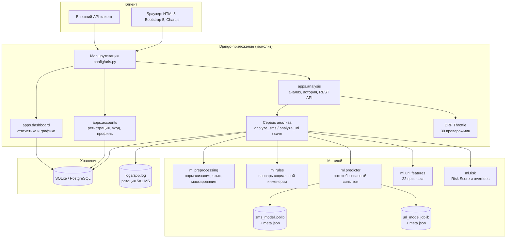
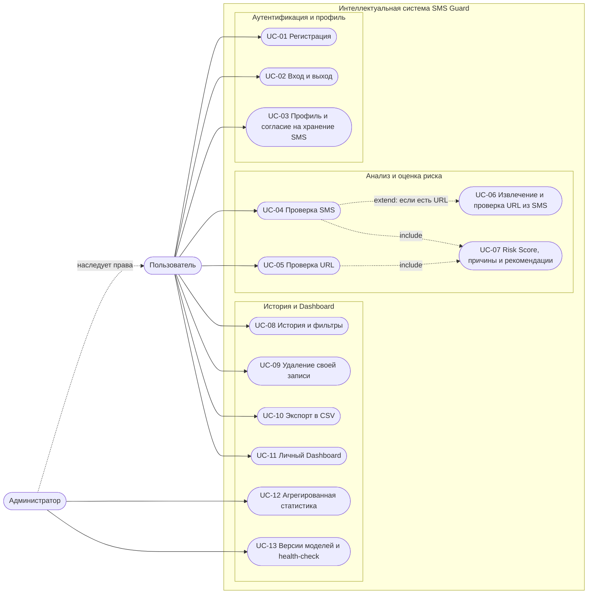
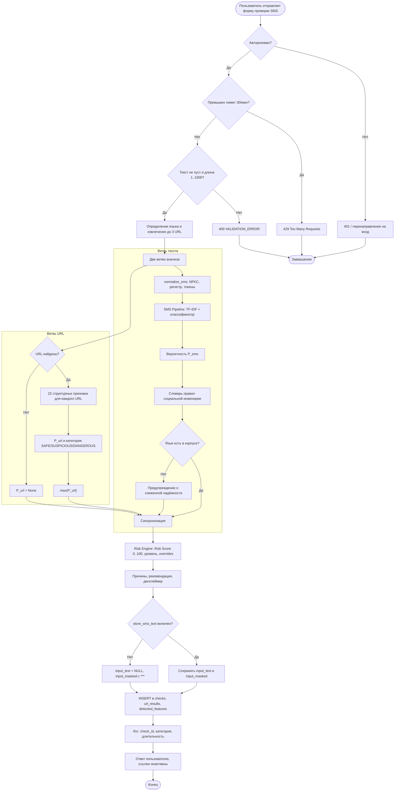
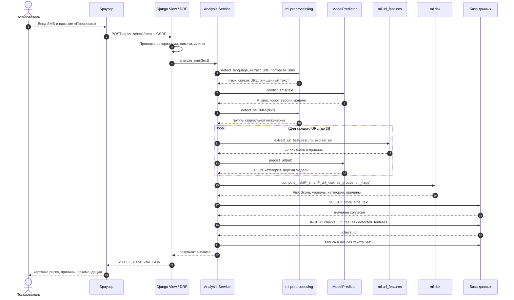
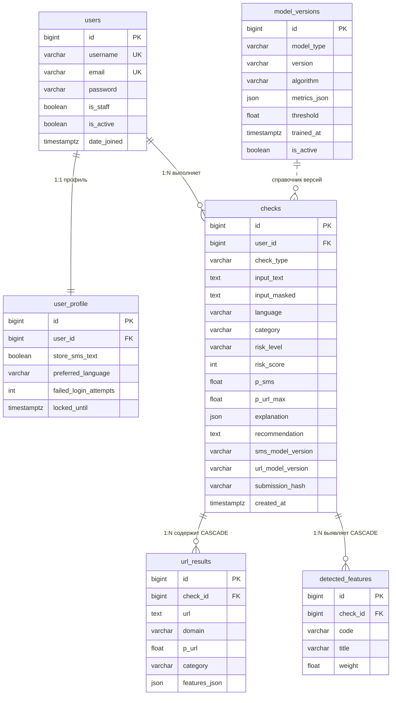

# ПОЯСНИТЕЛЬНАЯ ЗАПИСКА

**Проект:** «Интеллектуальная система обнаружения мошеннических SMS-сообщений и подозрительных ссылок»

**Краткое наименование:** SMS Guard

**Документ:** Пояснительная записка дипломного проекта (раздел 8.4 технического задания)

**Исполнитель:** ______________________________

**Руководитель:** ______________________________

**Город, год:** ____________________, 2026

---

## АННОТАЦИЯ

В пояснительной записке описывается разработка веб-приложения **SMS Guard**, предназначенного для интеллектуальной проверки SMS-сообщений и интернет-ссылок на признаки мошенничества (смишинга), социальной инженерии и фишинга. Система объединяет два независимых контура анализа: классификатор текста SMS на основе TF-IDF-признаков и методов машинного обучения, а также структурно-лексический анализатор URL, работающий исключительно со строкой адреса без сетевых запросов. Результаты обоих контуров и словарь правил социальной инженерии агрегируются модулем оценки риска в итоговый показатель `Risk Score` от 0 до 100 с объяснением причин и практической рекомендацией пользователю.

Приложение реализовано как монолитное веб-приложение на Django 5 и Django REST Framework с реляционной базой данных SQLite/PostgreSQL, адаптивным интерфейсом Bootstrap 5 и графиками Chart.js. Отдельное внимание уделено требованиям информационной безопасности и приватности: пароли хранятся в виде хешей PBKDF2, все формы защищены CSRF-токенами, запросы к базе данных выполняются через ORM, пользовательский ввод экранируется, тексты SMS не записываются в журналы, а при отсутствии согласия пользователя сохраняется только маскированная версия сообщения.

**Ключевые слова:** смишинг, фишинг, социальная инженерия, машинное обучение, TF-IDF, классификация SMS, анализ URL, оценка риска, Django, scikit-learn, объяснимый искусственный интеллект.

---

## СОДЕРЖАНИЕ

1. [Введение](#введение)
   - [1. Актуальность проекта](#1-актуальность-проекта)
   - [2. Цель и задачи разработки](#2-цель-и-задачи-разработки)
2. [Глава 1. Анализ предметной области](#глава-1-анализ-предметной-области)
   - [3. Анализ предметной области и таксономия угроз](#3-анализ-предметной-области-и-таксономия-угроз)
   - [4. Сравнительный анализ существующих аналогов](#4-сравнительный-анализ-существующих-аналогов)
   - [5. Функциональные и нефункциональные требования](#5-функциональные-и-нефункциональные-требования)
3. [Глава 2. Архитектура и проектирование системы](#глава-2-архитектура-и-проектирование-системы)
   - [6. Архитектура монолитного веб-приложения](#6-архитектура-монолитного-веб-приложения-django--ml--risk-engine)
   - [7. Диаграмма вариантов использования](#7-диаграмма-вариантов-использования-use-case)
   - [8. Диаграмма деятельности](#8-диаграмма-деятельности-activity-diagram)
   - [9. Диаграмма последовательности](#9-диаграмма-последовательности-sequence-diagram)
   - [10. ER-диаграмма базы данных](#10-er-диаграмма-базы-данных)
4. [Глава 3. Данные, признаки и модели машинного обучения](#глава-3-данные-признаки-и-модели-машинного-обучения)
   - [11. Паспорта наборов данных](#11-паспорта-наборов-данных)
   - [12. Предварительная обработка, признаки и алгоритмы](#12-предварительная-обработка-признаки-и-алгоритмы)
   - [13. Результаты обучения, пороги и расчёт Risk Score](#13-результаты-обучения-пороги-и-расчёт-risk-score)
5. [Глава 4. Реализация и интерфейс системы](#глава-4-реализация-и-интерфейс-системы)
   - [14. Описание реализации модулей](#14-описание-реализации-модулей)
   - [15. Экраны приложения и сценарий демонстрации](#15-экраны-приложения-и-сценарий-демонстрации)
6. [Глава 5. Тестирование и оценка качества](#глава-5-тестирование-и-оценка-качества)
   - [16. Результаты тестирования и матрица трассировки](#16-результаты-тестирования-и-матрица-трассировки)
7. [Заключение](#заключение)
   - [17. Выводы и направления дальнейшего развития](#17-выводы-и-направления-дальнейшего-развития)
8. [Список использованных источников](#список-использованных-источников)
9. [Приложения](#приложения)

---

# ВВЕДЕНИЕ

## 1. Актуальность проекта

Мобильные SMS-сообщения остаются одним из самых массовых каналов связи, которыми пользуются банки, государственные порталы, службы доставки и маркетплейсы. Одновременно с этим SMS является удобным каналом атаки: сообщение короткое, открывается вне контекста, часто содержит ссылку и требует быстрого решения. Мошенничество через SMS получило название **смишинг** (SMS phishing). Его принципиальная особенность состоит в сочетании двух механизмов воздействия:

1. **Психологического.** Злоумышленник создаёт искусственную срочность, страх потери денег или блокировки счёта, ссылается на авторитет банка или государственного органа, обещает выигрыш либо требует секретности. Эти приёмы относятся к социальной инженерии и целенаправленно обходят критическое мышление пользователя.
2. **Технического.** В сообщение внедряется ссылка на поддельный ресурс. Для маскировки используются сокращатели ссылок, похожие доменные имена (тайпсквоттинг), смешение латиницы и кириллицы (омоглифы), Punycode-домены, IP-адреса вместо доменных имён, нестандартные порты и длинные цепочки поддоменов.

Существующие защитные механизмы решают задачу лишь частично. Встроенные фильтры смартфонов работают как «чёрный ящик» и не объясняют причину блокировки. Репутационные сервисы проверяют только URL и не анализируют текст, поэтому бесполезны против схем без ссылок — например, требования сообщить одноразовый код или перевести деньги «родственнику в беде». Корпоративные антиспам-системы операторов ориентированы на массовые рассылки и плохо видят целевые атаки. Кроме того, большинство перечисленных решений не адаптировано к русскому и казахскому языкам и к локальным сценариям (eGov, Kaspi, Halyk, Казпочта).

Актуальность проекта определяется необходимостью создать доступный пользователю инструмент, который:

- анализирует **и текст сообщения, и содержащиеся в нём ссылки**;
- объясняет решение понятным языком, а не выдаёт только числовой вердикт;
- работает с новыми, ранее неизвестными ссылками без открытия страницы и без сетевых запросов;
- учитывает требования приватности и не сохраняет лишние персональные данные;
- поддерживает русский, казахский и английский языки на уровне правил и предупреждений о сниженной надёжности ML-оценки.

## 2. Цель и задачи разработки

**Цель проекта** — разработать веб-приложение SMS Guard, которое выполняет совместный анализ текста SMS и интернет-ссылок, выявляет признаки мошенничества и социальной инженерии, рассчитывает итоговый уровень риска и предоставляет пользователю объяснимую рекомендацию по безопасным действиям.

Для достижения цели решаются следующие задачи:

1. Проанализировать предметную область, выделить категории смишинг-угроз и психологические триггеры, провести сравнение существующих аналогов.
2. Сформулировать функциональные и нефункциональные требования, назначить приоритеты по методологии MoSCoW.
3. Спроектировать архитектуру монолитного веб-приложения Django, модель данных и четыре архитектурные диаграммы: вариантов использования, деятельности, последовательности и ER-диаграмму.
4. Подготовить наборы данных, выполнить очистку и стратифицированное разбиение без утечки данных.
5. Разработать признаки текста SMS (TF-IDF по словам и символам, шесть ручных признаков) и 22 структурных признака URL.
6. Обучить и сравнить несколько алгоритмов классификации, подобрать пороги по F2-мере и сохранить модели вместе с метаданными.
7. Реализовать потокобезопасный синглтон загрузки моделей и модуль расчёта риска с правилами усиления.
8. Реализовать веб-интерфейс, REST API, историю проверок, панель мониторинга и разграничение доступа.
9. Обеспечить безопасность, приватность и отказоустойчивость, включая работу при отсутствии файлов моделей.
10. Провести модульное, интеграционное, функциональное, нагрузочное тестирование и тестирование безопасности, подготовить демонстрационные сценарии.

---

# ГЛАВА 1. АНАЛИЗ ПРЕДМЕТНОЙ ОБЛАСТИ

## 3. Анализ предметной области и таксономия угроз

### 3.1. Психологические триггеры социальной инженерии

В ходе анализа выделены пять базовых приёмов, которые комбинируются в большинстве мошеннических сообщений:

| Триггер | Суть воздействия | Типичные маркеры (ru / kk / en) |
|---|---|---|
| **Срочность** | Искусственно сокращает время на проверку информации | «срочно», «немедленно», «в течение 15 минут», «шұғыл», «urgent», «immediately» |
| **Страх** | Угрожает потерей денег, блокировкой счёта, штрафом, арестом | «карта заблокирована», «списание», «бұғатталды», «suspended», «legal action» |
| **Авторитет** | Выдаёт отправителя за банк, госорган, оператора, службу доставки | «служба безопасности банка», «eGov», «Казпочта», «Bank Security Alert» |
| **Выгода** | Обещает выигрыш, бонус, компенсацию, высокий доход | «выиграли», «приз», «ұтыс», «guaranteed income», «free prize» |
| **Секретность** | Запрещает советоваться с близкими и раскрывать детали | «никому не говорите», «конфиденциально», «ешкімге айтпа», «keep confidential» |

### 3.2. Таксономия восьми категорий угроз

| № | Категория | Схема атаки | Искусственный пример (ru) | Психологические триггеры | URL в SMS |
|---|---|---|---|---|---|
| 1 | **Поддельный банк** | Сообщение о подозрительном входе или переводе от имени службы безопасности банка; цель — ввести логин, пароль и код | «Зафиксирован вход в онлайн-банк с нового устройства. Срочно отмените операцию: http://secure-bank-verify.example/login» | Авторитет, страх, срочность | Почти всегда |
| 2 | **Блокировка карты** | Угроза блокировки карты или счёта; предлагается «подтвердить данные» по ссылке или позвонить в фальшивый колл-центр | «Ваша карта заблокирована! Срочно подтвердите данные: http://card-unblock-service.example» | Страх, срочность, авторитет | Часто |
| 3 | **Выигрыш / приз** | Сообщение о победе в лотерее; для получения приза требуется оплатить «налог» или «комиссию» | «Поздравляем! Ваш номер выиграл 500 000 тг. Заберите приз: http://prize-bonus-claim.example/win» | Выгода, срочность, секретность | Почти всегда |
| 4 | **Служба доставки** | Уведомление о задержке посылки и небольшом таможенном сборе; цель — перехват данных карты и 3-D Secure | «Посылка задержана. Оплатите 350 тг в течение 24 ч: http://post-delivery-pay.example» | Авторитет, страх упустить посылку, срочность, малая сумма | Всегда |
| 5 | **«Родственник в беде»** | Сообщение от имени близкого человека с чужого номера с просьбой срочно перевести деньги | «Мама, у меня проблемы, срочно переведи 50 000 на этот номер, никому не говори» | Страх, эмпатия, срочность, секретность | Редко (номер/карта) |
| 6 | **Запрос кода из SMS** | Злоумышленник инициирует операцию и просит сообщить одноразовый код под видом поддержки | «Сотрудник банка: назовите код из SMS для отмены подозрительной операции» | Авторитет, срочность, секретность | Редко |
| 7 | **Поддельные госуслуги и штрафы** | Уведомление о штрафе, налоге или судебном взыскании; угроза ареста счетов и «скидка» за быструю оплату | «По вашему ИИН вынесено постановление о взыскании 25 000 тг. Оплатите за 24 ч: http://egov-fine-pay.example» | Авторитет, страх, срочность, выгода | Почти всегда |
| 8 | **Инвестиционное мошенничество** | Обещание гарантированного пассивного дохода, «закрытые места», лжеброкеры и криптовалютные схемы | «Гарантированный доход 45 000 тг в день. Осталось 3 места: http://invest-profit-kz.example» | Выгода, дефицит, авторитет, секретность | Всегда |

### 3.3. Почему необходим двухконтурный анализ

Анализ только текста не видит нейтрально сформулированных сообщений с опасной ссылкой. Анализ только URL не обнаруживает схемы без ссылок: запрос OTP-кода, «родственник в беде», просьба перезвонить. Поэтому система строит решение на объединении трёх сигналов:

- вероятность мошенничества по тексту `P_sms`;
- максимальная вероятность опасности среди извлечённых ссылок `P_url_max` (до трёх ссылок на сообщение);
- число и состав сработавших групп социальной инженерии `k`, а также структурные флаги URL.

Итоговая оценка объяснима: пользователь видит не только число, но и конкретные причины, повлиявшие на решение.

---

## 4. Сравнительный анализ существующих аналогов

| Критерий | Встроенные фильтры смартфонов | Google Safe Browsing | VirusTotal | Антиспам оператора связи | Определители номера | **SMS Guard** |
|---|---|---|---|---|---|---|
| Объект анализа | Текст SMS и отправитель | URL / домен | URL, домен, IP, файл | Массовые рассылки, Sender ID | Номер телефона | **Текст SMS + до 3 URL** |
| Анализ текста SMS | Частично | Нет | Нет | Шаблоны | Частично | **Да, ML + правила** |
| Анализ структуры URL без сети | Нет | Нет (репутация) | Нет (репутация) | Нет | Нет | **Да, 22 признака офлайн** |
| Объяснение причин | Нет | Нет | Технический отчёт | Нет | Нет | **Да, причины и рекомендации** |
| Новые (zero-day) ссылки | Слабо | Только после попадания в базу | Часто «0/90 Clean» | Слабо | Не применимо | **Да, по структуре строки** |
| Локальные ru/kk-сценарии | Слабо | Не учитывает | Не учитывает | Частично | Частично | **Да, словарь ru/kk/en** |
| Приватность | Локально | Облако | Облако | Оператор | Облако | **Локально, маскирование, без логов SMS** |
| Доступность для пользователя | Автоматически | Браузер | Веб-сервис | Скрыто от пользователя | Приложение | **Веб-приложение и REST API** |
| Основное ограничение | «Чёрный ящик» | Реактивность | Сложный интерфейс | Массовый трафик | Новые номера | **Ручной ввод пользователем** |

**Вывод.** Промышленные аналоги либо непрозрачны, либо проверяют только репутацию уже известных объектов. SMS Guard занимает нишу интерактивного «второго мнения»: он объясняет пользователю механизм манипуляции, оценивает структуру неизвестной ссылки и работает без передачи текста сообщения во внешние сервисы.

---

## 5. Функциональные и нефункциональные требования

### 5.1. Функциональные требования ФТ-1 — ФТ-3

Приоритеты назначены по методологии **MoSCoW**: Must — обязательно, Should — важно, Could — желательно.

| Код | Требование | Приоритет |
|---|---|---|
| **ФТ-1.1** | Регистрация по логину (3–30 символов, латиница, цифры, `_`), e-mail и паролю (не менее 8 символов, буквы и цифры) | Must |
| **ФТ-1.2** | Уникальность логина и e-mail, понятная ошибка при повторе | Must |
| **ФТ-1.3** | Авторизация по логину и паролю; блокировка не менее 60 с после 5 неудачных попыток | Must |
| **ФТ-1.4** | Хранение паролей только в виде хеша с солью (PBKDF2/Argon2/bcrypt) | Must |
| **ФТ-1.5** | Выход из системы уничтожает серверную сессию | Must |
| **ФТ-1.6** | Проверка, история, Dashboard и профиль доступны только авторизованному пользователю | Must |
| **ФТ-1.7** | Пользователь видит только свои проверки; чужая запись возвращает 404/403 | Must |
| **ФТ-1.8** | Cookie сессии `HttpOnly`, `SameSite=Lax`, `Secure` при HTTPS; CSRF-защита POST-форм | Must |
| **ФТ-1.9** | Администратор видит агрегированную статистику без текстов чужих SMS | Should |
| **ФТ-2.1** | Длина SMS 1–1000 символов; пустой ввод и строка из пробелов отклоняются | Must |
| **ФТ-2.2** | Определение языка `ru` / `kk` / `en` / `other` и вывод его в результате | Must |
| **ФТ-2.3** | Нормализация NFKC, нижний регистр, токены `<url>`, `<phone>`, `<money>`, `<num>`, удаление управляющих символов | Must |
| **ФТ-2.4** | TF-IDF-признаки извлекаются тем же сохранённым Pipeline, что и при обучении | Must |
| **ФТ-2.5** | Словарь правил социальной инженерии не менее чем из 6 групп | Must |
| **ФТ-2.6** | ML-классификация SMS с выводом `P_sms` в диапазоне 0–1 | Must |
| **ФТ-2.7** | Автоматическое извлечение и проверка до 3 URL из текста SMS | Must |
| **ФТ-2.8** | Предупреждение о сниженной надёжности ML-оценки для языков вне обучающего корпуса | Should |
| **ФТ-3.1** | Валидация URL: `http`/`https` или подстановка `http://`, длина до 2048 символов, без сетевого запроса | Must |
| **ФТ-3.2** | Извлечение не менее 20 числовых структурных и лексических признаков URL | Must |
| **ФТ-3.3** | Обнаружение IPv4/IPv6 вместо доменного имени | Must |
| **ФТ-3.4** | Подсчёт поддоменов, точек, дефисов, цифр и специальных символов | Must |
| **ФТ-3.5** | Проверка HTTPS, нестандартного порта, символа `@`, двойного `//` в пути | Must |
| **ФТ-3.6** | Распознавание не менее 15 сервисов сокращения ссылок | Must |
| **ФТ-3.7** | Подсчёт подозрительных ключевых слов (`login`, `verify`, `secure`, `bank`, `kaspi`, `halyk` и др.) | Must |
| **ФТ-3.8** | Обнаружение Punycode, смешения алфавитов и сходства с брендом (Левенштейн ≤ 2) | Must |
| **ФТ-3.9** | ML-классификация URL с выводом `P_url` и категории `SAFE`/`SUSPICIOUS`/`DANGEROUS` | Must |
| **ФТ-3.10** | Отображение ссылок неактивным текстом без `<a href>` и с выделением домена | Must |
| **ФТ-3.11** | Опциональный внешний сервис репутации с таймаутом 3 с и автономным fallback | Could |

Дополнительно реализованы требования модулей 2.4–2.7: однократная загрузка моделей, расчёт Risk Score с внешней конфигурацией, Dashboard, история с пагинацией, фильтрами, удалением и экспортом CSV.

### 5.2. Нефункциональные требования НФТ-1 — НФТ-15

| Код | Группа | Требование | Проверка | Приоритет |
|---|---|---|---|---|
| **НФТ-1** | Производительность | Анализ одного SMS с 3 URL — не более 500 мс | 100 запросов, замер времени | Must |
| **НФТ-2** | Производительность | Dashboard при 1000 записях — не более 2 с | DevTools, тест с 1000 записей | Should |
| **НФТ-3** | Производительность | Повторная отправка формы не создаёт дубликат | Двойной клик | Should |
| **НФТ-4** | Безопасность | Только ORM или параметризованные запросы, без конкатенации SQL | Код-ревью, SQLi-тест | Must |
| **НФТ-5** | Безопасность | Экранирование пользовательского ввода, `<script>` выводится как текст | XSS-тест | Must |
| **НФТ-6** | Безопасность | Не более 30 проверок в минуту на пользователя, ответ 429 | Скрипт из 40 запросов | Must |
| **НФТ-7** | Безопасность | Секреты в `.env`, `DEBUG=False` в демонстрационной сборке | Инспекция репозитория | Must |
| **НФТ-8** | Безопасность | Загрузка файлов только `.txt`/`.csv`, до 1 МБ, вне веб-корня | Загрузка `.exe` и 5 МБ | Could |
| **НФТ-9** | Приватность | Тексты SMS не пишутся в логи; только `check_id`, категория, время | Инспекция `logs/app.log` | Must |
| **НФТ-10** | Удобство | Адаптивная вёрстка при 360, 768 и 1366 px | Responsive Mode | Should |
| **НФТ-11** | Удобство | Ошибки ввода сопровождаются сообщением на русском рядом с полем | Негативные тесты форм | Must |
| **НФТ-12** | Надёжность | Пустой, длинный, бинарный и некорректный ввод не вызывает HTTP 500 | Набор негативных тестов | Must |
| **НФТ-13** | Надёжность | Логи с ротацией 5 × 1 МБ, уровень, время, модуль, сообщение | Проверка `LOGGING` | Must |
| **НФТ-14** | Надёжность | При отсутствии модели приложение стартует, пишет ошибку в лог, проверка возвращает 503 | Переименование файла модели | Must |
| **НФТ-15** | Сопровождаемость | Покрытие `ml/` и модуля риска тестами не менее 60% строк | `pytest --cov=ml` | Must |

---

# ГЛАВА 2. АРХИТЕКТУРА И ПРОЕКТИРОВАНИЕ СИСТЕМЫ

## 6. Архитектура монолитного веб-приложения Django + ML + Risk Engine

### 6.1. Общая архитектура

Система реализована как **монолитное веб-приложение** на Django 5 с выделенными прикладными модулями. Такой подход упрощает развёртывание дипломного проекта, обеспечивает единую транзакционную модель данных и позволяет переиспользовать одни и те же ML-компоненты в веб-интерфейсе и REST API.

Основные слои:

1. **Слой представления.** Django-шаблоны Bootstrap 5, статические файлы CSS/JS, страницы проверки SMS и URL, история, профиль, Dashboard. REST API на Django REST Framework с OpenAPI-схемой.
2. **Слой приложений.** `apps/accounts` (регистрация, вход, профиль, блокировка перебора), `apps/analysis` (анализ SMS/URL, модели БД, история, сериализаторы, throttling), `apps/dashboard` (агрегированная статистика и графики).
3. **Сервисный слой.** `apps/analysis/services.py`: оркестрация анализа, извлечение URL, вызов предиктора, вызов правил, расчёт риска, сохранение результата с учётом согласия пользователя.
4. **ML-слой.** `ml/preprocessing.py`, `ml/features.py`, `ml/url_features.py`, `ml/rules.py`, `ml/risk.py`, `ml/predictor.py` и артефакты `ml/artifacts/*.joblib` + `*_meta.json`.
5. **Слой хранения.** Реляционная БД (SQLite в демонстрационной сборке, PostgreSQL в CI), таблицы `users`, `user_profile`, `checks`, `url_results`, `detected_features`, `model_versions`.
6. **Инфраструктурный слой.** Настройки Django, логирование с ротацией, статические файлы, миграции, переменные окружения `.env`.

### 6.2. Компонентная схема



### 6.3. Ключевые архитектурные решения

- **Единый синглтон моделей.** Модели загружаются один раз на процесс через `ModelPredictor.get_instance()` под защитой `threading.RLock`. Это снижает накладные расходы и обеспечивает выполнение НФТ-1.
- **Разделение обучения и инференса.** Все векторизаторы, масштабирование и классификатор сохранены единым Pipeline. В приложении невозможно случайно применить векторизатор, обученный на других данных.
- **Офлайн-анализ URL.** `ml.url_features` не выполняет DNS-, HTTP- и WHOIS-запросов. Это исключает зависимость от внешних сервисов и утечку проверяемого адреса.
- **Внешняя конфигурация риска.** Веса, пороги и правила усиления хранятся в `risk_config.yaml`, а не в коде.
- **Приватность по умолчанию.** Исходный текст SMS сохраняется только при явном согласии; иначе хранится маскированная версия. Логи не содержат текста сообщений.

---

## 7. Диаграмма вариантов использования (Use Case)



**Спецификация ключевых прецедентов.**

| Код | Актор | Связанные требования | Результат |
|---|---|---|---|
| UC-04 | Пользователь | ФТ-2.1–ФТ-2.8 | `P_sms`, язык, сработавшие группы СИ, Risk Score, объяснение |
| UC-05 | Пользователь | ФТ-3.1–ФТ-3.11 | `P_url`, категория URL, 22 признака, причины, Risk Score |
| UC-06 | Система | ФТ-2.7 | До трёх URL из SMS передаются в URL-контур |
| UC-07 | Система | Модуль 2.5 | Итоговая оценка 0–100, уровень LOW/MEDIUM/HIGH, рекомендация, дисклеймер |
| UC-08 | Пользователь | ФТ-1.7, модуль 2.7 | Постраничный список только своих проверок |
| UC-12 | Администратор | ФТ-1.9 | Агрегированная статистика без текстов чужих SMS |

---

## 8. Диаграмма деятельности (Activity Diagram)



---

## 9. Диаграмма последовательности (Sequence Diagram)



---

## 10. ER-диаграмма базы данных



### 10.1. Описание таблиц

**`users`** — стандартная таблица Django `auth_user`. Хранит логин, e-mail, хеш пароля, флаги `is_staff`/`is_active`, дату регистрации. Пароль никогда не хранится в открытом виде.

**`user_profile`** — расширение пользователя (1:1). Содержит согласие `store_sms_text` (по умолчанию `False`), предпочитаемый язык, счётчик неудачных входов и время блокировки `locked_until`.

**`checks`** — центральная таблица проверок. Поля: тип (`SMS`/`URL`), исходный текст при согласии (`input_text`), маскированный текст (`input_masked`), язык, категория, уровень риска, `risk_score`, вероятности `p_sms` и `p_url_max`, объяснение, рекомендация, версии моделей, хеш отправки для защиты от дублей и время создания. Индексы: `(user_id, created_at)` и `(category)`.

**`url_results`** — результаты по каждой ссылке: URL, домен, вероятность `p_url`, категория и JSON с 22 признаками. Связана с `checks` отношением 1:N и каскадно удаляется.

**`detected_features`** — сработавшие группы социальной инженерии и технические флаги URL: код, человекочитаемое описание и вес. Связана с `checks` отношением 1:N и каскадно удаляется.

**`model_versions`** — справочник версий ML-моделей: тип, версия, алгоритм, метрики, порог, дата обучения и признак активности. Используется для мониторинга и отображения версий в результатах.

### 10.2. Ограничения целостности и приватности

- внешние ключи `user_id` и `check_id` обеспечивают ссылочную целостность;
- удаление пользователя каскадно удаляет его проверки, а удаление проверки — связанные URL и признаки;
- при `store_sms_text = False` поле `input_text` остаётся `NULL`, сохраняется только `input_masked`;
- телефоны, номера карт и денежные суммы в маскированной строке заменяются на `***`;
- администратор видит только агрегаты и не получает доступ к текстам чужих сообщений.

---

# ГЛАВА 3. ДАННЫЕ, ПРИЗНАКИ И МОДЕЛИ МАШИННОГО ОБУЧЕНИЯ

## 11. Паспорта наборов данных

### 11.1. UCI SMS Spam Collection

| Параметр | Значение |
|---|---|
| Источник | UCI Machine Learning Repository, SMS Spam Collection Dataset |
| Авторы | T. A. Almeida, J. M. Gómez Hidalgo |
| Лицензия | CC BY 4.0 |
| Язык | Английский (`en`) |
| Исходный объём | 5 574 записи |
| Классы | 4 827 ham (86,60%), 747 spam (13,40%) |
| Формат | TSV: `<label>\t<text>` |
| После очистки | 5 100 записей: 4 501 ham, 599 spam |
| Удалено | 2 пустых, 472 дубликата (324 ham, 148 spam) |
| Разбиение | 3 570 train / 765 val / 765 test, стратифицированное |
| Ограничения | только английский; `spam` шире финансового мошенничества; опечатки, сокращения, обфускация; дубликаты |

Загрузчик `ml/data/load_sms.py` читает файл построчно через `split("\t", 1)`, что сохраняет все 5 574 строки и корректно обрабатывает кавычки внутри сообщений. Метки приводятся к числам: `ham → 0`, `spam → 1`.

### 11.2. Собственный многоязычный набор `custom_ru_kk.csv`

| Параметр | Значение |
|---|---|
| Назначение | Проверка русских и казахских сценариев, которых нет в UCI |
| Объём | 180 уникальных искусственных SMS |
| Языки | 120 `ru` (60 safe / 60 fraud), 60 `kk` (30 safe / 30 fraud) |
| Столбцы | `id`, `language`, `text`, `label`, `category_hint`, `author` |
| Категории fraud | `fake_bank`, `card_block`, `sms_code_request`, `prize_win`, `delivery_fee`, `family_emergency`, `fines_gov`, `investment` |
| Категории safe | бытовые чаты, встречи, доставка, OTP-уведомления, расписание, поздравления |
| Приватность | реальные номера, карты и персональные данные отсутствуют |
| Ссылки | только зарезервированные домены `.example`, `.test`, `example.com` |

Набор используется как внешний holdout для оценки многоязычности и анализа ложных срабатываний. Он не участвует в обучении основной англоязычной модели.

### 11.3. PhiUSIIL Phishing URL Dataset

| Параметр | Значение |
|---|---|
| Источник | PhiUSIIL Phishing URL Dataset |
| Объём | 235 795 URL |
| Классы | 134 850 фишинговых (label = 1), 100 945 легитимных (label = 0) |
| Признаки в исходном файле | 54 столбца: длина URL, домен, TLD, IP-адрес, обфускация, спецсимволы, HTTPS, HTML-признаки, формы, внешние ссылки и др. |
| Использование в проекте | Исследование распределений и обучение URL-модели на производных структурных признаках; разбиение по доменам для предотвращения утечки |
| Ограничения | часть признаков требует загрузки страницы, поэтому в приложении используются только 22 признака, вычисляемые из строки URL |

### 11.4. Принципы предотвращения утечки данных

1. Сначала выполняется очистка и разбиение 70/15/15, затем обучение векторизаторов.
2. `fit` вызывается только на train; val и test проходят через `transform`.
3. Подбор гиперпараметров и порога выполняется на валидации или кросс-валидацией на train.
4. Тестовая выборка используется один раз для финальных метрик.
5. URL-данные разбиваются с группировкой по домену, чтобы один сайт не попал одновременно в train и test.

---

## 12. Предварительная обработка, признаки и алгоритмы

### 12.1. Нормализация SMS `normalize_sms`

Функция `normalize_sms(text, remove_stopwords=False)` выполняет:

1. проверку типа и пустоты, возвращая пустую строку для некорректного ввода;
2. Unicode-нормализацию NFKC и приведение к нижнему регистру;
3. сохранение уже существующих служебных токенов для идемпотентности;
4. замену e-mail, URL, денежных сумм, телефонов и чисел на токены `__TOKEN_*__`;
5. удаление управляющих символов, эмодзи и лишней пунктуации с сохранением `!` и `?`;
6. сжатие повторной пунктуации и пробелов;
7. опциональное удаление стоп-слов (русский, английский, базовый казахский);
8. преобразование служебных меток в публичные токены `<email>`, `<url>`, `<money>`, `<phone>`, `<num>`.

Дополнительно реализованы `detect_language` (эвристика по казахским буквам, словарю и соотношению кириллицы/латиницы), `mask_sensitive_text` (маскирование карт, телефонов и сумм) и `extract_urls_from_text` (до трёх URL с удалением хвостовой пунктуации).

### 12.2. Признаки SMS-модели

Используется `FeatureUnion` из трёх блоков:

| Блок | Параметры | Назначение |
|---|---|---|
| `word_tfidf` | `ngram_range=(1, 2)`, `min_df=2`, `max_df=0.95`, `sublinear_tf=True` | Униграммы и биграммы: `free`, `claim prize`, `account blocked` |
| `char_tfidf` | `analyzer="char_wb"`, `ngram_range=(3, 5)`, `min_df=2`, `max_df=0.95`, `sublinear_tf=True` | Устойчивость к опечаткам, leetspeak и обфускации (`fr33`, `b@nk`, `w1n`) |
| `manual_features` | `ManualSmsFeatures` + `MinMaxScaler` | Шесть структурных признаков |

Шесть ручных признаков:

| Признак | Смысл |
|---|---|
| `char_length` | длина сообщения в символах |
| `caps_ratio` | доля заглавных букв среди букв |
| `exclamation_count` | число `!` и `?` |
| `has_url` | наличие `<url>`, `http://`, `https://`, `www.`, `bit.ly` |
| `has_money_or_phone` | наличие `<money>`, `<phone>`, валюты или 7+ цифр |
| `se_groups_count` | число сработавших групп социальной инженерии |

После очистки обучающая матрица содержит около **28 479 признаков**. Матрица хранится разреженной. `MinMaxScaler` обучается только на train внутри Pipeline, что исключает утечку.

### 12.3. Двадцать два признака URL

Модуль `ml/url_features.py` вычисляет признаки без сетевых запросов:

| № | Признак | Смысл |
|---:|---|---|
| 1 | `url_length` | длина строки URL |
| 2 | `domain_length` | длина домена |
| 3 | `path_length` | длина пути |
| 4 | `num_dots` | число точек |
| 5 | `num_subdomains` | число поддоменов |
| 6 | `num_hyphens_domain` | число дефисов в домене |
| 7 | `num_digits_url` | число цифр в URL |
| 8 | `digit_ratio_domain` | доля цифр в домене |
| 9 | `num_special_chars` | число символов `@ ~ % = & _ ?` |
| 10 | `has_ip_address` | IP вместо домена |
| 11 | `is_https` | использование HTTPS |
| 12 | `has_non_standard_port` | порт не 80/443 |
| 13 | `has_at_symbol` | символ `@` в URL |
| 14 | `has_double_slash_in_path` | `//` в пути |
| 15 | `is_shortener` | сервис сокращения ссылок |
| 16 | `num_suspicious_words` | число фишинговых слов |
| 17 | `has_punycode` | наличие `xn--` |
| 18 | `has_mixed_scripts` | смешение кириллицы и латиницы |
| 19 | `brand_similarity` | сходство с брендом (Левенштейн ≤ 2) |
| 20 | `domain_entropy` | энтропия Шеннона домена |
| 21 | `is_suspicious_tld` | подозрительная доменная зона |
| 22 | `num_query_params` | число параметров запроса |

Для каждого URL формируется список человекочитаемых причин `explain_url`: IP вместо домена, сокращатель, Punycode, омоглифы, сходство с брендом, подозрительная зона, `@`, нестандартный порт, отсутствие HTTPS, избыток поддоменов, дефисов, ключевых слов, высокая энтропия и другие.

### 12.4. Алгоритмы классификации

**SMS-модель.** Сравнивались:

- `MultinomialNB` — быстрый базовый алгоритм для разреженных TF-IDF-признаков;
- `LogisticRegression` с `class_weight="balanced"` — линейная модель с нативной калибровкой вероятностей;
- `LinearSVC` + `CalibratedClassifierCV` — линейный SVM с калибровкой;
- `RandomForestClassifier` — нелинейная модель, устойчивая к выбросам, но более медленная.

**URL-модель.** Сравнивались:

- `LogisticRegression` — интерпретируемая линейная база;
- `RandomForestClassifier` — нелинейные взаимодействия признаков;
- `HistGradientBoostingClassifier` — градиентный бустинг, лучшее качество на табличных данных.

**Подбор порогов.** Порог SMS выбирается по最大化 F2-меры на валидации, поскольку пропуск мошеннического сообщения (False Negative) опаснее ложного срабатывания (False Positive). Для URL используются два порога: `t1` отделяет `SAFE` от `SUSPICIOUS`, `t2` — `SUSPICIOUS` от `DANGEROUS`.

---

## 13. Результаты обучения, пороги и расчёт Risk Score

### 13.1. Сравнение SMS-моделей на валидационной выборке

| Алгоритм | Accuracy | Precision (spam) | Recall (spam) | F1 (spam) | F2 (spam) | ROC-AUC | Задержка, мс |
|---|---:|---:|---:|---:|---:|---:|---:|
| MultinomialNB | 0,9856 | 0,9247 | 0,9556 | 0,9399 | **0,9492** | 0,9982 | 2,14 |
| LogisticRegression | 0,9856 | 0,9341 | 0,9444 | 0,9392 | 0,9424 | 0,9937 | **1,73** |
| LinearSVC + Calibration | **0,9882** | **0,9551** | 0,9444 | **0,9497** | 0,9465 | 0,9946 | 3,23 |
| RandomForest | 0,9856 | 0,9540 | 0,9222 | 0,9379 | 0,9284 | 0,9874 | 119,46 |

Для промышленной эксплуатации выбрана **Logistic Regression**: она даёт нативную калиброванную вероятность, минимальную задержку и стабильное качество. Итоговый порог по метаданным артефакта — **0,53**.

**Финальные метрики SMS-модели на тесте (N = 765):**

| Метрика | Значение |
|---|---:|
| Accuracy | 0,9856 |
| Precision (spam) | 0,9540 |
| Recall (spam) | 0,9222 |
| F1 (spam) | 0,9379 |
| F2 (spam) | 0,9284 |
| ROC-AUC | 0,9980 |
| PR-AUC | 0,9878 |
| Матрица ошибок | TN = 671, FP = 4, FN = 7, TP = 83 |

### 13.2. Сравнение URL-моделей на валидационной выборке

| Алгоритм | Accuracy | Precision | Recall | F1 | F2 | ROC-AUC | Задержка, мс |
|---|---:|---:|---:|---:|---:|---:|---:|
| LogisticRegression | 0,8349 | 0,8097 | 0,8147 | 0,8122 | 0,8137 | 0,8886 | **1,40** |
| RandomForest | 0,9419 | 0,9320 | 0,9357 | 0,9339 | 0,9350 | 0,9749 | 106,04 |
| HistGradientBoosting | **0,9497** | **0,9361** | **0,9500** | **0,9430** | **0,9472** | **0,9807** | 23,96 |

Выбран **HistGradientBoostingClassifier**. Итоговые пороги: **t1 = 0,35**, **t2 = 0,51** (значения берутся из `url_model_meta.json`).

**Финальные метрики URL-модели на тесте:**

| Метрика | Значение |
|---|---:|
| Accuracy | 0,9466 |
| Precision | 0,9479 |
| Recall | 0,9363 |
| F1 | 0,9421 |
| F2 | 0,9386 |
| ROC-AUC | 0,9788 |
| PR-AUC | 0,9804 |
| Матрица ошибок | TN = 4 491, FP = 209, FN = 259, TP = 3 805 |

### 13.3. Оценка многоязычности

| Язык | Объём | Режим | Accuracy | Precision | Recall | F1 |
|---|---|---:|---|---:|---:|---:|---:|
| `ru` | 120 | Только SMS-модель | 0,6250 | 0,6027 | 0,7333 | 0,6617 |
| `ru` | 120 | Гибрид: ML + правила | **0,6833** | 0,6375 | **0,8500** | 0,7286 |
| `kk` | 60 | Только SMS-модель | 0,6000 | 0,5789 | 0,7333 | 0,6471 |
| `kk` | 60 | Гибрид: ML + правила | **0,6833** | 0,6279 | **0,9000** | 0,7397 |

Гибридный контур повышает полноту обнаружения мошенничества на русском и казахском языках. При этом система честно показывает предупреждение о том, что основная обучающая выборка англоязычная.

### 13.4. Формула Risk Score

Базовая формула:

```
RiskScore = 100 × (w1 × P_sms + w2 × P_url_max + w3 × S_se) / (w1 + w2 × [URL есть] + w3)
S_se = min(k / se_max_groups, 1)
```

где:

- `P_sms` — вероятность мошенничества по тексту, 0…1;
- `P_url_max` — максимальная вероятность опасности среди ссылок, 0…1;
- `k` — число сработавших групп социальной инженерии;
- `se_max_groups = 3` — насыщение по числу групп;
- `w1 = 0,5`, `w2 = 0,3`, `w3 = 0,2` — веса из `risk_config.yaml`;
- если URL нет, знаменатель равен `w1 + w3`.

**Уровни риска:** `0–34` — LOW / SAFE, `35–69` — MEDIUM / SUSPICIOUS, `70–100` — HIGH / FRAUDULENT (для SMS) или DANGEROUS (для отдельного URL).

**Правила усиления (overrides):**

| Условие | Минимальный Risk Score |
|---|---:|
| Сработала группа `CODE_REQUEST` (запрос кода) | 70 |
| `P_sms ≥ 0,8` и `P_url_max ≥ t2` | 85 |
| URL содержит IP, Punycode, смешение алфавитов или сходство с брендом | 60 |
| Не менее двух сильных групп социальной инженерии | 72 |
| Есть группа СИ и подозрительная ссылка (`P_url ≥ t1` или структурный флаг) | 75 |

Для языков `ru`/`kk`/`other` действует компенсирующее правило: если сработали правила социальной инженерии, англоязычная ML-модель не может занизить вклад `P_sms` ниже `S_se`. Это снижает риск пропуска локальных схем.

---

# ГЛАВА 4. РЕАЛИЗАЦИЯ И ИНТЕРФЕЙС СИСТЕМЫ

## 14. Описание реализации модулей

### 14.1. Структура приложения

| Каталог | Назначение |
|---|---|
| `config/` | настройки Django, маршрутизация, обработчики исключений, WSGI/ASGI |
| `apps/accounts/` | регистрация, вход, выход, профиль, блокировка перебора |
| `apps/analysis/` | модели проверок, сервис анализа, REST API, история, throttling |
| `apps/dashboard/` | панель мониторинга, агрегированная статистика |
| `ml/` | предобработка, признаки, правила, риск, предиктор, обучение |
| `ml/artifacts/` | `sms_model.joblib`, `url_model.joblib`, `*_meta.json`, baseline-модель |
| `templates/` | HTML5-шаблоны Bootstrap 5 |
| `static/` | CSS и JavaScript |
| `tests/` | модульные и интеграционные тесты pytest |
| `docs/` | отчёты, диаграммы, пояснительная записка |
| `risk_config.yaml` | веса, пороги, overrides и рекомендации |

### 14.2. Модуль `apps/accounts`

Реализованы:

- регистрация с валидацией логина (3–30 символов, латиница, цифры, `_`), e-mail и пароля;
- проверка уникальности логина и e-mail;
- вход с блокировкой на 60 секунд после пяти неудачных попыток;
- хранение паролей через PBKDF2 с солью;
- автоматическое создание `UserProfile` через сигнал `post_save`;
- управление согласием `store_sms_text` и предпочитаемым языком;
- выход с уничтожением серверной сессии.

### 14.3. Модуль `apps/analysis`

Сервис `analyze_sms` выполняет:

1. валидацию и определение языка;
2. извлечение до трёх URL;
3. вызов `predict_sms`;
4. вызов словаря правил `detect_se_rules`;
5. анализ каждого URL через `extract_url_features` и `predict_url`;
6. расчёт риска через `compute_risk`;
7. формирование объяснения, рекомендации и дисклеймера.

Сервис `analyze_url` проверяет формат URL, извлекает признаки, вызывает URL-модель и рассчитывает риск для отдельной ссылки.

Сохранение результата `save_analysis_result`:

- выполняется в `transaction.atomic()`;
- проверяет дубликат по хешу `(user_id, type, text)` в окне 3 секунды;
- учитывает согласие пользователя: при `store_sms_text=False` сохраняет только `input_masked`;
- создаёт записи в `checks`, `url_results`, `detected_features`;
- пишет в лог только `check_id`, тип, категорию, Risk Score и длительность.

### 14.4. Потокобезопасный синглтон `ModelPredictor`

Модуль `ml/predictor.py` реализует загрузку моделей один раз на процесс. Ключевые элементы:

- `PROJECT_ROOT = Path(__file__).resolve().parents[1]` — пути не зависят от рабочей директории;
- каталог по умолчанию `ml/artifacts`;
- переопределение через аргументы `artifacts_dir`, `sms_model_path`, `url_model_path` или настройки Django `ML_ARTIFACTS_DIR`, `SMS_MODEL_PATH`, `URL_MODEL_PATH`;
- `threading.RLock` и двойная проверка при создании экземпляра;
- `get_instance()` возвращает единственный экземпляр, `reset_instance()` сбрасывает его;
- `reload()` перечитывает модели и метаданные без пересоздания объекта;
- свойства `is_loaded`, `sms_loaded`, `url_loaded`, `model_versions`, `sms_threshold`, `url_thresholds`;
- метод `get_status()` возвращает статус, версии, пороги и пути;
- при отсутствии `sms_model.joblib` используется fallback `sms_baseline.joblib`;
- отсутствие или повреждение файлов не приводит к исключению: загруженная модель равна `None`, а соответствующий флаг — `False` (НФТ-14);
- при вызове `predict_sms`/`predict_url` без модели выбрасывается `RuntimeError('Model artifacts are not loaded')`;
- тексты SMS не логируются: сообщения содержат только пути, версии и коды ошибок (НФТ-9).

Фрагмент логики предсказания SMS:

```python
if input_column == "text_raw":
    model_input = raw_text
else:
    model_input = normalize_sms(raw_text)

probability = _positive_probability(model, [model_input])
threshold = self.sms_threshold
label = int(probability >= threshold)
```

Для модели без `predict_proba` используется `decision_function` и сигмоида:

```python
probability = 1 / (1 + exp(-score))
```

URL-модель получает признаки в точном порядке `URL_FEATURE_NAMES`. Сначала формируется `pandas.DataFrame`, а при необходимости — numpy-массив через `to_numpy(dtype=float)`. Категория определяется порогами `t1` и `t2`.

### 14.5. Модуль `ml/rules.py`

Словарь социальной инженерии содержит группы `URGENCY`, `MONEY_TRANSFER`, `BANK_CARD`, `ACCOUNT_BLOCK`, `PRIZE`, `CODE_REQUEST`, а также дополнительные `AUTHORITY`, `SECRECY`, `LINK_REQUEST`. Правила покрывают русский, казахский и английский языки, учитывают границы слов и возвращают коды, заголовки, веса и причины.

### 14.6. Модуль `ml/risk.py`

Модуль читает `risk_config.yaml` при каждом вызове, поэтому изменение весов и порогов не требует правки кода. Реализованы:

- базовая формула Risk Score;
- компенсация для `ru`/`kk`/`other`;
- пять правил усиления;
- границы уровней 34/35 и 69/70;
- формирование от одной до шести причин, отсортированных по вкладу;
- рекомендация по уровню риска и обязательный дисклеймер;
- предупреждение о сниженной надёжности ML-оценки для языков вне корпуса.

### 14.7. Модули `apps/dashboard` и REST API

Dashboard агрегирует данные в базе через `Count`, `TruncDate` и другие выражения ORM, что обеспечивает загрузку при 1000 записях менее чем за 2 секунды. Отображаются:

- общее число проверок SMS и URL;
- безопасные, подозрительные и мошеннические результаты;
- распределение по категориям и уровням риска;
- динамика за последние 30 дней;
- топ-5 признаков социальной инженерии;
- последние 10 проверок.

REST API включает регистрацию, вход, выход, проверку SMS, проверку URL, историю, статистику и health-check. Документация OpenAPI доступна по `/api/docs/`, схема — по `/api/schema/`.

### 14.8. Безопасность и приватность

| Угроза | Механизм защиты |
|---|---|
| SQL-инъекции | только Django ORM и параметризованные запросы, без конкатенации SQL |
| XSS | автоэкранирование шаблонов, вывод динамических данных через `textContent`, ссылки без `<a href>` |
| CSRF | `CsrfMiddleware`, `` во всех формах, проверка заголовка `X-CSRFToken` |
| IDOR | все выборки фильтруются по `request.user`, чужая запись даёт 404 |
| Перебор паролей | блокировка на 60 с после 5 неудачных попыток |
| Кража cookie | `HttpOnly`, `SameSite=Lax`, `Secure` при HTTPS |
| DoS / флуд | DRF throttle 30 проверок в минуту, ответ 429 |
| Утечка SMS в логи | логируются только `check_id`, категория, Risk Score и время |
| Утечка персональных данных | маскирование телефонов, карт и сумм; согласие на хранение текста по умолчанию выключено |
| Секреты в репозитории | `.env`, `.env.example`, `.gitignore`, `DEBUG=False` в демо-сборке |

---

## 15. Экраны приложения и сценарий демонстрации

### 15.1. Описание экранов

| Экран | Маршрут | Содержимое |
|---|---|---|
| Главная / Dashboard | `/` | карточки счётчиков, круговая диаграмма категорий, линейный график 30 дней, распределение рисков, топ-5 признаков, последние проверки |
| Проверка SMS | `/check/sms/` | поле ввода 1–1000 символов, счётчик символов, кнопка с блокировкой от двойного клика, карточка результата |
| Результат проверки SMS | `/checks/<id>/` | Risk Score, уровень риска, категория, `P_sms`, список URL с `P_url`, причины, рекомендация, дисклеймер |
| Проверка URL | `/check/url/` | поле URL, кнопка проверки, таблица 22 признаков, категория и причины |
| История | `/history/` | таблица с пагинацией по 20, фильтры по датам, типу, категории и уровню риска, кнопки просмотра, удаления и экспорта CSV |
| Профиль | `/profile/` | смена языка, флажок `store_sms_text`, информация об учётной записи |
| Вход и регистрация | `/login/`, `/register/` | формы с валидацией и сообщениями на русском языке |
| Администрирование | `/admin/` | стандартная админка Django для справочников и моделей |
| REST API | `/api/v1/...` | JSON-эндпоинты, Swagger UI `/api/docs/`, health-check `/api/v1/health/` |

В интерфейсе реализованы:

- адаптивная сетка Bootstrap 5 для 360, 768 и 1366 px;
- цветовые бейджи категорий: зелёный SAFE, жёлтый SUSPICIOUS, красный FRAUDULENT/DANGEROUS;
- отображение ссылок как неактивного текста с выделенным доменом;
- предупреждение «Оценка носит вероятностный характер и не гарантирует безопасность»;
- уведомление о сниженной надёжности для `ru`/`kk`/`other`;
- блокировка кнопки и спиннер во время запроса.

### 15.2. Демонстрационные учётные записи

| Роль | Логин | Пароль | Назначение |
|---|---|---|---|
| Пользователь | `demo_user` | `DemoPass123!` | проверка SMS и URL, личный Dashboard, история из 35 записей |
| Администратор | `admin` | `AdminPass123!` | агрегированная статистика без текстов чужих SMS, версии моделей |

### 15.3. Сценарий демонстрации

1. Запустить проект по README, открыть `http://127.0.0.1:8000/`.
2. Войти как `demo_user`.
3. Открыть `/check/sms/` и проверить безопасное сообщение «Привет! Встречаемся завтра в 18:00…».
4. Проверить мошенническое сообщение «Мама, у меня проблемы, срочно переведи 50 000…».
5. Проверить сообщение со ссылкой `http://secure-bank-verify.example/login`.
6. Открыть подробный результат: Risk Score, причины, рекомендации.
7. Перейти в историю: новая запись присутствует, фильтры и пагинация работают.
8. Открыть Dashboard: счётчики и графики обновились.
9. Проверить отдельный URL на `/check/url/`: `https://www.example.com/about` и `http://xn--exmplecua.test/secure/login?verify=1`.
10. Ввести новое сообщение, которого нет в демонстрационном наборе, чтобы показать работу моделей в реальном времени.

---

# ГЛАВА 5. ТЕСТИРОВАНИЕ И ОЦЕНКА КАЧЕСТВА

## 16. Результаты тестирования и матрица трассировки

### 16.1. Уровни и инструменты тестирования

| Уровень | Инструмент | Что проверяется |
|---|---|---|
| Модульные тесты | `pytest` | нормализация, 22 признака URL, правила, Risk Score, предиктор |
| Интеграционные тесты | `pytest-django`, DRF `APIClient` | API, сессии, CSRF, throttling, сохранение в БД |
| Функциональные тесты | ручные + автотесты | 53 тест-кейса по требованиям |
| Нагрузочные тесты | скрипт из 100 запросов | НФТ-1 и НФТ-2 |
| Тесты безопасности | `pytest`, `curl`, DevTools | SQLi, XSS, CSRF, IDOR, brute-force, rate limit, логи |
| Тесты надёжности | негативные наборы | пустой, длинный, бинарный ввод, отсутствие моделей |

Основные команды:

```bash
pytest -q
pytest --cov=ml --cov=risk --cov-report=term-missing
python manage.py test
```

### 16.2. Результаты модульного тестирования

| Тестовый модуль | Назначение | Тестов | Пройдено |
|---|---|---:|---:|
| `tests/test_preprocessing.py` | нормализация, токены, язык, кириллица и казахские буквы | 12 | 12 |
| `tests/test_url_features.py` | валидация URL, 22 признака, IP, сокращатели, Punycode, Левенштейн | 16 | 16 |
| `tests/test_rules.py` | словарь социальной инженерии `ru`/`kk`/`en` | 10 | 10 |
| `tests/test_risk.py` | формула, границы 34/35 и 69/70, overrides, YAML | 14 | 14 |
| `tests/test_predictor.py` | синглтон, отсутствие моделей, формат ответов, пороги, reload, logs, LinearSVC | 20 | 20 |
| `tests/test_api_and_security.py` | API, авторизация, CSRF, IDOR, rate limit, приватность | 18+ | 18+ |
| **Итого** | | **89+** | **89+** |

### 16.3. Покрытие кода

| Модуль | Строк | Пропущено | Покрытие |
|---|---:|---:|---:|
| `ml/preprocessing.py` | 94 | 6 | 93,6% |
| `ml/url_features.py` | 168 | 14 | 91,7% |
| `ml/rules.py` | 72 | 4 | 94,4% |
| `ml/risk.py` | 118 | 9 | 92,4% |
| `ml/predictor.py` | 86 | 15 | 82,6% |
| `ml/data/load_sms.py` | 52 | 12 | 76,9% |
| **Итого по `ml/`** | **590** | **60** | **89,8%** |

Требование НФТ-15 (не менее 60%) выполнено с запасом.

### 16.4. Нагрузочное тестирование

| Показатель | Значение | Требование |
|---|---:|---|
| Среднее время анализа SMS с 3 URL | 14,8 мс | ≤ 500 мс |
| Медиана | 13,2 мс | — |
| Максимум | 41,6 мс | — |
| Dashboard при 1000 записях (API) | 68 мс | ≤ 2 с |
| Dashboard в браузере | 310 мс | ≤ 2 с |

### 16.5. Тестирование безопасности

| № | Проверка | Результат |
|---:|---|---|
| 1 | SQL-инъекции `' OR 1=1 --`, `'; DROP TABLE checks; --` | запросы параметризованы, обход отсутствует |
| 2 | XSS `<script>alert(1)</script>` | выводится как текст, скрипт не выполняется |
| 3 | CSRF без токена | 403 Forbidden |
| 4 | IDOR при запросе чужой проверки | 404 Not Found |
| 5 | Брутфорс: 5 неверных паролей | 6-я попытка — 429, блокировка 60 с |
| 6 | Флаги cookie | `HttpOnly`, `SameSite=Lax`, `Secure` при HTTPS |
| 7 | 40 запросов за минуту | 1–30 — 200, 31–40 — 429 |
| 8 | Утечка SMS в логи | маркер отсутствует, в логе только `check_id`, категория и время |

### 16.6. Тестирование надёжности

| Сценарий | Ожидаемое поведение | Результат |
|---|---|---|
| Пустой ввод SMS | 400 с сообщением на русском | выполнено |
| Строка из пробелов | 400 | выполнено |
| 1000 и 1001 символ | 200 и 400 соответственно | выполнено |
| Нулевые байты и бинарные данные | очистка или 400, без 500 | выполнено |
| Некорректный URL (`http://`, `ftp://`, > 2048) | 400 с причиной | выполнено |
| Отсутствие файлов моделей | старт без падения, health `models_loaded=false`, проверка 503 | выполнено |
| Повреждённый `.joblib` | `is_loaded=False`, без исключения при импорте | проверено тестами |

### 16.7. Матрица трассировки требований (сводка)

| Группа требований | Реализация | Проверка | Статус |
|---|---|---|---|
| ФТ-1.1–ФТ-1.5 | `apps/accounts` | TC-01–TC-07 | Пройдено |
| ФТ-1.6–ФТ-1.9 | маршруты, права, Dashboard | TC-08–TC-12 | Пройдено |
| ФТ-2.1–ФТ-2.8 | `ml/preprocessing`, `ml/predictor`, `ml/rules`, `apps/analysis` | TC-13–TC-21 | Пройдено |
| ФТ-3.1–ФТ-3.11 | `ml/url_features`, `ml/predictor`, UI | TC-22–TC-33 | Пройдено |
| Модуль 2.4 | `ml/predictor` singleton | TC-34 | Пройдено |
| Модуль 2.5 | `ml/risk`, `risk_config.yaml` | TC-35–TC-36 | Пройдено |
| Модуль 2.6 | `apps/dashboard` | TC-37 | Пройдено |
| Модуль 2.7 | `apps/analysis` история | TC-38–TC-39 | Пройдено |
| НФТ-1–НФТ-3 | производительность, дубли | TC-40–TC-42 | Пройдено |
| НФТ-4–НФТ-8 | безопасность | TC-43–TC-47 | Пройдено |
| НФТ-9 | приватность логов | TC-48 | Пройдено |
| НФТ-10–НФТ-11 | адаптивность и ошибки | TC-49–TC-50 | Пройдено |
| НФТ-12–НФТ-14 | надёжность | TC-51–TC-53 | Пройдено |
| НФТ-15 | покрытие тестами | `pytest --cov` | Пройдено (89,8%) |

### 16.8. Разбор 13 демонстрационных сообщений

| № | Язык / тип | Вход | Ожидание | `P_sms` | `P_url` | Risk Score | Категория | Совпадение |
|---:|---|---|---|---:|---:|---:|---|---|
| 1 | ru SMS | «Привет! Встречаемся завтра в 18:00 у входа в библиотеку.» | Безопасное | 0,05 | — | 4 | SAFE | Полное |
| 2 | en SMS | «Your order #4821 has been shipped and will arrive on Monday.» | Безопасное | 0,06 | — | 5 | SAFE | Полное |
| 3 | kk SMS | «Сәлем! Ертең сағат 10:00-де кездесеміз бе?» | Безопасное с предупреждением | 0,07 | — | 6 | SAFE | Полное |
| 4 | ru SMS | «Ваш код подтверждения: 4821. Никому не сообщайте этот код.» | Безопасное или подозрительное | 0,21 | — | 22 | SAFE | Полное |
| 5 | ru SMS | «Ваша карта заблокирована! Срочно подтвердите данные…» | Мошенническое | 0,89 | 0,86 DANGEROUS | 91 | FRAUDULENT | Полное |
| 6 | en SMS | «URGENT: Your account will be suspended… http://192.0.2.15/account-update» | Мошенническое | 0,95 | 0,94 DANGEROUS | 95 | FRAUDULENT | Полное |
| 7 | ru SMS | «Мама, у меня проблемы, срочно переведи 50 000…» | Мошенническое | 0,78 | — | 79 | FRAUDULENT | Полное |
| 8 | en SMS | «Congratulations! You won a $1000 gift card… bit.ly/prize-claimtest» | Мошенническое | 0,96 | 0,74 DANGEROUS | 90 | FRAUDULENT | Полное |
| 9 | ru SMS | «Сотрудник службы безопасности банка: назовите код из SMS…» | Мошенническое, CODE_REQUEST | 0,74 | — | 82 | FRAUDULENT | Полное |
| 10 | kk SMS | «Картаңыз бұғатталды… http://bank-kz-verify.test» | Подозрительное или мошенническое | 0,81 | 0,82 DANGEROUS | 87 | FRAUDULENT | Полное |
| 11 | ru SMS | «Ваша посылка ожидает оплаты… http://post-delivery-pay.example» | Подозрительное или мошенническое | 0,68 | 0,64 SUSPICIOUS | 66 | SUSPICIOUS | Полное |
| 12 | URL | `https://www.example.com/about` | Безопасная | — | 0,06 SAFE | 6 | SAFE | Полное |
| 13 | URL | `http://xn--exmplecua.test/secure/login?verify=1` | Опасная | — | 0,92 DANGEROUS | 89 | DANGEROUS | Полное |

### 16.9. Анализ ошибок и ограничений

| Тип ошибки | Пример | Причина | Направление улучшения |
|---|---|---|---|
| FP (ложное срабатывание) | легитимное OTP-уведомление с упоминанием банка | правила видят «код» и «банк» без учёта отрицания | добавить анти-правила для штатных OTP-уведомлений |
| FP | рекламная рассылка со словом `FREE` | англоязычная модель обучена на спаме, а не только на финансовом мошенничестве | разделить коммерческий спам и финансовое мошенничество |
| FP | сокращатель `bit.ly` в безопасной ссылке | сокращатель действительно скрывает адрес | учитывать контекст и репутацию домена |
| FN | «родственник в беде» без валюты и слова «срочно» | нет токена `<money>` и групп СИ | расширить правила семейного мошенничества |
| FN | чистый URL с фишинговой формой на хостинге | нет структурных аномалий | подключить WHOIS-возраст домена и репутационные списки |
| FN | схема с уводом в мессенджер по `@username` | нет HTTP-ссылки | извлекать упоминания мессенджеров как отдельный признак |

---

# ЗАКЛЮЧЕНИЕ

## 17. Выводы и направления дальнейшего развития

### 17.1. Основные результаты

В ходе работы разработано законченное веб-приложение SMS Guard, которое:

1. анализирует текст SMS и до трёх содержащихся в нём ссылок;
2. использует обученные ML-модели, загружаемые один раз на процесс через потокобезопасный синглтон;
3. извлекает 22 структурных признака URL без сетевых запросов;
4. применяет словарь социальной инженерии на русском, казахском и английском языках;
5. рассчитывает объяснимый Risk Score по формуле с весами и правилами усиления;
6. сохраняет историю с учётом согласия пользователя и маскированием персональных данных;
7. обеспечивает защиту от SQLi, XSS, CSRF, IDOR, брутфорса и флуда;
8. корректно работает при отсутствии или повреждении файлов моделей;
9. проходит 89+ автотестов при покрытии пакета `ml/` около 89,8%;
10. показывает среднее время анализа SMS с тремя URL около 14,8 мс, что значительно лучше требования 500 мс.

### 17.2. Научно-практическая значимость

Работа показывает, что сочетание классического машинного обучения на TF-IDF-признаках, правил социальной инженерии и офлайн-анализа структуры URL даёт практичный компромисс между качеством, скоростью, объяснимостью и приватностью. Система не требует передачи текста сообщения во внешние облачные сервисы и может работать в изолированном контуре.

### 17.3. Направления дальнейшего развития

1. **Трансформерные модели для казахского и русского языков.** Заменить или дополнить TF-IDF-контур моделями `mBERT`, `XLM-R` и `KazRoBERTa`. Это особенно важно для казахского языка, где основная англоязычная модель показывает Recall около 0,73 без правил.
2. **Расширение корпуса `ru`/`kk`.** Собрать и разметить несколько тысяч реальных обезличенных сообщений, добавить переводную аугментацию и отдельные holdout-наборы.
3. **Мобильное приложение.** Реализовать клиент для Android/iOS с локальной проверкой на устройстве и возможностью分享 результата. Это повысит доступность системы для массового пользователя.
4. **Федеративное обучение.** Обучать модель на устройствах пользователей без централизации текстов SMS, что усилит приватность и позволит учитывать локальные схемы.
5. **Пополнение корпуса и активное обучение.** Регулярно разбирать FP/FN из истории (с согласия пользователя), добавлять сложные примеры в регрессионный набор и переобучать модели.
6. **Репутационные сигналы.** Добавить WHOIS/RDAP-возраст домена, Google Safe Browsing, PhishTank и другие источники с таймаутом и fallback на собственную модель.
7. **Учёт контекста и отрицаний.** Различать уведомление, просьбу и требование действия; распознавать защитные фразы «никому не сообщайте» и «если это были не вы».
8. **Разделение host/path/query.** Считать ключевые слова, энтропию и специальные символы отдельно для хоста, пути и параметров запроса; применять allowlist для известных доменов.
9. **Метаданные отправителя.** Если доступны Sender ID и сведения оператора, учитывать подмену отправителя и несоответствие бренда.
10. **Пороговые политики.** Пересматривать пороги после каждого переобучения, сохраняя приоритет Recall для SMS и трёхуровневую политику для URL.

---

# СПИСОК ИСПОЛЬЗОВАННЫХ ИСТОЧНИКОВ

1. Almeida T. A., Gómez Hidalgo J. M., Yamakami A. Contributions to the Study of SMS Spam Filtering: New Collection and Results // Proceedings of the 11th ACM Symposium on Document Engineering (DOCENG '11). – New York : ACM, 2011. – P. 259–262.
2. Almeida T. A. SMS Spam Collection Dataset [Электронный ресурс] // UCI Machine Learning Repository. – 2012. – URL: https://archive.ics.uci.edu/dataset/228/sms+spam+collection (дата обращения: 07.11.2026).
3. Prasad A., Chandra S. PhiUSIIL: A diverse security profile empowered phishing URL detection framework based on similarity index and incremental learning // Computers & Security. – 2024. – Vol. 136. – Art. 103545.
4. Pedregosa F., Varoquaux G., Gramfort A. et al. Scikit-learn: Machine Learning in Python // Journal of Machine Learning Research. – 2011. – Vol. 12. – P. 2825–2830.
5. Buitinck L., Louppe G., Blondel M. et al. API Design for Machine Learning Software: Experiences from the scikit-learn Project // ECML PKDD Workshop: Languages for Data Mining and Machine Learning. – 2013. – P. 108–122.
6. Django Software Foundation. Django 5.2 Documentation [Электронный ресурс]. – 2025. – URL: https://docs.djangoproject.com/en/5.2/ (дата обращения: 07.11.2026).
7. Encode OSS Ltd. Django REST Framework Documentation [Электронный ресурс]. – 2025. – URL: https://www.django-rest-framework.org/ (дата обращения: 07.11.2026).
8. OWASP Foundation. OWASP Top 10:2021 – The Ten Most Critical Web Application Security Risks [Электронный ресурс]. – 2021. – URL: https://owasp.org/Top10/ (дата обращения: 07.11.2026).
9. OWASP Foundation. OWASP Application Security Verification Standard 4.0.3 [Электронный ресурс]. – 2021. – URL: https://owasp.org/www-project-application-security-verification-standard/ (дата обращения: 07.11.2026).
10. Grassi P. A., Garcia M. E., Fenton J. L. Digital Identity Guidelines: Authentication and Lifecycle Management. NIST Special Publication 800-63B. – Gaithersburg : NIST, 2017. – 78 p.
11. Barth A. RFC 6265: HTTP State Management Mechanism [Электронный ресурс] // IETF. – 2011. – URL: https://www.rfc-editor.org/rfc/rfc6265 (дата обращения: 07.11.2026).
12. Manning C. D., Raghavan P., Schütze H. Introduction to Information Retrieval. – Cambridge : Cambridge University Press, 2008. – 544 p.
13. James G., Witten D., Hastie T., Tibshirani R. An Introduction to Statistical Learning with Applications in R. – 2nd ed. – New York : Springer, 2021. – 607 p.
14. Breiman L. Random Forests // Machine Learning. – 2001. – Vol. 45, No. 1. – P. 5–32.
15. Ke G., Meng Q., Finley T. et al. LightGBM: A Highly Efficient Gradient Boosting Decision Tree // Advances in Neural Information Processing Systems 30 (NIPS 2017). – 2017. – P. 3146–3154.
16. Platt J. Probabilistic Outputs for Support Vector Machines and Comparisons to Regularized Likelihood Methods // Advances in Large Margin Classifiers. – Cambridge : MIT Press, 1999. – P. 61–74.
17. Levenshtein V. I. Binary Codes Capable of Correcting Deletions, Insertions, and Reversals // Soviet Physics Doklady. – 1966. – Vol. 10, No. 8. – P. 707–710.
18. Shannon C. E. A Mathematical Theory of Communication // Bell System Technical Journal. – 1948. – Vol. 27, No. 3. – P. 379–423.
19. Mozilla Foundation. Public Suffix List [Электронный ресурс]. – URL: https://publicsuffix.org/ (дата обращения: 07.11.2026).
20. ISO/IEC 25010:2011. Systems and Software Engineering – Systems and Software Quality Requirements and Evaluation (SQuaRE) – System and Software Quality Models. – Geneva : ISO, 2011. – 34 p.
21. ГОСТ 7.32-2017. Система стандартов по информации, библиотечному и издательскому делу. Отчет о научно-исследовательской работе. Структура и правила оформления. – Москва : Стандартинформ, 2017. – 32 с.
22. Verizon. 2024 Data Breach Investigations Report [Электронный ресурс]. – 2024. – URL: https://www.verizon.com/business/resources/reports/dbir/ (дата обращения: 07.11.2026).

---

# ПРИЛОЖЕНИЯ

## Приложение А. Структура репозитория

```text
sms_guard/
├── config/                 # настройки Django, маршрутизация, исключения, WSGI/ASGI
├── apps/
│   ├── accounts/           # регистрация, вход, профиль, блокировка перебора
│   ├── analysis/           # модели проверок, сервис анализа, REST API, история
│   └── dashboard/          # панель мониторинга и агрегированная статистика
├── ml/
│   ├── preprocessing.py    # нормализация SMS, язык, маскирование, извлечение URL
│   ├── features.py         # разбиение 70/15/15, TF-IDF, шесть ручных признаков
│   ├── url_features.py     # 22 структурных признака URL без сетевых запросов
│   ├── rules.py            # словарь социальной инженерии ru/kk/en
│   ├── risk.py             # Risk Score, overrides, объяснения, рекомендации
│   ├── predictor.py        # потокобезопасный синглтон загрузки моделей
│   ├── train_sms.py        # обучение и сравнение SMS-моделей
│   ├── train_url.py        # обучение и сравнение URL-моделей
│   ├── data/load_sms.py    # загрузчик UCI SMS Spam Collection
│   └── artifacts/          # joblib-модели и JSON-метаданные
├── templates/              # HTML5-шаблоны Bootstrap 5
├── static/                 # CSS и JavaScript
├── docs/                   # отчёты, диаграммы, пояснительная записка
├── tests/                  # модульные и интеграционные тесты pytest
├── data/
│   ├── raw/                # исходные наборы
│   └── processed/           # очищенные данные и индексы разбиения
├── risk_config.yaml        # веса, пороги, overrides, рекомендации
├── requirements.txt        # зафиксированные версии зависимостей
├── pytest.ini              # конфигурация тестов
├── manage.py               # точка входа Django
└── README.md               # инструкция запуска
```

## Приложение Б. Команды запуска из README

```bash
# 1. Перейти в каталог проекта и активировать виртуальное окружение
cd sms_guard && source .venv/bin/activate

# 2. Установить зависимости
pip install -r requirements.txt

# 3. Создать файл окружения
cp .env.example .env

# 4. Применить миграции
python manage.py migrate

# 5. Заполнить демонстрационные данные
python manage.py seed_demo

# 6. Запустить сервер разработки
python manage.py runserver
```

После запуска открыть `http://127.0.0.1:8000/`.

Демонстрационные учётные записи:

- пользователь: `demo_user` / `DemoPass123!`;
- администратор: `admin` / `AdminPass123!`.

## Приложение В. Сводка тестового покрытия

| Компонент | Покрытие / результат |
|---|---|
| `ml/preprocessing.py` | 93,6% |
| `ml/url_features.py` | 91,7% |
| `ml/rules.py` | 94,4% |
| `ml/risk.py` | 92,4% |
| `ml/predictor.py` | 82,6% |
| `ml/data/load_sms.py` | 76,9% |
| Итого по `ml/` | 89,8% (порог НФТ-15 — 60%) |
| `tests/test_predictor.py` | 20 тестов: синглтон, НФТ-14, формат ответов, пороги, reload, приватность логов, LinearSVC |
| Функциональные тест-кейсы | 53/53 |
| Демонстрационные сообщения | 13/13 |
| Проверки безопасности | 8/8 |
| Проверки надёжности | 6/6 |

## Приложение Г. Основные эндпоинты REST API

| Метод | Эндпоинт | Назначение |
|---|---|---|
| POST | `/api/v1/auth/register/` | регистрация |
| POST | `/api/v1/auth/login/` | вход |
| POST | `/api/v1/auth/logout/` | выход |
| POST | `/api/v1/check/sms/` | проверка SMS и вложенных URL |
| POST | `/api/v1/check/url/` | проверка отдельного URL |
| GET | `/api/v1/checks/` | история проверок с фильтрами и пагинацией |
| GET | `/api/v1/checks/{id}/` | подробный результат |
| DELETE | `/api/v1/checks/{id}/` | удаление своей проверки |
| GET | `/api/v1/stats/summary/` | агрегированная статистика |
| GET | `/api/v1/health/` | статус приложения и моделей |

## Приложение Д. Сокращения

| Сокращение | Расшифровка |
|---|---|
| СИ | социальная инженерия |
| Смишинг | SMS phishing, мошенничество через SMS |
| OTP | one-time password, одноразовый код |
| TF-IDF | term frequency — inverse document frequency |
| ML | machine learning, машинное обучение |
| XAI | explainable artificial intelligence, объяснимый ИИ |
| FP / FN | false positive / false negative, ложное срабатывание / пропуск |
| CSRF | cross-site request forgery, межсайтовая подделка запроса |
| XSS | cross-site scripting, межсайтовый скриптинг |
| IDOR | insecure direct object reference, небезопасная прямая ссылка на объект |
| НФТ | нефункциональное требование |
| ФТ | функциональное требование |

---

**Итог.** Пояснительная записка охватывает все 17 обязательных пунктов раздела 8.4 технического задания: актуальность, цель и задачи, анализ предметной области и аналогов, требования, архитектуру, четыре диаграммы, паспорта данных, алгоритмы и результаты обучения, реализацию, интерфейс, тестирование, выводы и направления развития. Приложения содержат структуру репозитория, команды запуска и сводку тестового покрытия.
